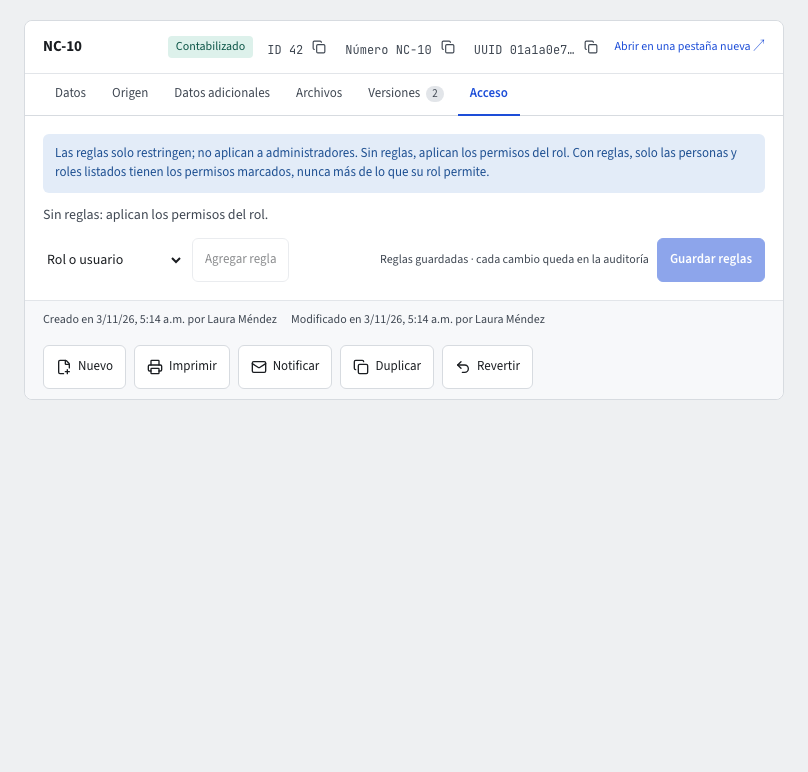

# Acceso por registro

Además de los permisos de cada rol (guía [Administración](administracion.md)), el administrador de la empresa puede **restringir un registro concreto**: un tercero, un producto, una cuenta, un comprobante. Por ejemplo, que solo el rol Contador vea el comprobante de una bonificación reservada.

## Cómo funcionan las reglas

- Las reglas **solo restringen**: nunca dan a nadie más de lo que su rol ya permite.
- **Sin reglas**, aplican los permisos del rol, como siempre.
- **Con reglas**, solo los roles y usuarios listados tienen los permisos marcados sobre ese registro; los demás no lo ven.
- A los **administradores** de la empresa nunca se les aplican: siempre ven el registro y pueden cambiar sus reglas.

Los permisos de una regla son:

| Permiso | Maestro | Documento |
|---|---|---|
| **Ver** | ✓ | ✓ |
| **Usar en documentos** | ✓ | — |
| **Modificar** | ✓ | ✓ |
| **Eliminar** | ✓ | — |
| **Anular** | — | ✓ |

## Restringir un registro

1. Como administrador, abre el registro y entra a la pestaña **Acceso** (solo la ven los administradores).
2. Pulsa **Agregar regla** y elige el **Rol o usuario** (los grupos **Roles** y **Usuarios**).
3. Marca los permisos que debe tener: **Ver**, **Modificar** y los demás de la tabla.
4. Repite para cada rol o usuario. **Quitar** borra una regla.
5. Pulsa **Guardar reglas** y escribe tu código de 6 dígitos. El aviso dice «Reglas guardadas · cada cambio queda en la auditoría».

Para volver a los permisos del rol, quita todas las reglas y guarda.

## Qué ve quien no tiene acceso

- Quien no tiene **Ver**: el registro no aparece en listados, búsquedas, ⌘K, cajas de búsqueda, exportaciones, PDF de listados ni en lo que el asistente consulta. Si abre su dirección, ve «No encontramos este registro o no tienes acceso a él». Al importar, un registro oculto no se usa para emparejar filas; si choca con un valor único, el error solo dice «ya existe un registro con ese valor».
- Quien lo **ve** pero no puede **Modificar**: lo abre de solo lectura, sin los botones de cambio de estado, y el sistema rechaza el cambio aunque llegue por otro camino.
- Un maestro sin **Usar en documentos** no se puede elegir en un documento.
- Los informes contables de saldos (balance de prueba, estados financieros) siguen sumando sus valores, sin mostrar el registro: los totales no dependen de quién mira.

## El asistente respeta las reglas

El asistente actúa con tus permisos: no consulta lo que no ves, y si le pides aprobar o anular un documento que no puedes modificar, te dice que no tienes permiso en lugar de mostrarte una tarjeta de confirmación. Si no puedes ver el documento, responde como si no existiera.

## Relacionado

- Ocultar opciones del menú a un rol: **Administración › Acceso al menú** (guía [Moverse por el sistema](navegacion.md), «Opciones restringidas»).
- Restringir cuentas contables completas: guía [Seguridad por cuenta](contabilidad/seguridad-por-cuenta.md).
