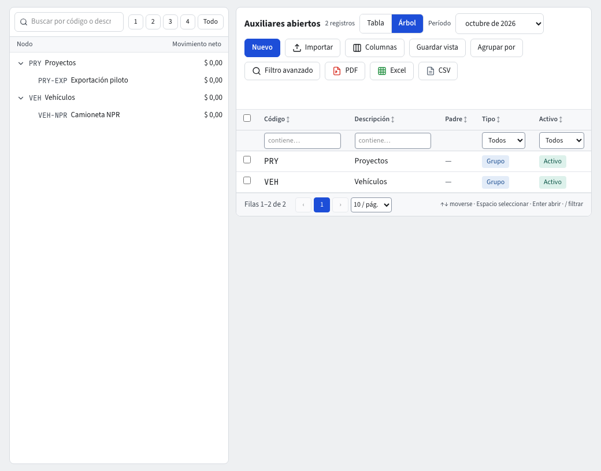

# Auxiliares abiertos e ítems

Además del tercero y del centro de costo, un comprobante puede llevar otras dos etiquetas de análisis:

- **Auxiliar abierto**: un código libre que la empresa define para seguir algo que el plan de cuentas no separa (un contrato, una obra, un convenio).
- **Ítem**: un código de seguimiento para un artículo o concepto de gasto.

Los dos son opcionales: **Auxiliares abiertos** e **Ítems** aparecen en **Contabilidad › Maestros** solo cuando están encendidos.

## Encenderlos

1. Entra a **Contabilidad › Reglas contables › Configuración**.
2. En **Dimensiones analíticas en uso** marca **Usar auxiliares abiertos** y/o **Usar ítems**.
3. Pulsa **Guardar**; pedirá tu código de verificación. Los maestros aparecen en el menú **Maestros** y como columnas en las líneas de los comprobantes.

Para apagarlos, desmarca la casilla: los datos ya registrados se conservan.

## Trabajar con ellos

Los dos tienen la misma pantalla que los centros de costo (guía **Centros de costo**): **Vista** **Tabla** o **Árbol** (la Tabla trae la columna **Movimiento neto** del **Período** elegido, que se ordena, se filtra y se exporta), **Nuevo** para crear (Código, Descripción, Tipo, Bajo qué nodo) y registro con pestañas **Datos**, **Saldos por cuenta**, **Movimientos**, **Datos adicionales** y **Archivos**.

- El Árbol de **Auxiliares abiertos** muestra el **Movimiento neto** del período junto a cada nodo.
- **Saldos por cuenta** muestra el débito, el crédito y el neto de cada cuenta para el rango de períodos que elijas (**Desde**, **Hasta**), incluyendo a los descendientes del nodo.

## Exigirlos en una cuenta

En la cuenta (guía **Plan de cuentas**), marca **Exige auxiliar abierto** o **Exige ítem**. Desde ese momento, una línea en esa cuenta sin el dato no se contabiliza.

## Informes

El informe **Auxiliar por dimensión analítica** elige la **Dimensión** (Centro de costo, Auxiliar abierto, Ítem o Unidad de negocio) y muestra sus movimientos por cuenta. En **Movimientos** puedes filtrar y agrupar por estas columnas.
