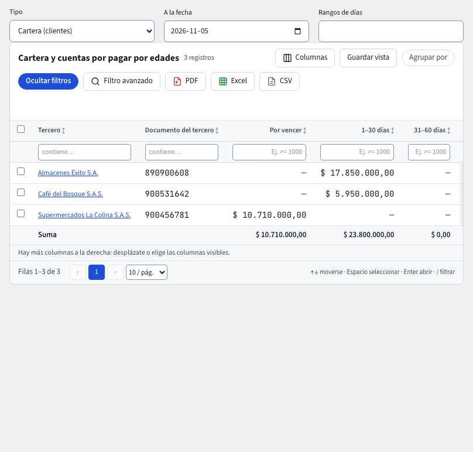

# Cartera y cuentas por pagar por edades

Este informe responde «¿quién me debe, desde cuándo?» (cartera) y «¿a quién le debo, desde cuándo?» (cuentas por pagar). Reparte lo pendiente por la edad de cada vencimiento.

## Abrirlo

1. **Contabilidad › Reportes › Informes › Cartera y cuentas por pagar por edades**.
2. En **Tipo** elige **Cartera (clientes)** o **Por pagar (proveedores)**.
3. En **A la fecha** pon el día de corte. Por defecto los rangos son los del sistema; en **Rangos de días** puedes cambiarlos.

## Cómo leerlo

Una fila por tercero y las columnas **Por vencer**, **1–30 días**, **31–60 días**, **61–90 días**, **Más de 90 días** y **Anticipos y saldos a favor**, más el **Total**. La edad cuenta los días pasados desde la fecha de vencimiento de cada partida hasta la fecha de corte.

- Una partida abierta es una línea con fecha de vencimiento en una cuenta de cartera (clientes) o de proveedores.
- **Anticipos y saldos a favor** va en negativo y el **Total** ya lo descuenta.
- Haz clic en un tercero para ver sus **partidas abiertas** documento por documento, y en un documento para abrir su comprobante.

## Cómo se calcula lo pendiente

Depende de si la empresa tiene activo el módulo **Pagos**. Puedes activarlo o desactivarlo en cualquier momento: el informe se recalcula con la regla que corresponda y no se pierde nada.

**Sin Pagos.** Los abonos de un tercero en una cuenta se aplican a sus partidas por orden de vencimiento, la más antigua primero. Un abono mayor que todo lo pendiente no aparece en el informe. La **Conciliación de control** lo muestra como diferencia.

**Con Pagos (cartera de clientes).** Lo pendiente de cada factura es lo que el documento todavía debe:

- **Recibos de caja.** Cada recibo rebaja las facturas a las que lo aplicaste, por el valor aplicado. Ese valor incluye las retenciones que te practicó el cliente. Un abono a la factura más nueva no rebaja la más antigua.
- **Recibo anulado.** Si anulas un recibo, sus facturas vuelven a quedar pendientes desde la fecha de la anulación.
- **Notas.** Una nota crédito rebaja su propia factura. Si la nota acredita más de lo que la factura todavía debía (un reembolso), el sobrante sale en **Anticipos y saldos a favor**: no rebaja otras facturas. Una factura anulada (con su nota crédito de anulación) sale del informe. Una nota débito es una partida más de su factura, con su propio vencimiento: el recibo que pagas a esa factura la cubre también.
- **Anticipos.** Lo que un recibo no aplicó a ninguna factura es un anticipo del cliente (cuenta de anticipos de clientes). No rebaja ninguna factura: sale en **Anticipos y saldos a favor**.
- **Abonos sin recibo.** Un comprobante manual que abona la cuenta del cliente sin recibo de caja se aplica a las partidas más antiguas primero, como sin Pagos. Si sobra, sale como saldo a favor. Así, la suma de las partidas de la cuenta del cliente es siempre su saldo contable.
- **Retenciones que te practicó el cliente.** Quedan en una cuenta de retenciones (por ejemplo 135515) a nombre del cliente, pero no son deuda del cliente: no salen en su fila.
- **Cuentas por pagar.** Se calculan siempre como sin Pagos.

Si cada recibo se aplica a las facturas más antiguas primero, los dos cálculos dan las mismas partidas de las facturas.

> Sin Pagos, las retenciones que te practicó el cliente sí salen en su fila, como una partida más: quedan en una cuenta del grupo 13 a nombre del cliente.

## Cobrar lo vencido

1. Ordena por **Más de 90 días** (clic en el encabezado) para ver primero a los más atrasados.
2. Abre el tercero y revisa qué facturas están vencidas.
3. Exporta con **Excel**, **CSV** o **PDF** y compártelo con quien cobra.

## Preguntarle al asistente

«¿Quién me debe más de 90 días?» responde desde este mismo informe, con el enlace a la pantalla.

## Cuentas restringidas

Si tu rol no ve una cuenta de cartera o proveedores, sus partidas no aparecen para ti (guía **Seguridad por cuenta**).
