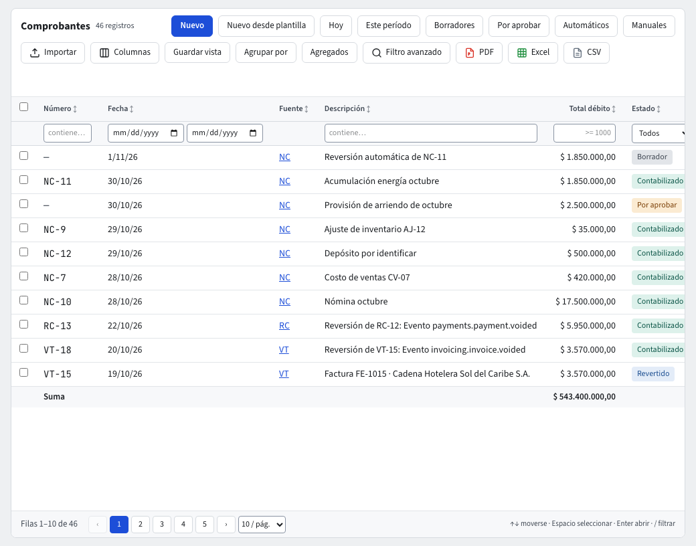
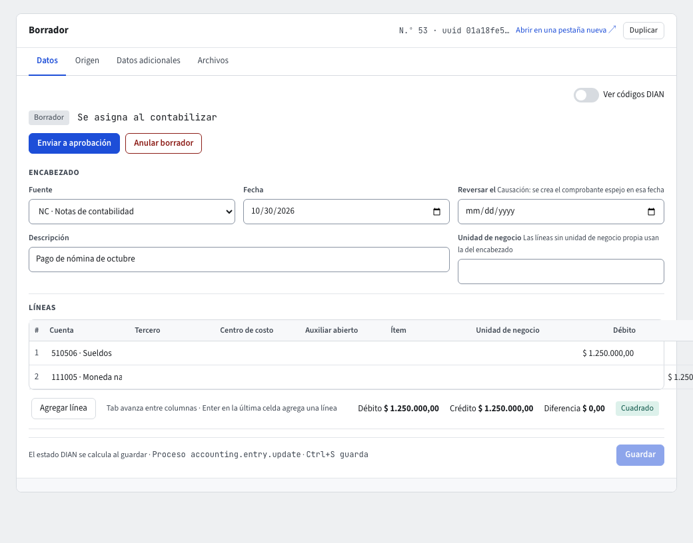

# Comprobantes contables y Fuentes

Un **comprobante** es un asiento contable: una fecha, una fuente y líneas que suman lo mismo al débito que al crédito. Entra por **Contabilidad › Documentos › Comprobantes**.

El comprobante es un **documento**: sus estados, su barra de acciones (**Guardar**, **Guardar y enviar a aprobación**, **Aprobar**, **No aprobar**, **Anular**, **Revertir**, **Imprimir**, **Notificar**, **Duplicar**), el **ID**, el pie y la pestaña **Versiones** funcionan como en todo documento (guía [Maestros y documentos](../maestros-y-documentos.md)).

## El listado

Trae ID, Número, Fecha, Fuente, Descripción, Débito, Crédito, Estado y Origen. Los filtros rápidos son **Hoy**, **Este período**, **Borradores**, **Por aprobar**, **Automáticos** y **Manuales**. **Borradores** muestra los comprobantes sin terminar: en **Borrador**, **Grabado** o **No Aprobado**, los mismos que cuenta el cierre del período.

El **Estado** puede ser **Borrador**, **Grabado**, **Pendiente de Aprobación**, **No Aprobado**, **Aprobado**, **Contabilizado** o **Anulado**. Un comprobante reversado sigue contabilizado, pero tanto el listado como su ficha lo muestran como **Revertido**, en rojo, y ya no ofrece **Revertir** (el filtro **Estado** sigue usando los estados guardados: para encontrarlos, filtra por **Contabilizado** y busca los rojos). El **Origen** es **Manual** (lo hizo una persona), **Automático** (lo contabilizó el sistema a partir de una factura, un recibo u otro documento), **Plantilla** o **Importado**.

Los comprobantes automáticos no se escriben: nacen de las reglas contables (guía **Reglas contables**).

## Crear un comprobante manual

1. Pulsa **Nuevo**. Se abre un **Comprobante nuevo** en estado **Borrador**.
2. En **Encabezado** elige la **Fuente** (por defecto, la de comprobantes manuales), la **Fecha** y escribe la **Descripción**. Si la empresa usa unidades de negocio, la **Unidad de negocio** del encabezado la heredan las líneas que no tengan una propia.
3. En **Líneas** agrega cada línea con **Agregar línea**: **Cuenta** (escribe el código o el nombre; la lupa busca), **Tercero** (si la cuenta lo exige), **Centro de costo**, **Auxiliar abierto**, **Ítem**, **Unidad de negocio**, **Descripción**, **Débito** o **Crédito**. Solo se ofrecen las cuentas en las que puedes contabilizar.
4. Con el teclado: **Tab** avanza entre columnas y **Enter** en la última celda agrega una línea. Para quitar una línea, usa **Quitar la línea n**.
5. El pie muestra **Débito**, **Crédito** y **Diferencia**. Mientras no cuadre dice «Descuadrado: falta $ …»; cuando cuadra dice **Cuadrado**.
6. Si la empresa exige soporte, adjúntalo en la pestaña **Archivos** («Adjunta el soporte en la pestaña Archivos antes de contabilizar»).
7. Pulsa **Guardar**. Guardar revisa el comprobante completo y, si no necesita aprobación, lo contabiliza en el mismo paso: recibe su número consecutivo («Contabilizado como NC-…») y queda de solo lectura. Si requiere aprobación, pulsa **Guardar y enviar a aprobación** (o **Guardar**, que lo deja **Grabado**, y después **Enviar a aprobación**). Si algo no cumple (el período está cerrado, falta un dato, no cuadra), no se graba nada: el comprobante sigue en **Borrador**, sin número, y lo que escribiste sigue en el formulario. Mientras está en **Borrador** recibe su **ID**, no su número.

Para causar un gasto que se anula solo al mes siguiente, llena **Reversar el** con la fecha en que debe crearse el comprobante espejo (guía **Controles y cierre**).

## Nuevo desde plantilla

Pulsa **Nuevo desde plantilla** en la barra de Comprobantes, elige la **Plantilla** (si tiene nota, se muestra debajo) y pulsa **Abrir comprobante**. Se abre la misma pantalla de un comprobante nuevo, ya llena con la **Fuente**, la descripción, la unidad de negocio y las líneas de la plantilla. Completa lo que falte (la fecha y los valores que la plantilla deja abiertos) y pulsa **Guardar**: hasta entonces no se crea nada.

- El comprobante queda con origen **Plantilla**, y su pantalla lo dice en un aviso azul al comienzo, con un enlace a la plantilla. La pestaña **Origen** también la nombra.
- Si la plantilla tiene desmarcado **Se pueden cambiar los valores**, sus líneas con valor fijo aparecen con la cuenta y el valor bloqueados, y no se pueden quitar; solo se llenan las que la plantilla dejó abiertas. El sistema lo vuelve a exigir al guardar.
- Solo ves las plantillas activas que puedes usar: si el administrador restringió una plantilla a ciertos roles o usuarios (pestaña **Acceso**, guía [Acceso por registro](../acceso-por-registro.md)), solo ellos la ven en la lista.

## Crear una plantilla

Abre un comprobante grabado y pulsa **Guardar como plantilla**, en la barra de abajo, junto a **Revertir**. Escribe el nombre (único en la empresa); se copian la **Fuente**, la descripción y las líneas con su lado, cuenta y demás datos. Marca **Dejar los valores en blanco** si quieres que cada línea pida su valor al usarla. La plantilla queda en **Contabilidad → Maestros → Plantillas de comprobante** y se abre en una pestaña.

En la ficha de la plantilla puedes cambiar:

- el **Nombre**, la **Fuente**, la descripción y si está activa;
- la **Nota**: un texto que se muestra al elegirla y en el aviso del comprobante;
- **Se pueden cambiar los valores**: desmárcalo para que quien la use no pueda cambiar los valores fijos de las líneas;
- **quién la puede usar**: el administrador entra a la pestaña **Acceso**, agrega los roles o usuarios y marca **Usar en documentos**.

Las líneas no se editan en la ficha: se vuelve a guardar la plantilla desde otro comprobante. Un comprobante con una línea de una cuenta restringida para ti no se puede guardar como plantilla.

## Importar comprobantes desde Excel

**Importar** (en el listado) carga uno o varios comprobantes con sus líneas desde un archivo `.xlsx`.

1. Descarga la **Plantilla Excel**. Tiene dos hojas: **Datos** (un comprobante por fila: `ref`, fecha, descripción…) y **Líneas** (una línea por fila: `ref`, `accountCode` o cuenta, débito, crédito…).
2. El `ref` une cada línea con su comprobante: todas las líneas con el mismo `ref` pertenecen al mismo comprobante. Debe ser distinto en cada fila de Datos.
3. Elige el archivo. La vista previa revisa cada comprobante con las mismas reglas del formulario (cuentas que reciben movimiento, débitos = créditos, período abierto) y muestra, debajo de cada uno, sus líneas. **Ver** abre los motivos de un comprobante con error.
4. **Importar filas válidas** pide el código de verificación en dos pasos y corre en segundo plano. Cada comprobante nace en **Borrador**, con **Origen: Importado**, sin consecutivo: lo revisas y lo contabilizas. Si un comprobante tiene una línea con error, no se crea, pero los demás sí; el motivo queda en `errores.csv` del historial de importaciones.

## Aprobación por otra persona

Un comprobante requiere aprobación cuando el administrador activó **Aprobación de comprobantes manuales** en Reglas contables › Configuración, o cuando en **Parámetros** se marcó **Requiere aprobación** para los comprobantes. Los automáticos nunca la requieren: su control es la regla contable.

1. Quien lo hizo pulsa **Guardar y enviar a aprobación** (o **Enviar a aprobación** si ya estaba **Grabado**): el comprobante se graba, completo y sin número, y pasa a **Pendiente de Aprobación**, de solo lectura.
2. Una persona con permiso lo abre y pulsa **Aprobar**: se contabiliza en ese mismo paso y recibe su número. Si no se puede contabilizar (por ejemplo, el período se cerró), no se aprueba: sigue **Pendiente de Aprobación** y el aviso dice por qué. Con **Aprobación de comprobantes manuales** activada, quien lo creó no puede aprobarlo («Otra persona debe aprobar»); si la aprobación viene solo de Parámetros, puede aprobarlo cualquiera con el permiso.
3. Si hay algo por corregir, quien aprueba pulsa **No aprobar** y escribe el **motivo** (obligatorio): el comprobante queda **No Aprobado**, tal como estaba, con sus mismas líneas, y el motivo queda en su historial. Lo puede hacer quien tenga el permiso; también si el comprobante tiene líneas de cuentas restringidas que esa persona no ve, porque las líneas no se tocan. El autor lo corrige, lo guarda y pulsa otra vez **Enviar a aprobación**. Un comprobante pendiente de aprobación no se edita.

Un comprobante **Grabado** o **No Aprobado** todavía se puede editar; cada cambio queda guardado en su historial. El filtro **Por aprobar** y el indicador de Inicio cuentan los pendientes.

## Revertir, eliminar y anular

- **Revertir** (en un comprobante contabilizado): elige la fecha y escribe el **Motivo de la reversión**; se crea un comprobante nuevo con las líneas invertidas. Los dos se enlazan con «Reversión de» y «Revertido por»; el original sigue **Contabilizado** y se ve **Contabilizado · Revertido**, y no se reversa dos veces. Nunca se borra nada.
- **Eliminar** (en un **Borrador**): borra el borrador y sus líneas, después de confirmar. No aplica a la reversión automática de una causación ni a un borrador con archivos adjuntos (quítalos primero).
- **Anular** (en un comprobante **Grabado**, **Pendiente de Aprobación**, **No Aprobado** o **Aprobado**): escribe el **Motivo de la anulación**; el comprobante queda **Anulado** con su motivo y no cambia más. Un comprobante **Contabilizado** no se anula: se revierte.

## Imprimir, Notificar, Versiones y Acceso

- **Imprimir** descarga el PDF del comprobante con la plantilla de la empresa (guía [Plantillas PDF e Imprimir](../plantillas-pdf.md)).
- **Notificar** envía ese PDF por correo, en copia oculta, desde que el comprobante sale de Borrador (guía [Notificaciones por correo](../notificaciones.md)).
- **Versiones** guarda una versión completa en cada cambio de datos o de estado desde que sale de Borrador, para verlas y compararlas.
- **Acceso** (solo administradores) restringe un comprobante a ciertos roles o usuarios (guía [Acceso por registro](../acceso-por-registro.md)).

## La pestaña Origen

En **Origen** ves el tipo, el documento de origen (con enlace a la factura, por ejemplo), el evento, la regla contable que lo generó, quién lo creó, envió y contabilizó, y la **Cadena causal** con el historial de auditoría.

## Líneas de cuentas restringidas

Si un comprobante tiene líneas de cuentas que tu rol no ve, esas líneas se muestran como **Línea de una cuenta restringida**, con los valores ocultos, y no se pueden editar; los totales del comprobante siguen completos.

## Fuentes

Una **Fuente** es el tipo de comprobante (NC Notas de contabilidad, VT Ventas, CP Compras, RC Recibos de caja, CE Comprobantes de egreso, AP Apertura y CI Cierre). Se administran en **Maestros › Fuentes**: cada una tiene su **Consecutivo** y la casilla **Admite comprobantes manuales** (Apertura y Cierre no la tienen, porque los hace el sistema). Para crear una, pulsa **Nuevo** e indica Código, Descripción y Clase.

## Si algo no funciona

- «Descuadrado»: ajusta las líneas hasta que la **Diferencia** sea cero.
- El período está cerrado: pide a quien administra los períodos que lo reabra (guía **Períodos y cierre**).
- La cuenta exige un dato (tercero, centro de costo…) y la línea no lo trae: el sistema lo pide antes de contabilizar.

## Qué falta para completar el comprobante

Mientras el comprobante no está completo, el cuadro **Falta para completar el comprobante** lista lo pendiente (la fecha, la descripción, al menos una línea con valor, líneas con valor sin cuenta, y la diferencia entre débito y crédito); al hacer clic en cada punto el cursor va al campo. Un comprobante sin valores muestra **Sin líneas** en gris, no **Cuadrado**.
