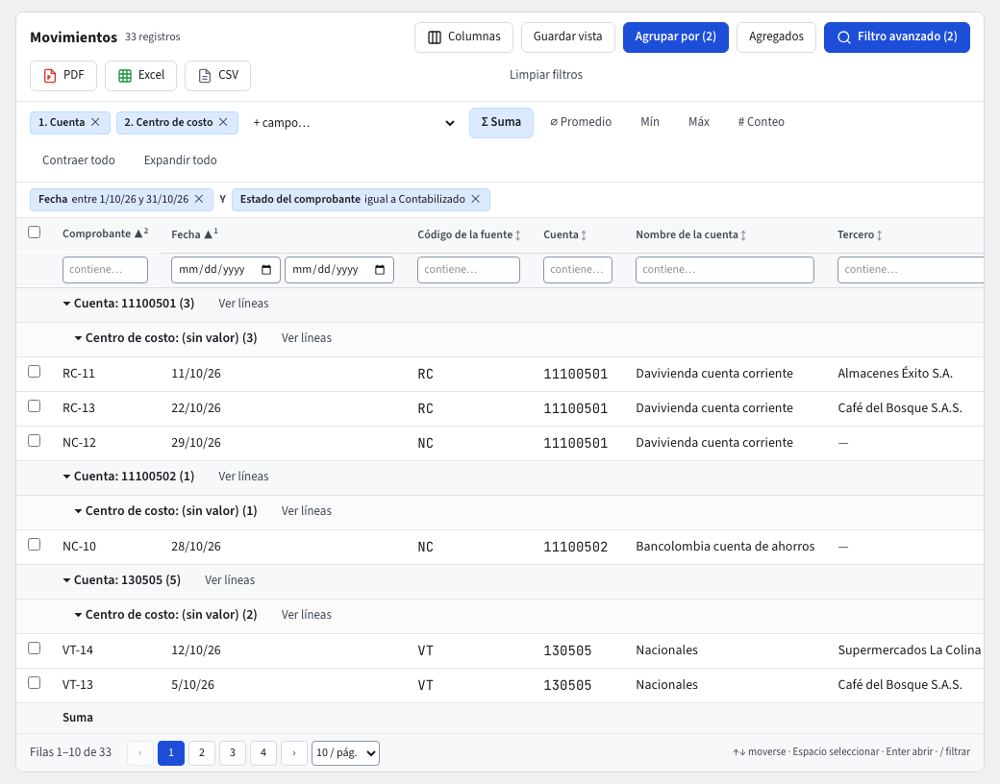

# Consulta de movimientos

**Movimientos** es la pantalla para preguntarle cualquier cosa al libro contable: cada línea de cada comprobante, con todos sus datos, incluidas las dimensiones analíticas. Entra por **Contabilidad › Reportes › Movimientos**.

## Qué ves al abrir

Un listado de las líneas **contabilizadas del período abierto**, ordenadas por **Fecha**, **Comprobante** y **Línea**. Las columnas son: Fecha, Comprobante, Fuente, Cuenta, Nombre de la cuenta, Tercero, Centro de costo (y Auxiliar abierto, Ítem y Unidad de negocio si la empresa los usa), Detalle de la línea, Débito, Crédito, Neto y Estado del comprobante.

Los borradores y los comprobantes por aprobar solo aparecen si lo pides con el filtro de **Estado del comprobante**. Las líneas de apertura y de cierre sí cuentan: para excluirlas agrega la condición **Es apertura** o **Es cierre**.

## Filtrar

Como en cualquier listado (guía **Listados**): la fila de filtros bajo cada encabezado y el **filtro avanzado** con hasta 50 condiciones unidas con **Y** u **O**. Ejemplo: escribe `5105` en el filtro de **Cuenta**, agrega **Centro de costo** *en* (Ventas Bogotá, Ventas Medellín) y **Tercero** *contiene* «Nómina».

## Ordenar por varias columnas

Pulsa un encabezado para ordenar; con **Shift** + clic agregas niveles (hasta 5). Un número pequeño junto a la flecha marca la prioridad.

## Agrupar y totalizar

1. Pulsa **Agrupar por** y elige hasta 3 campos, en orden: por ejemplo **Cuenta** y luego **Centro de costo**.
2. Pulsa **Agregados** para elegir qué se calcula por grupo y columna: **Σ Suma**, **⌀ Promedio**, **Mín**, **Máx** o **# Conteo**.
3. Los grupos se pueden **Contraer todo** o **Expandir todo**. Cada grupo muestra su subtotal y el pie trae el total general.
4. En el menú de un grupo, **Ver líneas** abre las líneas de ese grupo.

## Guardar la consulta

**Guardar vista** guarda filtros, orden, columnas, agrupación y agregados con el nombre que elijas, por ejemplo «Gastos de personal por sede». Es tuya, y el administrador puede promoverla a un rol.

## Exportar

**PDF**, **Excel** y **CSV** (iconos rojo, verde y gris) exportan exactamente lo que ves: las columnas visibles, todas las páginas y los grupos con sus subtotales.

## Abrir el comprobante

Haz clic en una fila para abrir su comprobante (guía **Comprobantes**).

## Cuentas restringidas

Si tu rol no ve una cuenta (guía **Seguridad por cuenta**), sus líneas no salen y la nota «Líneas omitidas por falta de acceso» dice cuántas fueron. Las vistas guardadas de otra persona devuelven para ti solo lo que tú puedes ver.

## Preguntarle al asistente

Pregunta «gastos de octubre por centro de costo» en el asistente: consulta esta misma pantalla y te devuelve una tabla con el enlace a **Movimientos**.
