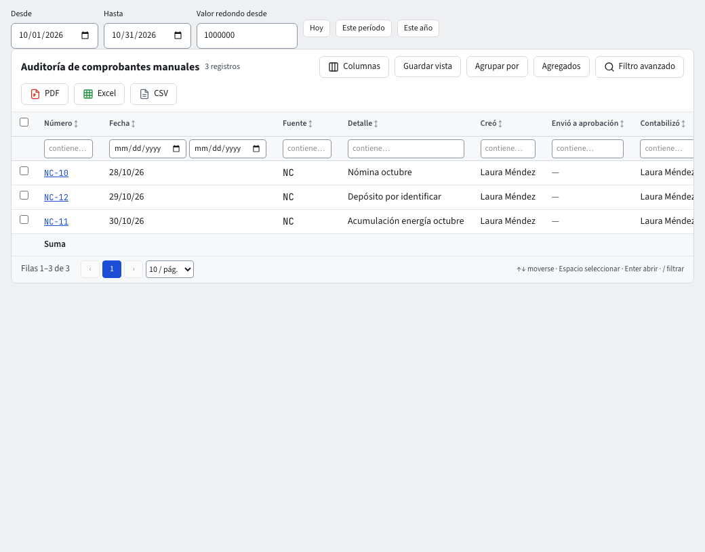

# Controles contables

La contabilidad trae seis controles pequeños, pensados para que un error o un fraude se vea a tiempo. Esta guía explica qué hace cada uno y dónde se maneja. Para cerrar el período paso a paso, mira la guía **Períodos y cierre**.

## 1. Aprobación por otra persona

En **Reglas contables › Configuración › Comprobantes manuales**, activa **Exigir aprobación de otra persona**. Desde entonces un comprobante manual (o el que prepara el asistente) pasa por **Guardar y enviar a aprobación** y lo contabiliza otra persona con **Aprobar**. Quien lo creó no puede aprobarlo. Este control es opcional y viene apagado. **No aprobar** (con un motivo obligatorio) lo regresa al autor como **No Aprobado**, sin cambiar sus líneas; lo puede hacer quien tenga el permiso, aun si el comprobante incluye cuentas restringidas que no ve. Los comprobantes automáticos no pasan por aquí: su control es la regla contable, que solo se cambia con código de verificación.

También puedes exigir **Un archivo adjunto** en cada comprobante manual.

## 2. Reversión automática de causaciones

En el comprobante, el campo **Reversar el** crea, al contabilizarlo, un comprobante espejo en **Borrador** con esa fecha (por ejemplo el 1.º del mes siguiente). Aparece en **Borradores** del siguiente período y bloquea su cierre hasta que lo contabilices, así no se olvida. Al contabilizarlo, el original sigue **Contabilizado** y se ve **Contabilizado · Revertido**.

## 3. Conciliación de control

En **Informes › Conciliación de control**, elige **A la fecha** y compara, por tercero, el saldo de las cuentas de control (cartera, proveedores, inventario) contra sus auxiliares. La columna **Diferencia** debe ser cero. El cierre del período corre este mismo control y se niega si hay una diferencia mayor a la **Tolerancia de ajuste al peso**.

## 4. Cuenta transitoria en cero

La cuenta transitoria recibe lo que aún no se sabe dónde va. El período no se cierra mientras su saldo al final del mes no sea cero; la conciliación de control muestra las líneas abiertas.

## 5. Auditoría de comprobantes manuales

**Informes › Auditoría de comprobantes manuales** lista, por rango de fechas, todos los comprobantes no automáticos: quién los creó, quién los envió y quién los contabilizó, cuándo, cuántos **Adjuntos** y **Líneas** tienen, el valor, si se **Contabilizó tras el cierre** y si es **Valor redondo** (múltiplo de la cifra que fijes en **Valor redondo desde**; por defecto $ 1.000.000,00). Es la lista que pide un auditor. Haz clic en una fila para abrir el comprobante.

## 6. Diferencia en cambio no realizada

Si tienes facturas de venta en otra moneda (por ejemplo USD) todavía por cobrar al terminar el período, su valor en pesos cambió con la tasa. La **diferencia en cambio no realizada** lleva esa cartera a la tasa del último día del período.

1. Pídele al asistente «calcula la diferencia en cambio de octubre» (o del período que quieras). Te muestra una tarjeta de confirmación y te pide el código de verificación.
2. El sistema toma cada factura abierta en otra moneda, su saldo en esa moneda y la tasa del último día del período (la TRM o la tasa que registraste; si no hay una de ese día, usa la de hasta tres días antes). Si no encuentra tasa, se niega y te dice qué moneda falta.
3. Contabiliza un comprobante **NC Notas de contabilidad** con fecha del último día del período: la cartera de cada factura sube o baja, contra **Diferencia en cambio** (ingreso 421020 o gasto 530525, con la dimensión «no realizada»).
4. Al mismo tiempo contabiliza su reversión con fecha del día siguiente. Así, cuando el cliente paga, la diferencia realizada se calcula contra la tasa de la factura, como siempre.

Las facturas en pesos no se tocan, ni los anticipos ni las cuentas bancarias en dólares.

**Volver a calcular.** Si corriges una tasa o registras un pago con fecha del período, vuelve a pedirlo: el cálculo anterior se anula (con dos comprobantes espejo) y se contabiliza uno nuevo. También puedes pedir **anular la diferencia en cambio** sin recalcular. Las dos cosas solo se pueden mientras el período y el siguiente estén abiertos.

**Al cerrar el período.** Si hay facturas abiertas en otra moneda y no la calculaste, el cierre muestra la advertencia **Diferencia en cambio no calculada**. Es solo un aviso: el período se cierra igual y la advertencia queda a la vista en la ventana de cierre.

## Quién puede qué

Los permisos se asignan por rol en **Administración**. Cerrar y reabrir períodos, calcular o anular la diferencia en cambio, cambiar reglas y la configuración piden además el código de verificación. La diferencia en cambio la pueden calcular el administrador y el contador. Todo queda en la auditoría.
