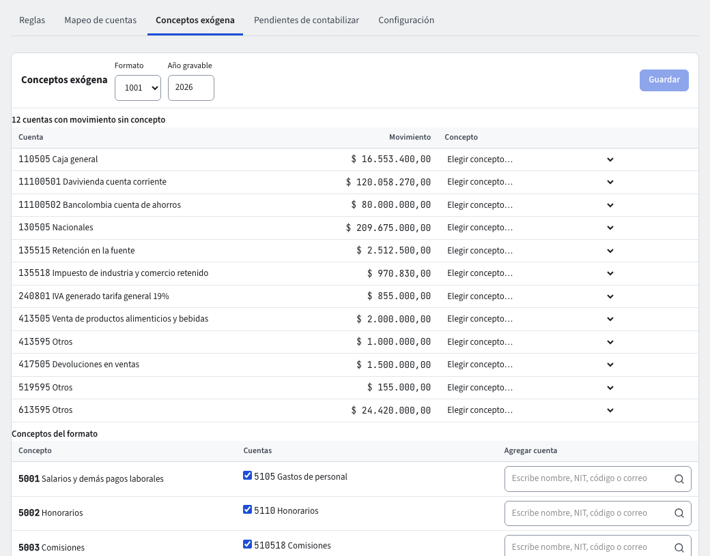

# Información exógena

La información exógena es lo que reportas a la DIAN cada año sobre tus pagos, retenciones, ingresos y saldos por tercero. ERP-IA la arma desde el libro: cada cuenta se asocia a un **concepto** del formato y el informe suma el movimiento del año por tercero y concepto.

## 1. Asociar las cuentas a conceptos

1. Entra a **Contabilidad › Parámetros › Reglas contables › Conceptos exógena**.
2. Elige el **Formato** y el **Año gravable**.
3. Mira **Cuentas con movimiento sin concepto** (en rojo): son las cuentas que se movieron en el año y ningún concepto cubre. Para cada una, en **Elegir concepto…** escoge el **Concepto** que le corresponde.
4. En **Conceptos del formato** puedes ver las cuentas de cada concepto, **Agregar cuenta** a uno o quitar una que no corresponde.
5. Cada cambio pide tu código de verificación.

Cuando el aviso diga «Todas las cuentas con movimiento en el año están cubiertas por un concepto», el mapeo está completo. El país trae un catálogo de conceptos por año gravable; si no existe para el año que eliges, la pantalla lo dice.

## 2. Ver el informe

1. Entra a **Contabilidad › Reportes › Informes › Información exógena**.
2. Elige **Formato** (1001, 1005, 1006, 1007, 1008, 1009…), **Año gravable** y, si quieres cambiarla, la **Cuantía mínima**.
3. El informe lista por tercero y concepto: **Tipo de documento**, **Documento del tercero**, **Concepto**, **Descripción del concepto** y **Valor 1**, **Valor 2**, **Valor 3**. Los terceros por debajo de la cuantía se agrupan bajo el NIT de cuantías menores.
4. Un panel de **errores** avisa lo que impide enviar el formato: cuentas con movimiento sin concepto, líneas sin tercero, terceros sin tipo de documento o sin código DANE. Arréglalos (en el tercero, el comprobante o el mapeo) y vuelve a consultar.

Reglas básicas: los formatos de pagos (1001, 1005) toman el débito de las cuentas y los de ingresos y retenciones practicadas (1006, 1007), el crédito; los de saldos (1008, 1009) toman el saldo, incluido el de apertura. Una devolución o nota crédito de un documento ya contado resta; un traslado entre cuentas no cuenta como pago.

## 3. Exportar

**Excel**, **CSV** y **PDF** exportan lo que ves, con los botones de siempre. El archivo **XML** para el prevalidador de la DIAN sale del botón **Exportar XML**, junto a ellos.

1. Elige el **Formato** y el **Año gravable** (y la **Cuantía mínima**, si la cambiaste). El XML se arma con esos mismos parámetros.
2. Pulsa **Exportar XML**. Mientras trabaja, el botón dice «Generando el archivo…».
3. Si todo está en orden, el navegador descarga el archivo `Dmuisca_<formato><versión><año>.xml`: el formato con seis dígitos, la versión del formato con dos y el año gravable (por ejemplo `Dmuisca_001001102026.xml` para el 1001 de 2026). El enlace de descarga dura **10 minutos**; si lo pierdes, vuelve a pulsar el botón.

Cuando no se puede generar, aparece el aviso **«No se generó el archivo:»** con la lista de motivos y no se guarda ningún archivo. Son los mismos que el panel de errores del informe: cuentas con movimiento sin concepto, líneas sin tercero, terceros sin tipo de documento o sin código DANE, que el formato no tenga información para el año, o que la empresa no tenga NIT registrado. Corrige lo que dice la lista (en el tercero, el comprobante, el mapeo o los datos de la empresa) y pulsa el botón otra vez.

Si el administrador marcó «Genera el archivo XML de exógena» como proceso sensible, el botón pide tu código de verificación una vez y sigue solo. Si tu rol no puede generar el archivo, el botón no te sirve: te lo dice el aviso de sin permiso. El archivo respeta tus cuentas visibles: lo que no puedes ver en el informe tampoco está en el XML.

También puedes pedírselo al asistente («genera el XML de la exógena 1001 de 2026»).

El formato y los topes cambian cada año gravable con el paquete de Colombia, sin tocar el módulo.

## Preguntarle al asistente

«¿Qué cuentas me faltan por mapear en la exógena de 2026?» consulta el mismo mapeo y el informe.
