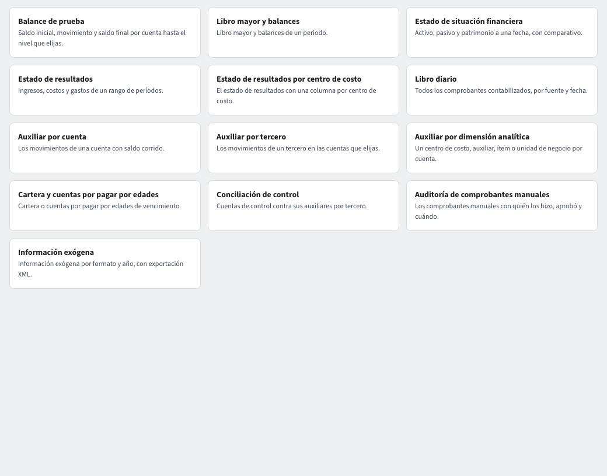

# Informes contables

Entra por **Contabilidad › Reportes › Informes**: una tarjeta por informe. Solo ves los que tu rol puede consultar.

## Los informes

- **Balance de prueba**: saldo inicial, movimiento y saldo final por cuenta, hasta el **Nivel** que elijas (**Período inicial**, **Período final**).
- **Libro mayor y balances**: el libro de un período.
- **Estado de situación financiera**: activo, pasivo y patrimonio **A la fecha** (**Al cierre de**), con **Comparar con el año anterior**.
- **Estado de resultados**: ingresos, costos y gastos de un rango de períodos. **Por centro de costo** da una columna por centro: es el informe **Estado de resultados por centro de costo**.
- **Libro diario**: todos los comprobantes contabilizados, por fuente y fecha.
- **Auxiliar por cuenta**: los movimientos de una cuenta con saldo corrido.
- **Auxiliar por tercero**: los movimientos de un tercero en las cuentas que elijas.
- **Auxiliar por dimensión analítica**: un centro de costo, auxiliar abierto, ítem o unidad de negocio por cuenta.
- **Cartera y cuentas por pagar por edades**, **Información exógena**, **Conciliación de control** y **Auditoría de comprobantes manuales**: tienen su propia guía.

## Usar un informe

1. Pulsa la tarjeta. Se abre la página del informe con la barra **Parámetros del informe**.
2. Elige los parámetros (períodos, nivel, cuenta, tercero…). Las opciones **Incluir saldos de apertura**, **Incluir cierre del año** y **Solo con movimiento** acotan lo que se suma.
3. La tabla se actualiza con un pie de totales; en los balances, **sumas iguales**.
4. **Profundiza** con un clic: una fila del Balance de prueba abre el **Auxiliar por cuenta**; una fila del auxiliar abre el comprobante; en el comprobante, **Origen** abre el documento.

## Exportar y guardar

- **PDF**: con el encabezado de libro oficial (empresa, NIT, período y «página x de y»), listo para imprimir.
- **Excel** y **CSV**: exactamente lo que ves.
- **Guardar vista**: guarda el conjunto de parámetros con un nombre para volver a él.

## Montos y cuentas restringidas

Los importes se muestran como `$ 1.234.567,00`. Las cuentas que tu rol no ve se resumen en **Cuentas restringidas** o se omiten con una nota; los totales no cambian (guía **Seguridad por cuenta**). La línea de cuentas restringidas muestra el saldo deudor y el saldo acreedor de sus cuentas, cada uno en su columna.

## Preguntarle al asistente

El asistente consulta los mismos informes: «dame el balance de prueba de octubre» o «¿cuánto se gastó en arriendo este año?» devuelven una tabla con el enlace a la página del informe.

## Parámetros del informe

Los parámetros (períodos, nivel, centro de costo, tercero…) pasan a una línea nueva cuando no caben, en lugar de recortarse, también con el asistente abierto. Los rangos rápidos **Hoy · Período · Año** forman su propio grupo.
