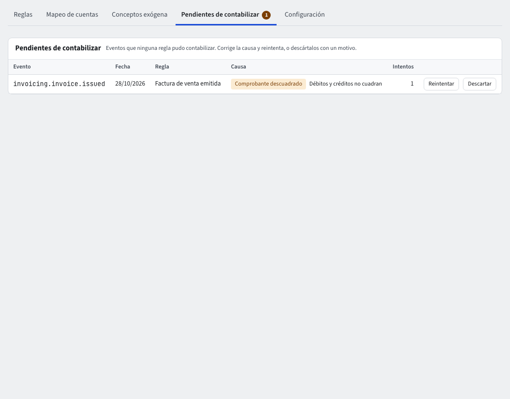

# Pendientes de contabilizar

Cuando una factura, un recibo u otro documento llega a contabilidad y ninguna regla logra convertirlo en un comprobante, no se pierde: queda como **evento pendiente**. Hay una insignia con el número de pendientes en **Reglas contables** y una tarjeta **Pendientes de contabilizar** en Inicio («3 eventos sin contabilizar»).

Entra por **Contabilidad › Parámetros › Reglas contables › Pendientes de contabilizar**.

## La lista

Cada fila trae el **Evento**, la **Fecha**, la **Regla**, la **Causa** (en palabras), los **Intentos**, y los botones **Reintentar**, **Reabrir período** (cuando la causa es un período cerrado) y **Descartar**. Las causas más comunes:

- **Falta mapear una cuenta**: un rol contable no tiene cuenta. Ve a **Mapeo de cuentas** y asígnala.
- **Período cerrado**: reabre el período con **Reabrir período**.
- **Cuenta inactiva**: reactiva la cuenta o cambia la regla.
- **Falta el tercero**, **el centro de costo**, **el auxiliar abierto**, **el ítem** o **la unidad de negocio**: el dato que exige la cuenta no vino en el documento.
- **Comprobante descuadrado**: la regla produce débitos distintos de los créditos; revisa la regla.
- **Sin permiso en la cuenta**: la cuenta es restringida y el motor no puede usarla.

## Resolver un pendiente

1. Lee la **Causa** y corrige lo que dice (mapeo, cuenta, período…).
2. Pulsa **Reintentar**. Si funciona, la fila dice «Contabilizado en el comprobante …» con el número; si no, «Sigue pendiente: …» con la razón.
3. Si el evento no debe contabilizarse, pulsa **Descartar**, escribe el **Motivo** y confirma. Queda en el historial y el pendiente sale de la cuenta.

## Documentos que esperan y fallos

Esta lista guarda los **fallos**: eventos que una regla intentó contabilizar y no pudo. Es distinta de los **documentos que esperan su asiento**, que aparecen con el modo **Asíncrona con reintentos** (guía **Reglas contables**, sección **Modo de contabilización**): el documento ya está guardado y su comprobante todavía no se ha registrado, pero no ha fallado; el sistema lo registra solo en unos instantes. Si falla, pasa a esta lista. Arriba de **Mapeo de cuentas** ves los dos contadores, y en la ficha de cada documento la insignia **Pendiente de contabilizar** (esperando) o **Contabilización fallida · ver pendientes** (aquí).

## Por qué importa

El cierre del período se niega mientras haya pendientes (**Sin pendientes de contabilizar**, guía **Períodos y cierre**). Revisa esta lista antes de cerrar el mes.
