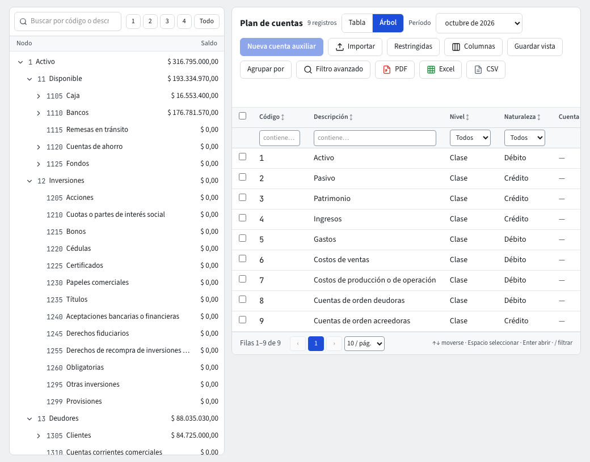

# Plan de cuentas

El **Plan de cuentas** es la lista de cuentas en las que se contabiliza. En Colombia sigue el PUC: clase, grupo, cuenta, subcuenta y auxiliar. Entra por **Contabilidad › Maestros › Plan de cuentas**.

Si es la primera vez, la contabilidad todavía no está configurada: pide al administrador que pulse **Configurar contabilidad** (ver la guía **Reglas contables**). Esa acción instala el plan de cuentas del país, las fuentes y el año fiscal.

## Tabla o Árbol

Arriba a la derecha, el interruptor **Vista** ofrece **Tabla** y **Árbol**. El sistema recuerda tu elección.

- **Tabla**: un listado con todas las cuentas. Trae Código, Descripción, Cuenta madre, Nivel (**Clase**, **Grupo**, **Cuenta**, **Subcuenta**, **Auxiliar**), Naturaleza, Seguridad y Activa. Se ordena, filtra, agrupa, exporta y guarda en vistas como cualquier listado (guía **Listados**). Además trae la columna **Saldo** del período que elijas en el selector **Período** (el mismo del Árbol): el saldo al cierre de ese período, con las cuentas hijas incluidas. Se ordena, se filtra y sale en los archivos de exportación como las demás columnas. Una cuenta restringida que no puedes ver no aparece ni suma en el saldo de su cuenta madre.
- **Árbol**: el PUC como árbol. Escribe en **Buscar por código o descripción** para encontrar una cuenta; **Abrir por nivel** despliega hasta el nivel que elijas (o **Todo**). Junto a cada cuenta ves su **Saldo** del período que elijas en **Período**. A la derecha, el listado de las cuentas que cuelgan de la cuenta seleccionada.

Una cuenta restringida para ti aparece como **Cuenta restringida**, con un candado y sin cifras (guía **Seguridad por cuenta**). El filtro rápido **Restringidas** muestra solo esas.

## Crear una cuenta auxiliar

Las clases, grupos, cuentas y subcuentas vienen del PUC y no se crean a mano. Lo que sí agregas son **auxiliares**, por ejemplo una cuenta por banco. Las cuentas del PUC que no traen subcuentas oficiales pero que una empresa comercial usa a diario (salarios por pagar, cesantías, intereses sobre cesantías, prima y vacaciones consolidadas, compras y devoluciones en compras de mercancías) vienen con su subcuenta terminada en 05, por ejemplo **250505 Salarios por pagar** o **620505 De mercancías**; también vienen las subcuentas de impuesto de renta e industria y comercio por pagar (240405, 241205), las obligaciones laborales estimadas (261005 a 261020) y el mantenimiento (514505 a 514540).

La empresa demo Café del Norte S.A.S. trae, además del PUC, dos auxiliares de bancos (**11100501 Davivienda cuenta corriente**, **11100502 Bancolombia cuenta de ahorros**), los saldos iniciales de 2026 y comprobantes de ejemplo de compras y ventas: facturas, recibos con retenciones, notas crédito, costo de ventas, nómina, una compra de café con IVA descontable, retención en la fuente, ReteIVA y ReteICA, su devolución, el pago al proveedor, un mantenimiento, la provisión de prestaciones sociales y los rendimientos financieros.

1. Selecciona una **subcuenta**, o un auxiliar que todavía no tenga movimientos, en el Árbol.
2. Pulsa **Nueva cuenta auxiliar** (el botón queda desactivado si lo seleccionado no admite hijas, y el texto de ayuda dice por qué).
3. Escribe el **Código** y la **Descripción**. La cuenta queda **Bajo** la que seleccionaste y hereda su naturaleza y su sección del estado financiero.
4. Marca lo que la cuenta **Exige**: **Exige tercero**, **Exige centro de costo**, **Exige auxiliar abierto**, **Exige ítem**, **Exige unidad de negocio**. Los comprobantes que usen la cuenta no se contabilizan sin ese dato.
5. Pulsa **Crear**.

Un auxiliar con movimientos deja de aceptar hijas: la cuenta que ya recibe saldos es de hoja.

## Abrir una cuenta

Haz clic en una fila para abrir la cuenta. Sus pestañas:

- **Datos**: Código, Descripción, Naturaleza, Sección del estado, las casillas **Exige…**, **Activa** y **Admite movimientos**.
- **Saldos**: Débito, Crédito y Saldo por cada período del año fiscal que elijas.
- **Movimientos**: el auxiliar de la cuenta.
- **Seguridad**: quién ve y quién contabiliza en la cuenta (solo administradores).
- **Datos adicionales** y **Archivos**.

**Saldos** y **Movimientos** responden **Sin acceso** si no tienes permiso para ver la cuenta.

## Desactivar una cuenta

En **Datos**, quita la marca **Activa**. Una cuenta inactiva conserva su historia pero no recibe comprobantes nuevos: si una regla contable apunta a ella, el evento queda en **Pendientes de contabilizar** con el motivo **Cuenta inactiva**. No se puede desactivar mientras tenga líneas en comprobantes sin contabilizar (en **Borrador**, **Grabado**, **Pendiente de Aprobación** o **No Aprobado**). Una cuenta que ya se usó (en comprobantes, plantillas, reglas o como cuenta madre) no se elimina: se desactiva.

## Si algo no funciona

- «Sin permiso en la cuenta»: la cuenta es restringida y tu rol no puede contabilizar en ella.
- No ves **Nueva cuenta auxiliar** activo: selecciona primero una subcuenta.
- Los cambios al plan de cuentas quedan en la auditoría con el antes y el después.
