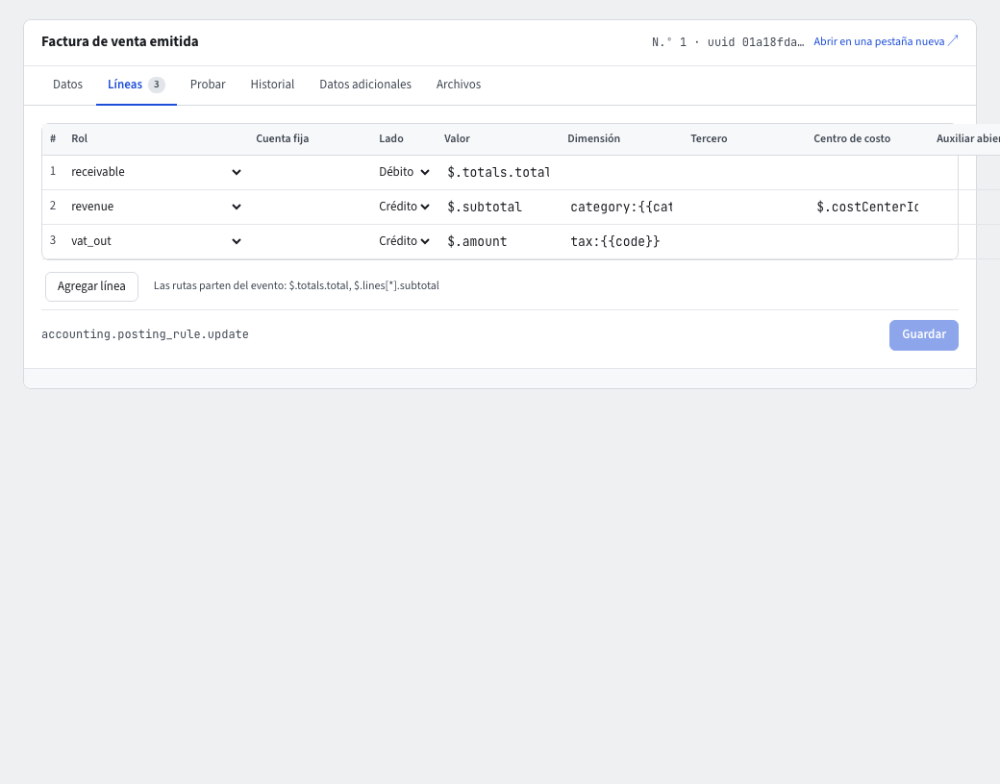

# Reglas contables

Una **regla contable** dice cómo se contabiliza cada hecho de la empresa: «cuando se emite una factura de venta, débito a clientes, crédito a ventas e impuestos». Así los comprobantes automáticos nacen solos. Entra por **Contabilidad › Parámetros › Reglas contables**; sus secciones son **Reglas**, **Mapeo de cuentas**, **Conceptos exógena**, **Pendientes de contabilizar** y **Configuración**.

## Primera vez: Configurar contabilidad

Si la contabilidad aún no está configurada, la pantalla ofrece **Configurar contabilidad** (solo el administrador). Instala el plan de cuentas del país, el mapeo de roles, las fuentes, los conceptos de exógena, el año fiscal y las reglas por defecto. Pide el código de verificación. Puedes ejecutarlo otra vez: solo agrega lo que falte y nunca cambia lo que editaste.

## Mapeo de cuentas

Cada regla habla de **roles contables** (clientes, ventas, caja, IVA generado…), no de números de cuenta. En **Mapeo de cuentas** cada rol tiene su **Cuenta**; la pantalla dice «Todos los roles tienen cuenta» o cuántos faltan (en rojo, **Sin cuenta**). Para cambiar una, escoge otra cuenta en la lista y **Guardar** (pide código de verificación).

Algunos roles pueden variar por **Dimensión**: por ejemplo, la cuenta de ingresos por categoría de producto, que también se edita en la pestaña **Contabilidad** de la categoría. Otro ejemplo es la cuenta de **Caja** de un medio de pago, en la pestaña **Contabilidad** del medio (`payment_method_id:…`; guía **Pagos de clientes**).

Una línea de regla puede probar varias dimensiones en orden: el recibo de caja busca primero la cuenta del **medio de pago**, luego la de su **tipo** (`payment_method:transfer`) y, si ninguna tiene cuenta, la del rol sin dimensión. En la regla se escribe como una lista: `"dimension": ["payment_method_id:{{methodId}}", "payment_method:{{method}}"]`.

## Modo de contabilización

Arriba de **Mapeo de cuentas** está el **Modo de contabilización**, que dice cuándo se registra el comprobante de los documentos que contabilizan solos (facturas, notas crédito y débito, recibos de caja y costos en destino). Debajo del control, la pantalla lista a qué documentos aplica.

- **Inmediata y estricta (recomendada)**: el documento y su comprobante se guardan en la misma operación. Si el comprobante no se puede registrar (falta una cuenta, el período está cerrado, el comprobante no cuadra), el documento tampoco se guarda y la pantalla dice por qué. Mientras Contabilidad esté activa y contratada, nunca se guarda un documento sin su comprobante; con Contabilidad apagada o sin contratar, o con una cola que quedó del modo asíncrono, el documento sí puede quedar sin comprobante y su ficha muestra **Pendiente de contabilizar**, en cualquiera de los dos modos.
- **Asíncrona con reintentos**: el documento se guarda primero y su comprobante se registra después, en segundo plano. Si el comprobante falla, el documento queda guardado y el fallo va a **Pendientes de contabilizar**, donde se corrige y se reintenta.

**El riesgo del modo asíncrono.** Una factura emitida y aceptada por la DIAN puede existir sin su asiento contable hasta que el reintento tenga éxito, y los reportes contables no la incluyen mientras tanto. Por eso la pantalla muestra un aviso rojo mientras el modo sea asíncrono, y también antes de elegirlo. En este modo solo se rechaza al emitir un documento si el libro aún no empezó o si ninguna regla contable le aplica.

**Cómo cambiarlo.** Elige la otra opción, lee el aviso en el cuadro que se abre, pulsa **Cambiar a…** y escribe el código de verificación. Solo lo puede hacer quien tiene el permiso de cambiar el modo; los demás ven el modo sin poder cambiarlo. Cambiar de modo no reescribe nada: los comprobantes ya registrados se quedan y los documentos que esperan su comprobante se registran igual.

**Los dos contadores.** Debajo del control: cuántos **documentos esperan su asiento** (el comprobante todavía no se registró) y cuántos **fallos hay en la cola de reintentos** (**Ver pendientes**). Se muestran en los dos modos, porque al volver a **Inmediata y estricta** puede quedar una cola de la etapa asíncrona: se vacía sola cuando el sistema registra los comprobantes que faltan, y los fallos se resuelven en **Pendientes de contabilizar**.

**El aviso de asientos atrasados.** En el modo asíncrono, si un documento espera su asiento más de los minutos de **Configuración › Minutos para avisar de un asiento pendiente** (por defecto 60), el sistema avisa a quienes pueden reintentar contabilizaciones (el permiso **Reintentar** de **Pendientes de contabilizar**; el administrador también lo ve): aparece en **Inicio › Recomendaciones para ti**, en **Pendientes** del inicio de Contabilidad y en la campana como «Documento sin asiento contable hace más de N minutos», con un enlace al documento y los minutos que llevaba esperando cuando se dio el aviso. Cuenta tanto un documento cuyo asiento aún no se registró como uno cuyo asiento falló y está en la cola de reintentos. Hay un solo aviso por documento: mientras el documento sigue esperando igual, el aviso no se repite ni cambia; si su situación cambia (por ejemplo, el asiento que esperaba falla), el aviso se actualiza con la nueva situación. Se cierra solo cuando el asiento queda registrado (porque el sistema lo registró o porque reintentaste el fallo), o al volver a **Inmediata y estricta**. Si lo **Descartas**, no vuelve mientras el documento siga esperando en la misma situación; si la situación cambia, llega un aviso nuevo. El sistema revisa los documentos periódicamente (como mucho una vez por minuto; en la demostración publicada puede ser una vez al día), así que el aviso puede tardar un poco en aparecer o en cerrarse. Solo ves el aviso si puedes ver el documento.

**En el documento.** Mientras el comprobante no existe, la ficha de la factura, la nota, el recibo o el costo en destino muestra **Pendiente de contabilizar**; si falló, **Contabilización fallida · ver pendientes** (lleva a la lista). Si la contabilidad está apagada para la empresa, dice **Contabilidad desactivada**, y si nunca se contrató, **Módulo contable no contratado**. La insignia desaparece sola cuando el comprobante existe.

## Reglas de anticipos

Al aplicar un anticipo de un cliente a sus facturas (guía **Pagos de clientes**) se usan dos reglas de fábrica, ambas en el diario **RC**: **Aplicación de anticipo** (evento de aplicar: débito al rol *anticipos de clientes* y crédito al rol *clientes*, por el total, con el cliente como tercero y la aplicación como fuente) y **Anulación de aplicación de anticipo** (evento de deshacer: revierte el comprobante de la aplicación). No necesitan mapeo nuevo: usan las mismas cuentas de los roles *anticipos de clientes* (280505) y *clientes* (130505) que ya usa el recibo de caja. Una empresa creada antes de esta versión no las tiene: un administrador debe **sincronizar las reglas por defecto** una vez (el proceso *sincronizar reglas contables*: se ejecuta también al repetir **Configurar contabilidad** o al volver a activar el módulo de contabilidad), y aplicar un anticipo funciona; la sincronización agrega lo que falta y no cambia las reglas que editaste. Mientras falten, aplicar o deshacer un anticipo se rechaza sin cambiar nada.

## Reglas

El listado de **Reglas** muestra Evento, Módulo, Fuente, Prioridad y si está **Activa**; una insignia **Modificada** marca las que cambiaste frente a las de fábrica. Al abrir una regla activa que tiene condición (por ejemplo, «solo cuando el tipo es ajuste»), la insignia amarilla **Sin coincidencias en N días** avisa que ningún evento de ese tipo cumplió la condición en los últimos N días: revisa si la condición está bien escrita o si la regla ya no se necesita. No aparece en reglas sin condición, en reglas apagadas ni en reglas creadas hace menos de N días; es un aviso, la regla sigue funcionando. Abre una:

- **Datos**: evento, fuente, prioridad, activa.
- **Líneas**: la plantilla, una fila por línea del comprobante: **Rol** (o **Cuenta fija**), **Lado** (Débito o Crédito), **Valor** (la ruta del dato en el evento, por ejemplo `$.totals.total`), **Dimensión**, tercero, centro de costo y demás. **Agregar línea** o **Quitar la línea n**.
- **Probar**: elige un **Evento real** y pulsa **Probar con un evento real** para ver la **Vista previa** del comprobante que saldría, sin contabilizar nada.
- **Historial**: los cambios de la regla (solo el administrador).

Para cambiarla: edita las líneas, pruébalas y pulsa **Guardar** (pide el código de verificación). Cada cambio queda en la auditoría.

## Configuración

- **Dimensiones analíticas en uso**: **Usar auxiliares abiertos**, **Usar ítems**, **Usar unidades de negocio**.
- **Comprobantes manuales**: **Exigir aprobación de otra persona**, **Exigir un archivo adjunto** y **Fuente de los comprobantes manuales**.
- **Grupo NIIF** (1, 2 o 3) y **Tolerancia de ajuste al peso**: la diferencia máxima que se absorbe al cuadrar un comprobante automático.
- **Días para marcar una regla sin coincidencias** (N, por defecto 30): el plazo de la advertencia anterior; es un número entero de días, de 1 en adelante.
- **Minutos para avisar de un asiento pendiente** (por defecto 60, entre 5 y 10.080, una semana): en el modo asíncrono, cuánto puede esperar un documento su asiento antes del aviso de asientos atrasados (ver **Modo de contabilización**).
- **El libro empieza el**: los eventos anteriores a esa fecha se reconocen sin contabilizar.

Guarda con **Guardar**; pide el código de verificación.

## Conceptos exógena y Pendientes

Tienen sus guías: **Información exógena** y **Pendientes de contabilizar**.

## Pedirle al asistente

«Las ventas de la categoría Bebidas deben ir a la 413520» propone el cambio de mapeo en una tarjeta con el antes y el después y pide el código de verificación antes de aplicarlo.
