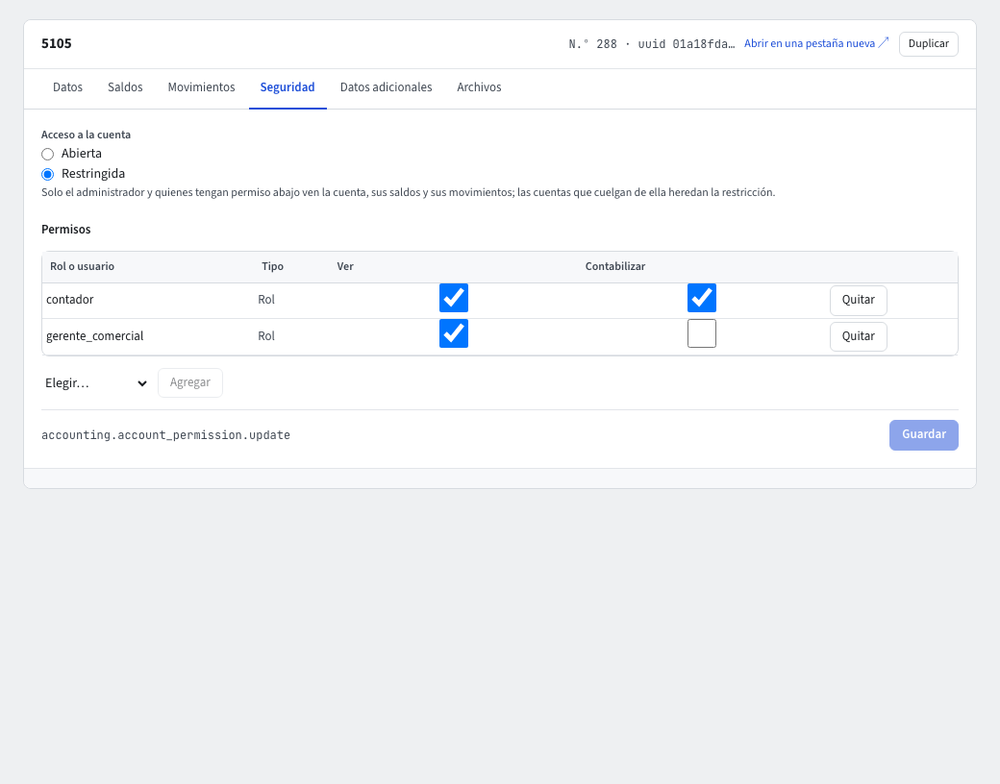

# Seguridad por cuenta

Algunas cuentas no deben verlas todos: los sueldos (5105), el patrimonio (clase 3) o la cuenta de un banco. La **seguridad por cuenta** permite restringirlas. Es independiente de los permisos por proceso: un rol puede consultar comprobantes y aun así no ver una cuenta.

## Restringir una cuenta

1. Abre **Contabilidad › Maestros › Plan de cuentas** y haz clic en la cuenta.
2. Ve a la pestaña **Seguridad**.
3. En **Acceso a la cuenta** elige **Restringida**. Quedan con acceso el administrador y quienes agregues abajo; las cuentas que cuelgan de ella heredan la restricción.
4. En **Permisos** pulsa **Agregar**: elige el **Rol o usuario** y marca **Ver** (ve la cuenta, sus saldos y sus movimientos) y/o **Contabilizar** (puede usarla en comprobantes).
5. **Guardar**; pide tu código de verificación.

Para quitar un permiso, **Quitar**; **Descartar** deshace los cambios sin guardar. Con **Abierta**, todos los que ven el plan de cuentas ven la cuenta y pueden contabilizar en ella.

En el listado, la columna **Seguridad** y el filtro rápido **Restringidas** muestran cuáles son. En **Administración › Roles** y **Usuarios**, la pestaña **Cuentas** lista los permisos de cuenta de ese rol o usuario.

## Qué ve quien no tiene acceso

El dinero nunca se oculta, solo el detalle:

- **Informes de totales** (Balance de prueba, Libro mayor y balances, Estado de resultados, Estado de situación financiera): las cuentas restringidas se reemplazan por una línea **Cuentas restringidas** («Cuentas restringidas (n)») con sus cifras sumadas; los totales y las ecuaciones cuadran. La línea muestra los saldos deudores y acreedores de esas cuentas, cada uno en su lado, así que los seis totales son iguales para todas las personas.
- **Informes de líneas** (Auxiliar, Libro diario…): las líneas no salen y una nota dice **Líneas omitidas por falta de acceso**.
- **Auxiliar de una cuenta restringida**: si pides el Auxiliar de una cuenta que no puedes ver, el informe responde solo **Sin acceso**, sin código, nombre ni saldos. Pedir una cuenta que no existe da la misma respuesta, así que no se puede averiguar qué cuentas existen.
- **Movimientos**: igual, con la nota de las líneas omitidas.
- **Una cuenta restringida abierta directamente**: el marco se titula **Cuenta restringida**, el **N.º** aparece oculto (`N.º ••••`) junto al UUID del enlace, y **Abrir en una pestaña nueva** abre la misma dirección. Sus pestañas **Saldos** y **Movimientos** responden **Sin acceso**, y el pie del marco también dice **Sin acceso**. Un identificador que no existe se ve exactamente igual, así que no se puede averiguar qué cuentas existen.
- **Comprobantes**: una línea de cuenta restringida se ve como **Línea de una cuenta restringida**, sin cifras, y no se puede editar; los totales del comprobante están completos.
- **Al crear un comprobante** solo se ofrecen las cuentas donde puedes contabilizar. Si una línea usa una cuenta prohibida, el sistema la rechaza con «Sin permiso en la cuenta», nunca la descarta en silencio.

El asistente y las exportaciones respetan lo mismo.
