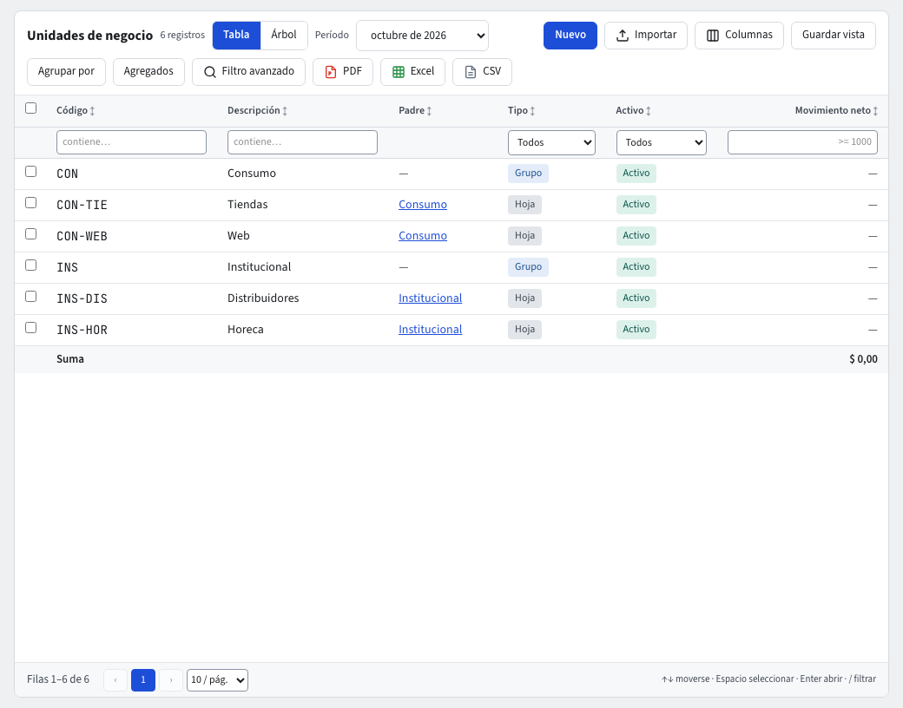

# Unidades de negocio

Una **unidad de negocio** es una línea de la empresa que quieres medir por separado: la tienda, el servicio de catering, la exportación. A diferencia del centro de costo, puede asignarse a **todo el comprobante** desde su encabezado.

Es opcional. **Unidades de negocio** aparece en **Contabilidad › Maestros** solo cuando está encendida.

## Encenderla

1. **Contabilidad › Reglas contables › Configuración**.
2. En **Dimensiones analíticas en uso**, marca **Usar unidades de negocio**.
3. **Guardar** (pide tu código de verificación).

## Crear y administrar

Es la misma pantalla de los demás maestros jerárquicos (guía **Centros de costo**): **Vista** **Tabla** o **Árbol** (la Tabla trae la columna **Movimiento neto** del **Período** elegido, que se ordena, se filtra y se exporta), **Nuevo** con Código, Descripción, Tipo y el nodo **Bajo** el que se crea. El registro tiene **Datos**, **Saldos por cuenta**, **Movimientos**, **Datos adicionales** y **Archivos**.

## En un comprobante

- En el **Encabezado** elige la **Unidad de negocio** del comprobante: «Las líneas sin unidad de negocio propia usan la del encabezado».
- La columna **Unidad de negocio** de cada línea muestra la heredada y puedes cambiarla en esa línea.
- Una cuenta con **Exige unidad de negocio** no se contabiliza sin ella.

## En consultas e informes

Filtra o agrupa por **Unidad de negocio** en **Movimientos**, o usa **Auxiliar por dimensión analítica** con la dimensión **Unidad de negocio** (guía **Informes**).
