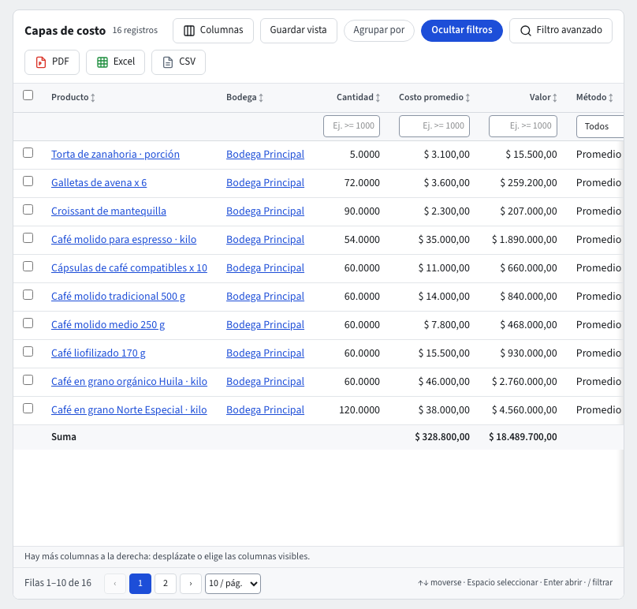

# Costos

El módulo **Costos** dice cuánto vale lo que tienes en inventario y cuánto te costó lo que vendiste. **Inventario** lleva las cantidades (guía **Inventario**); Costos valora cada movimiento sin que tengas que hacer nada: cada entrada, salida, traslado, ajuste, entrega o devolución queda valorada en el mismo orden en que se registró.

Sus pantallas están en la barra superior del módulo **Costos**:

- **Documentos › Costos en destino**: el flete, los aranceles o el seguro que suben el costo de una entrada.
- **Reportes › Capas de costo**: el costo promedio de cada producto en cada bodega.
- **Reportes › Costos pendientes**: los productos que salieron sin costo.
- **Parámetros › Costeo**: el método de costeo de la empresa y el costo de las unidades sin costo conocido.

Los costos son datos confidenciales: si tu rol no puede verlos, salen enmascarados (••••••) en los listados, los registros, las exportaciones y el asistente, y no se pueden filtrar ni ordenar.

## El promedio ponderado

La empresa costea por **promedio ponderado**, por producto y por bodega. Cada par producto–bodega tiene una **capa de costo** con su **Cantidad**, su **Valor** y su **Costo promedio** (valor ÷ cantidad).

- **Una entrada** suma su cantidad y su valor (cantidad × costo unitario de la línea), y el promedio cambia. Ejemplo: tienes 10 unidades que valen $ 1.000,00 (promedio $ 100,00) y entran 10 a $ 120,00: quedan 20 que valen $ 2.200,00, promedio $ 110,00.
- **Una salida** (una salida de inventario, una entrega despachada, el despacho de un traslado o un ajuste negativo) sale al costo promedio de ese momento y no cambia el promedio.
- **Un traslado** lleva el costo de la bodega de origen a la de destino.
- **Una devolución de venta** vuelve al **costo de la salida original**, no al promedio de hoy.
- **Un ajuste** se valora al costo promedio de la bodega o, si no lo tiene, al **Costo estándar** del producto.
- Si una entrada no trae costo unitario, el sistema usa el promedio de la bodega y, si no hay, el **Costo estándar** del producto (guía **Productos**).

Solo los productos de tipo **Bien** que **controlan existencias** tienen capa de costo. Los montos se redondean al centavo y el valor de la capa es siempre la suma de sus movimientos, así que cuadra con la contabilidad.

## El costo de ventas

Cuando despachas una entrega (guía **Entregas y devoluciones de venta**), Costos valora la salida al promedio de la bodega y **Contabilidad** registra el asiento de **costo de ventas**: débito costo de ventas, con el centro de costo de la entrega, y crédito inventarios, en la fecha de la entrega. La entrega muestra ese asiento en su pestaña **Contabilidad**.

- Una **devolución recibida** devuelve ese costo (débito inventarios, crédito costo de ventas) al costo de la salida original.
- **Anular** una entrega o una devolución reversa su costo y su asiento.
- Si la fecha cae en un **período cerrado**, la mercancía se mueve igual y el asiento queda en **Contabilidad › Pendientes de contabilizar** hasta que se reabra el período (guía **Pendientes de contabilizar**).

## Capas de costo

**Costos › Reportes › Capas de costo** lista una fila por producto y bodega con la **Cantidad**, el **Valor**, el **Costo promedio** y el **Último movimiento** (un enlace al movimiento de inventario). Filtra por producto o bodega y exporta como en cualquier listado (guía **Listados**). Cada movimiento de inventario guarda también su valoración por línea: costo unitario, valor, **Origen del costo** (costo de la línea, costo promedio, costo estándar, costo de la salida original…) y cómo quedó la capa después.

## Costos pendientes

Si sale mercancía de un producto que en esa bodega todavía no tiene costo (por ejemplo, despachas antes de registrar la entrada de la compra), la salida se registra igual y se valora en **cero**: nada se detiene y el producto sigue **Listo para facturar**. **Costos › Reportes › Costos pendientes** muestra cada producto y bodega en esa situación, con las **Veces** que pasó, la **Cantidad sin costo** y el primer y el último movimiento.

- La fila se marca **Resuelto** sola cuando llega una entrada con costo de ese producto a esa bodega.
- Las unidades que salieron en cero no se revalúan después: si el valor debe corregirse, registra un **Ajuste** en Inventario.
- Revisa esta lista antes de cerrar el mes. El listado empieza mostrando solo los pendientes abiertos.

Cada fila abierta deja además un **aviso** «Falta el costo de un producto» con el producto, la bodega y cuántos movimientos salieron sin costo. Lo ven quienes pueden registrar ajustes de inventario, en **Recomendaciones para ti**, en la **campana** y en el **Inicio de Costos** (tarjeta **Pendientes**); **Abrir registro** lleva a **Costos pendientes**. Un segundo movimiento sin costo del mismo producto y bodega suma al mismo aviso. Cuando la fila se marca **Resuelto** (llega la entrada con costo, o se anula el último movimiento sin costo), el aviso se cierra solo (guía **Primeros pasos**, «Pendientes del sistema y la campana»).

## Costos en destino

Un **costo en destino** suma al costo de una entrada lo que pagaste después por traerla: flete, aranceles, seguro. Se numera `CD-…` y se contabiliza en el mismo momento en que lo registras.

1. Ve a **Costos › Documentos › Costos en destino** y pulsa **Nuevo**.
2. Elige la **Entrada de mercancía** (la entrada cuyo costo sube) y escribe el **Valor**.
3. En **Repartir por**, elige **Valor** (en proporción al valor de cada línea de la entrada) o **Cantidad** (en proporción a las unidades).
4. Elige la **Contrapartida**: **Cuentas por pagar**, **Anticipos a proveedores**, **Caja**, **Bancos** o **Cuenta transitoria**. Si es una cuenta por pagar o un anticipo, elige también el **Proveedor**.
5. Escribe la **Fecha**, la **Referencia** (por ejemplo el número de la factura del transportador) y la **Descripción**, y pulsa **Guardar**.

El valor se reparte entre las líneas al centavo (la suma da exactamente el valor) y sube el valor de la capa de cada producto; la cantidad no cambia, así que sube el costo promedio de las unidades que quedan. Lo que ya se vendió no se recalcula: el costo de ventas registrado no cambia. El asiento es débito inventarios por línea y crédito la contrapartida elegida. Si contabilidad no puede tomar el asiento (período cerrado, proveedor no listo, falta una cuenta o un centro de costo), el costo en destino no se registra y el mensaje dice por qué. Pulsar dos veces **Guardar** no lo registra dos veces. Una misma entrada puede tener varios costos en destino (el flete y los aranceles, por ejemplo).

**Pendiente de contabilizar.** Si la empresa eligió el modo de contabilización **Asíncrona con reintentos** (guía **Reglas contables**), el costo en destino se guarda antes de que su comprobante exista y su ficha muestra la insignia **Pendiente de contabilizar** hasta que el sistema lo registre; si el registro falla, la insignia dice **Contabilización fallida · ver pendientes** y lleva a **Pendientes de contabilizar**. Con la contabilidad apagada la insignia dice **Contabilidad desactivada**, y sin el módulo contratado, **Módulo contable no contratado**. En el modo por defecto, **Inmediata y estricta**, esta insignia no aparece: sin comprobante no hay documento.

**Anular** un costo en destino (en la barra del registro, con un motivo) pide tu **código de verificación**. Quita exactamente el valor que había sumado a cada capa y reversa su asiento. Si el período de la anulación está cerrado, se rechaza y nada cambia.

## Costeo: el método

**Costos › Parámetros › Costeo** muestra el **Método** de la empresa. Hoy el único disponible es **Promedio ponderado**. **PEPS (FIFO)** aparece en la lista pero llega en la fase 3: si lo eliges, el sistema lo rechaza con «El método PEPS (FIFO) está disponible en la fase 3». **Guardar** pide tu **código de verificación**. Mientras nadie lo configure, la empresa costea por promedio ponderado. La sección de abajo, **Costo de unidades sin costo conocido**, se guarda aparte.

## Costo de unidades sin costo conocido

Cuando entra o sale mercancía de un producto que todavía no tiene costo, el sistema la valora con la opción que elijas en **Costos › Parámetros › Costeo**, en la sección **Costo de unidades sin costo conocido**:

- **Cero (como hasta ahora)**: las unidades entran valoradas en $ 0,00. Es lo que se hace mientras nadie lo configure. Tiene un efecto que conviene conocer: esas unidades **bajan el costo promedio de las entradas siguientes**. Ejemplo: entran 10 unidades sin costo y luego 5 a $ 200,00; quedan 15 unidades que valen $ 1.000,00, promedio $ 66,67.
- **Último costo conocido**: las unidades se valoran con una **estimación**, el costo de la última vez que ese producto tuvo un costo real. Se busca primero en la misma bodega y, si ahí no hay, en cualquier otra bodega de la empresa. Con el mismo ejemplo y un último costo de $ 100,00, las 15 unidades valen $ 2.000,00, promedio $ 133,33: el promedio no se diluye. A cambio, el **costo de ventas y el inventario llevan un valor que no es el real** hasta que se corrija. Si el producto nunca tuvo un costo, o su última entrada con costo fue anulada, queda en cero como siempre.

En los dos modos el producto queda en **Costos pendientes** y el sistema recomienda corregirlo (el aviso «Falta el costo de un producto»).

**Cómo se ve una estimación.** Su **Origen del costo** dice **Último costo conocido (estimado)** y la línea cuenta como pendiente de costo real, aunque su costo unitario sea mayor que cero. Un traslado o una devolución de venta de unidades estimadas heredan la estimación. El costo de lo estimado llega a la contabilidad como cualquier costo de ventas: débito costo de ventas y crédito inventarios por ese valor, y el asiento cuadra con la capa de costo.

**Mientras la estimación siga abierta.** Mientras el producto siga en Costos pendientes con una estimación, el costo promedio de esa bodega está hecho de estimaciones: lo que salga de ahí (ventas, salidas, traslados, devoluciones) y las nuevas entradas sin costo se valoran a ese promedio y **también quedan marcados como estimados** y suman a la misma fila. Un **Ajuste** nunca se estima: sin costo queda en cero (inventario y contabilidad coinciden), y uno valorado a ese promedio también queda marcado como estimado. Solo una entrada con costo real cierra la fila y devuelve el promedio a la normalidad; si esa entrada se anula, la fila vuelve a abrirse. Las unidades que ya están en la bodega con valor cero salen en cero, aunque salgan todas.

**Cómo se corrige.** Una entrada con costo real de ese producto en esa bodega marca la fila de Costos pendientes como **Resuelto**, pero **no recalcula** lo ya valorado. Para dejar el valor correcto, registra un **Ajuste** en Inventario (guía **Inventario**).

**Desde cuándo vale.** El cambio vale **desde el siguiente movimiento** que se valore; lo anterior queda como estaba y no se recalcula nada. **Guardar opción** pide tu **código de verificación**, y solo puede cambiarlo quien tenga el permiso; sin él, la opción se ve pero no se puede modificar.

## Preguntarle al asistente

«¿Cuál es el costo promedio del café de 500 g en la bodega principal?» o «¿qué productos tienen costos pendientes?» responden desde estas mismas pantallas, con lo que tu rol puede ver. Un costo en destino también se puede registrar con el asistente: te muestra una tarjeta con la entrada, el valor y la contrapartida, y solo lo registra cuando la confirmas.

## Preguntas frecuentes

- **«El costo promedio no cambió después de una venta»**: es lo esperado. Las salidas usan el promedio, no lo cambian.
- **«Registré el flete y el costo de ventas de lo que ya vendí no subió»**: un costo en destino no recalcula lo ya vendido; sube el costo de las unidades que quedan.
- **«No puedo desactivar Costos»**: Inventario lo necesita para valorar sus ajustes. Desactiva primero Inventario (guía **Administración**, sección Módulos); Costos puede quedar apagado con Inventario activo solo después de ese paso, y los ajustes usan entonces el costo estándar.
- **«Cambié a Último costo conocido y el costo de ventas de ayer no cambió»**: es lo esperado. El cambio vale desde el siguiente movimiento y no recalcula lo anterior.
- **«No veo los costos»**: tu rol los tiene enmascarados u ocultos. Pídeselo al administrador (guía **Administración**).
