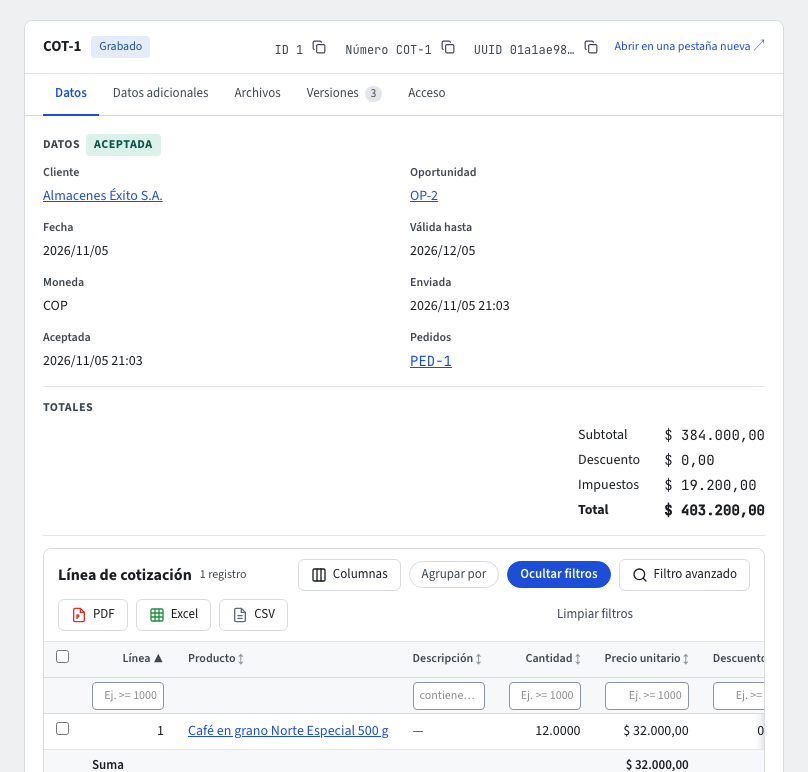

# Cotizaciones

Una **cotización** es lo que le ofreces a un cliente, línea por línea: el producto, la cantidad, el precio, el descuento y los impuestos. Vive en **CRM › Documentos › Cotizaciones**, se numera `COT-…` al grabarla y nunca genera asientos contables. Cuando el cliente la acepta, de ella sale el pedido.

Si tu empresa también tiene el módulo **Ventas**, la misma pantalla aparece como **Ventas › Documentos › Cotizaciones**, al final de la lista, para tenerla junto a los pedidos y las entregas. Es la misma lista de CRM, con los mismos permisos: si no puedes abrirla en CRM, tampoco aparece en Ventas.

El listado de **CRM › Documentos › Cotizaciones** muestra el número, el cliente, las fechas, la etapa (**Abierta**, **Enviada**, **Aceptada**, **Vencida**), el total y el estado. **Nuevo** abre **Crear cotización**; un clic en el número abre la cotización en su propia pestaña. Todo esto también lo puedes pedir al **asistente** (guía **El asistente**).

## Crear una cotización

1. Elige el **Cliente**. Si viene de una negociación, elige también la **Oportunidad** (debe ser del mismo cliente).
2. La **Fecha** es la de hoy y la cotización vale los días que diga **Parámetros de CRM** (30 si no se ha configurado); puedes cambiar la fecha **Válida hasta**.
3. Agrega las **líneas**: producto y cantidad. El **precio unitario** lo pone el sistema (ver **Ventas: precios y condiciones comerciales**): la lista de precios del cliente, si no la lista predeterminada, si no el precio de lista del producto. Puedes escribir otro precio a mano.
4. El **descuento** de cada línea es un porcentaje; si no lo escribes, se usa el descuento habitual del cliente, también cuando el precio lo escribes a mano (por ejemplo, en una cotización en dólares).
5. Pulsa **Guardar** en la barra de acciones. El sistema calcula la base, el IVA, el INC y los otros impuestos de cada línea, y el subtotal, los impuestos y el total, con las reglas de redondeo de la DIAN, y abre la cotización grabada.

La cotización grabada muestra sus **Datos** (el cliente y la oportunidad son enlaces que abren su ficha), la etapa, los **Totales** (por ejemplo `$ 88.200,00`) y sus líneas en un listado con filtros y exportación. **Editar** vuelve al formulario mientras la cotización está abierta; **Duplicar** (en la barra) crea una nueva con el mismo cliente y las mismas líneas, con fecha de hoy y la vigencia de los parámetros.

## Cliente y productos listos para facturar

En el cuadro **Cliente** un cliente que no está listo aparece deshabilitado, con el motivo al pasar el cursor (por ejemplo «Faltan datos DIAN: Dirección»). Solo se cotiza a un cliente y con productos **listos para facturar**: datos DIAN completos, archivos obligatorios cargados, activos y, si requieren aprobación, ya aprobados. Si alguno no lo está, la cotización no se graba y el mensaje dice cuál y por qué, por ejemplo «Línea 2: el producto SIN-01 no está listo para facturar: faltan datos DIAN: Código estándar» o «… está pendiente de aprobación». Completa el tercero o el producto (guías **Terceros** y **Productos**) y vuelve a intentarlo. La misma revisión se repite al aprobar y al aceptar.

## Descuentos que necesitan aprobación

En **CRM › Parámetros › Parámetros de CRM** el administrador fija el **Descuento máximo sin aprobación (%)**. Una cotización con alguna línea por encima de ese porcentaje queda **Pendiente de Aprobación** (lo dice junto al título): no se puede enviar ni aceptar hasta que alguien con permiso pulse **Aprobar** en la barra de acciones (o **No aprobar**). Si la rechazan, corrígela (por ejemplo, baja el descuento) y grábala de nuevo; si ya no supera el tope, queda grabada sin pasar por aprobación. El descuento habitual del cliente también cuenta para el tope. Sin tope configurado, ninguna cotización pide aprobación.

Aprueba o rechaza quien tiene ese permiso (no el vendedor, salvo que se lo den). Quien puede aprobar ve, además de las suyas, todas las cotizaciones que pasan por aprobación, aunque no sea su dueño.

## Enviar, aceptar y vencer

Los botones están en la barra de acciones de la cotización grabada, en la fila de sus pestañas; solo aparecen los que se pueden usar en su etapa.

- **Enviar al cliente**: marca la cotización como enviada al cliente. Solo una grabada (o aprobada, si lo necesitaba).
- **Aceptar cotización**: registra que el cliente la aceptó. Se puede aceptar sin haberla enviado (el cliente acepta en el momento). Debe estar vigente (no pasada su fecha **Válida hasta**). Desde ese momento sus líneas, precios y totales **ya no cambian**, ni con **Editar** ni de ninguna otra forma; si hay que cambiar algo, anúlala y crea otra. La aceptación avisa para crear el pedido y lleva la oportunidad, para que el CRM la cierre como ganada cuando el pedido se confirme.
- **Crear pedido**: en una cotización aceptada, elige la **Bodega del pedido** y pulsa **Crear pedido**; el pedido se abre en su pestaña (guía **Pedidos de venta**).
- **Marcar vencida**: da por vencida una cotización abierta o enviada que el cliente no tomó, aunque no haya llegado su fecha **Válida hasta**. Una vencida ya no se acepta.

Mientras está abierta y grabada (o no aprobada) puedes **Editar** sus líneas, su vigencia y sus notas: el sistema vuelve a preciar y a calcular los impuestos.

## Imprimir

**Imprimir** (en la barra de acciones) genera el PDF de la cotización con su plantilla: el membrete de la empresa, el número, el cliente, las fechas, los totales y la tabla de líneas (producto, descripción, cantidad, precio, descuento, base, IVA y total). El administrador puede crear otra plantilla en **CRM › Parámetros › Plantillas PDF** (guía **Parámetros de maestros y documentos**); si la marca como predeterminada, se usa esa.

## Quién ve qué

Cada vendedor ve solo sus cotizaciones y sus líneas. Quien tiene permiso de reasignar oportunidades (el jefe de ventas) y los administradores las ven todas.
