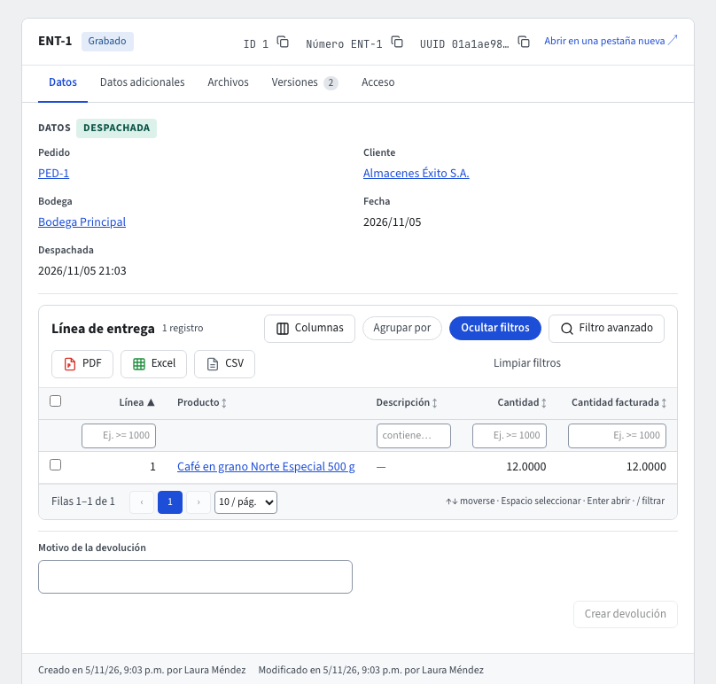

# Entregas y devoluciones de venta

Una **entrega** es la mercancía de un pedido confirmado que sale de la bodega hacia el cliente. Vive en **Ventas › Documentos › Entregas**, se numera `ENT-…` al grabarla y no lleva valores: lleva productos y cantidades. Al **despacharla**, Inventario descarga las existencias y el sistema contabiliza el **costo de ventas** al costo promedio de la bodega. Una **devolución** (`DEV-…`, en **Ventas › Documentos › Devoluciones**) recibe de vuelta lo que salió en una entrega.

Los listados muestran el número, el pedido o la entrega de origen, el cliente, la fecha, la etapa (**Por despachar** / **Despachada**; **Por recibir** / **Recibida**) y el estado. Un clic en el número abre el documento: sus **Datos** (con enlaces al pedido, la entrega, el cliente y la bodega), sus líneas y los botones de su etapa. Todo esto también lo puedes pedir al **asistente** (guía **El asistente**).

## Crear una entrega

En un pedido **Confirmado** pulsa **Crear entrega** (guía **Pedidos de venta**), o en **Entregas** pulsa **Nuevo** y elige el **Pedido**: aparecen sus líneas con lo pedido y una casilla **A despachar** por línea. Si no indicas las líneas, la entrega lleva todo lo que falta por entregar del pedido; puedes entregar menos (una **entrega parcial**) e indicar otra bodega o el centro de costo. Nunca se entrega más de lo pedido: el sistema cuenta lo que ya llevan las otras entregas del pedido que no están anuladas, y si te pasas el mensaje dice, línea por línea, cuánto queda.

Puedes pedir al asistente, por ejemplo: «haz la entrega del pedido PED-12 con 2 cafés de 500 g» o «despacha la entrega ENT-4».

## Entrega desde un alistamiento

Si la empresa tiene el módulo **Bodega**, un pedido confirmado se **alista** antes de salir: el alistador confirma de qué **ubicación**, **lote** y **serial** tomó cada línea. Confirmar el alistamiento no mueve existencias: el inventario **asigna** a la reserva del pedido lo que se tomó. Cuando la asignación alcanza y el parámetro de bodega **Crear la entrega al confirmar el alistamiento** está activo (lo normal), aparece sola una entrega **Por despachar** del pedido con lo alistado:

- Una línea por línea del pedido, con la cantidad alistada. Si todo se tomó de un solo lote, la línea muestra ese **Lote**; un producto por serial lleva sus **Seriales**.
- En **Documentos relacionados** la entrega aparece unida al pedido (*Pedido → Entrega*) y al alistamiento (*Alistamiento → Entrega*).
- Se crea una sola vez por alistamiento. Si alguna línea del alistamiento no alcanzó (otra reserva ya tenía esas existencias), no se crea entrega: el alistamiento vuelve a **En proceso** para corregirlo. Tampoco se crea si el pedido se canceló o ya no le queda nada por entregar.

Revisa la entrega y despáchala como cualquier otra: puedes bajar cantidades, cambiar la fecha o el centro de costo. Al **despachar**, cada línea sale **primero de lo asignado**: la ubicación, el lote y el serial que tomó el alistador, aunque FEFO o la ubicación con más existencias dijeran otra cosa; lo que falte (si la entrega lleva más de lo alistado) sale como siempre. Si despachas menos de lo alistado, lo demás queda asignado para la siguiente entrega del pedido.

Con **Crear la entrega al confirmar el alistamiento** apagado, el alistamiento solo asigna y tú creas la entrega a mano: al despacharla, también sale de lo asignado. Un pedido sin alistamiento se entrega igual que siempre.

Al **anular** una entrega que salió de un alistamiento, cada cantidad vuelve a la ubicación, lote y serial de donde salió; si pides reservar de nuevo, la reserva vuelve al pedido, pero ya sin ubicación ni lote asignados (un nuevo alistamiento los asigna).

Un producto sin lote ni serial que el alistador tomó de **dos ubicaciones** para la misma línea sigue saliendo de una sola al despachar, como siempre (la que tiene más existencias): si ninguna tiene toda la cantidad, la entrega no se despacha (*la línea sale de una sola ubicación*); divide la línea en dos entregas.

## Despachar

Pulsa **Despachar** en una entrega **Por despachar** (grabada). Al despachar:

1. El sistema vuelve a revisar que el cliente y cada producto sigan **listos para facturar**.
2. Revisa las **existencias físicas** de la bodega, no solo la reserva: si una línea no alcanzó a reservarse completa, o lo que hay está reservado para otro pedido, la entrega no se despacha (`existencias negativas`) y el mensaje dice qué producto falta. Una bodega que permite existencias negativas no se revisa.
   Cada línea sale de **una sola ubicación** (o de la bodega sin ubicación): si ninguna tiene toda la cantidad de la línea, aunque entre todas sí alcance, la entrega no se despacha (*la línea sale de una sola ubicación*). Divide la línea en varias entregas o traslada la mercancía a una ubicación. Lo que otra entrega ya despachó y el inventario aún no descargó se cuenta como salido.
3. La entrega queda **Despachada** y ya no cambia. El pedido pasa a **Entregado en parte** o, con la última entrega, a **Entregado**.
4. **Inventario** registra la salida por venta, con la fecha de la entrega, y libera la reserva de lo que salió. Los servicios no mueven existencias.
5. **Costeo** valora la salida al costo promedio y **Contabilidad** registra el asiento de **costo de ventas** (débito costo de ventas con el centro de costo de la entrega, crédito inventarios) en la fecha de la entrega.

Si el mismo despacho llega dos veces (por ejemplo, un reintento), solo hay una salida de inventario y un asiento. Un pedido con entregas ya no se cancela: anula primero sus entregas.

### Lotes y seriales: primero lo que vence primero (FEFO)

Si el producto se sigue **por lote** o **por serial** (guía **Inventario**, *Lotes, seriales y seguimiento por producto*), la línea de la entrega puede indicar el **Lote** o los **Seriales** (uno por unidad, sin repetir). Si no indicas el lote, el inventario lo escoge al despachar con la regla **FEFO**: primero el lote que **vence primero**; entre lotes sin vencimiento o con la misma fecha, el más antiguo por fecha de producción y después por código. Si un lote no alcanza, la línea **se reparte** entre varios lotes, en ese orden.

- Nunca sale de un lote **bloqueado** ni, si el producto **bloquea los lotes vencidos** (lo normal), de un lote **vencido** a la fecha de la entrega. Si indicas un lote vencido, la entrega no se despacha (*El lote está vencido…*); escoge otro o deja que FEFO lo escoja.
- La **disponibilidad** que se revisa al confirmar, reservar y despachar cuenta solo los lotes que se pueden vender, así que una reserva nunca promete existencias que el despacho no puede sacar.
- Un producto por serial necesita sus seriales: si la línea no los indica, el inventario no despacha la entrega y la devuelve con el motivo.
- Después del despacho, la columna **Lote / Vence / Serie** de cada línea muestra lo que salió de cada lote (código, vencimiento y cantidad) o cada serial; el PDF de la entrega la imprime. Las columnas de lote solo aparecen en las entregas con productos seguidos por lote o serial: las demás se ven igual que antes.

Al **anular** una entrega despachada, cada cantidad vuelve al mismo lote o serial de donde salió, y la reserva de nuevo (si la pides) cuenta los mismos lotes vendibles.

### Si el inventario no pudo descargar la entrega

Inventario descarga la entrega unos instantes después del despacho. Si en ese lapso otra salida se llevó las existencias, Inventario no la descarga y lo avisa: la entrega **vuelve a Grabada** (abierta, editable), el campo **Motivo del rechazo de inventario** dice qué faltó y cuándo, y el pedido vuelve a su estado anterior. Nada queda descargado a medias ni contado como pendiente. Cuando haya existencias, despáchala de nuevo (el motivo se borra), o anúlala.

## Periodo cerrado

Si la fecha de la entrega cae en un **periodo cerrado**, la mercancía sale igual: las existencias se descargan. Lo que queda pendiente es el asiento de costo de ventas, que aparece en **Contabilidad › Pendientes de contabilizar** con el motivo *periodo cerrado*. Para registrarlo, quien tenga el permiso **reabre el periodo** (pide el código de verificación) y **reintenta** el pendiente: el asiento se registra una sola vez.

## Anular una entrega

Anula una entrega con **Anular** en la barra de acciones y un **motivo**. Una entrega sin despachar se anula sin más. Una entrega despachada se anula solo si **nada de ella se ha facturado** (ninguna factura emitida la incluye, aunque se haya emitido hace un instante; ver la guía **Facturas de venta**) y no tiene devoluciones recibidas: las existencias vuelven a la bodega, el costo vuelve a la capa de costo y el asiento de costo de ventas se **reversa**. Si el costo de ventas aún estaba pendiente (periodo cerrado), el pendiente se descarta y no se registra después. El pedido vuelve a **Confirmado** (o **Entregado en parte**) y puedes hacer otra entrega.

### ¿Reservar de nuevo las existencias para el pedido?

Al anular una entrega **despachada**, la barra de acciones pide el motivo y pregunta **«¿Reservar de nuevo las existencias para el pedido?»**, marcada por defecto. La pregunta aparece solo si el pedido sigue abierto (no está cancelado); una entrega sin despachar no la muestra porque no había sacado nada.

- **Con la casilla marcada**: el inventario devuelve las existencias a la bodega y, **solo si alcanzan**, las reserva de nuevo para las líneas del pedido, de modo que otro pedido no se las lleve. Se reserva de nuevo **solo lo que la línea del pedido tenía reservado** y la entrega usó: si la línea había reservado menos de lo que se entregó (faltaban existencias al confirmar) o no tenía nada reservado (por ejemplo, un pedido sin bodega), recupera solo esa parte, no todo lo que salió. Si falta existencia de **algún** producto no se reserva **nada** (nunca queda un pedido reservado a medias) y la entrega anulada lo explica nombrando el producto, lo que se necesitaba y lo que hay.
- **Con la casilla desmarcada**: igual que siempre; las existencias vuelven a la bodega sin quedar reservadas para el pedido.

La anulación **nunca se rechaza** por falta de existencias: lo único que depende de ellas es la reserva. El resultado aparece en la entrega anulada, en **Reserva al anular** (reservado de nuevo, no alcanzaron las existencias, sin permiso para reservar, o no aplica); el inventario lo confirma unos segundos después de anular. Para reservar de nuevo necesitas también el permiso de **reservar existencias** (Inventario); sin él la entrega se anula igual y el resultado dice que no tenías permiso. El asistente y la API anulan sin reservar de nuevo, salvo que se les pida.

Lo **facturado** de una entrega solo baja cuando su factura se **anula** (la DIAN aceptó la nota crédito de anulación): entonces vuelve a **por facturar**. Una **nota crédito parcial** de la factura (una devolución, una rebaja) no cambia lo facturado de la entrega (guía **Facturación electrónica**).

## Devoluciones

En una entrega **Despachada** escribe el **Motivo de la devolución** (por ejemplo, producto averiado) y pulsa **Crear devolución**, o en **Devoluciones** pulsa **Nuevo** y elige la **Entrega**. Si no indicas las líneas, se devuelve todo lo que salió; nunca más de lo que salió, contando las otras devoluciones de la entrega. Un vendedor solo registra, recibe o anula devoluciones de entregas de **sus** pedidos: la de otro vendedor responde **No encontrado**, salvo que su rol pueda cambiar vendedor (guía [Visibilidad de pedidos](ventas-visibilidad-de-pedidos.md)). La devolución se abre **Por recibir**; al pulsar **Recibir**:

- Las existencias vuelven a la bodega y ubicación de donde salieron, al **costo de la salida original** (no al promedio de hoy).
- Con lotes o seriales, cada línea de la devolución vuelve al **lote o serial** de la salida: si la línea de la entrega salió de un solo lote, ese es el lote por defecto; si salió de varios, puedes indicar el **Lote**, o el inventario la reparte en el orden en que salieron. Para un producto por serial, indica los **Seriales** que vuelven: los seriales se escanean, el sistema no los elige. Solo si la devolución trae **todos** los seriales de la línea que aún no se han devuelto puedes dejarlos sin indicar; si devuelve una parte, la devolución pide los seriales (*indica los seriales que vuelven*). Un serial no se repite en la línea y va uno por unidad. Nunca vuelve a un lote más de lo que salió de él.
- Justo después de despachar, Inventario tarda unos segundos en registrar los lotes y seriales que salieron. Si creas la devolución en ese momento, se rechaza con *Los lotes de la línea … aún se están registrando; inténtalo de nuevo en un momento*: espera y vuelve a crearla.
- Contabilidad devuelve ese costo de ventas (débito inventarios, crédito costo de ventas con el centro de costo).

Anular una devolución recibida saca de nuevo esas existencias de la ubicación a la que entraron y reversa su asiento. Si esas existencias ya salieron (por ejemplo, se vendieron), la anulación se rechaza (*existencias negativas*). Si salen justo mientras Inventario procesa la anulación, la devolución **vuelve a Grabada (recibida)** con el **Motivo del rechazo de inventario**, y su asiento no se toca.

## Imprimir y listados

El listado de **Entregas** muestra el número, el pedido, el cliente, la **Bodega**, la fecha, la etapa y el estado; el de **Devoluciones**, también su bodega y el motivo. **Imprimir** (en la barra de acciones) genera el PDF de una entrega o de una devolución con el membrete de la empresa: el número, el cliente, las fechas, la entrega de donde viene (en una devolución) y el motivo, y la tabla de líneas con producto, descripción y cantidad, sin precios; con lotes o seriales, también **Lote / Vence / Serie**.

## Permisos

Cada acción es un permiso del rol: crear, cambiar, despachar y anular entregas; crear, recibir y anular devoluciones. Reabrir un periodo y reintentar pendientes son permisos de Contabilidad.
