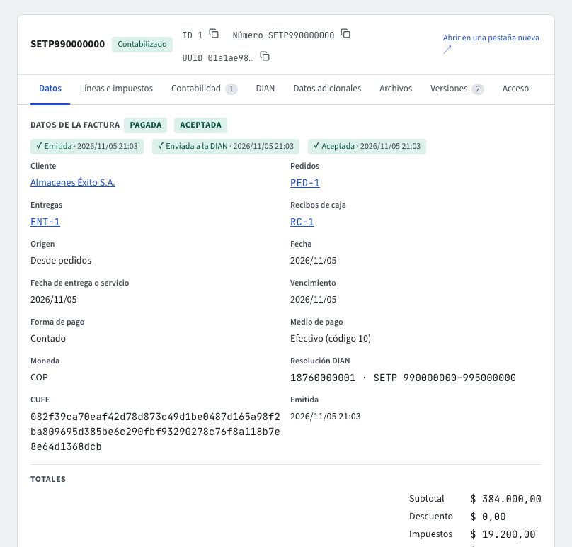

# Facturas de venta

Una **factura de venta** cobra al cliente lo que se le vendió. Vive en **Facturación › Documentos › Facturas**. Mientras la escribes es un **Borrador**: no tiene número y se puede cambiar o eliminar. Al pulsar **Emitir**, en una sola operación, el sistema la revisa, le da el **número de la resolución DIAN** vigente, calcula su **CUFE** (el código único que la DIAN exige) y la **contabiliza**: cuenta por cobrar al cliente, ingreso por cada línea e IVA por cada tarifa. Si algo de eso no se puede hacer, la factura no se emite y queda como estaba, sin gastar número. Todo esto también lo puedes pedir al **asistente** (guía **El asistente**).

Cada factura emitida se envía sola a la DIAN; su estado ante ella (**Estado DIAN**: Sin enviar, En proceso, Aceptada, Rechazada) y **Reintentar envío** se explican en la guía **Facturación electrónica**.

## La lista de facturas

**Facturación › Documentos › Facturas** muestra las facturas en la tabla de siempre (ordenar, filtrar, columnas, exportar). Arriba tienes filtros rápidos por etapa (**Borradores**, **Emitidas**, **Pagadas**, **Anuladas**) y **Rechazadas por la DIAN**, y el botón **Crear factura desde pedidos**, que abre **Por facturar**. Cada fila abre la ficha de la factura.

## La ficha de la factura

Arriba ves la **etapa** (Borrador, Emitida, Pagada, Anulada), el **Estado ante la DIAN** y el total. La ficha tiene cuatro pestañas propias, además de **Datos adicionales**, **Archivos**, **Versiones** y **Acceso** (guía **Maestros y documentos**):

- **Datos**: el cliente, las fechas, la forma y el medio de pago, el número, el CUFE, la resolución DIAN, los pedidos y las entregas de donde salió (cada uno abre su ficha), los totales y las notas crédito y débito de la factura, con los botones **Crear nota crédito** y **Crear nota débito**. Un borrador hecho a mano muestra aquí mismo su formulario para cambiarlo. En una factura emitida también ves el **Recorrido DIAN** (Emitida, Enviada a la DIAN, Aceptada o Rechazada) y, si la DIAN la rechazó, la lista **Errores de la DIAN**.
- **Líneas e impuestos**: las líneas de la factura y sus impuestos por impuesto y tarifa, en la tabla de siempre.
- **Contabilidad**: el asiento que la factura generó al emitirse.
- **DIAN**: el envío a la DIAN (guía **Facturación electrónica**) y sus archivos para descargar.

La barra de la ficha tiene los botones del documento, en cualquier pestaña: **Guardar** guarda el borrador (sigue siendo un borrador), **Emitir** lo emite (si tienes cambios sin guardar, guárdalos primero), **Recalcular precios** (solo en un borrador) pone los precios de la lista de hoy y recalcula los impuestos (las líneas facturadas desde un pedido conservan el precio acordado), **Reintentar envío** reenvía a la DIAN una factura rechazada o cuyo envío se detuvo (si no hay nada que reenviar, el botón se ve apagado y dice por qué), **Anular (nota crédito)** (ver abajo), **Eliminar** borra un borrador, **Imprimir** genera el PDF y **Duplicar** abre una factura nueva con los mismos datos. Un borrador que salió de pedidos solo deja cambiar su encabezado (fechas, forma y medio de pago, notas): sus líneas son las de las entregas.

## Crear una factura

Hay tres maneras de crear facturas; la empresa elige cuál usa en **Facturación › Parámetros › Parámetros de facturación** (ver abajo).

- **A mano.** Eliges el cliente, la fecha, la forma de pago (**Contado** o **Crédito**), el medio de pago y las líneas: producto, cantidad, precio (si no lo indicas, el precio de lista del producto) y descuento. Los impuestos los calcula el sistema según el producto y el cliente. Para una exportación, elige la **Moneda** (ver «En moneda extranjera»).
- **Desde lo despachado («Por facturar»).** **Facturación › Reportes › Por facturar** (o **Crear factura desde pedidos** en la lista de facturas) lista, en la tabla de siempre (filtrar, ordenar, columnas), cada producto que salió en entregas despachadas y aún no está en ninguna factura (tampoco en un borrador): el pedido, la entrega, su fecha, el cliente, el producto y lo pedido, entregado, facturado y lo que falta por facturar. Filtra por **Pedido** o por cliente, marca las líneas (la casilla de arriba marca todas las que ves) y pulsa **Crear facturas**: cada pedido que marcaste se factura completo con lo que le falta; se crea un borrador por cliente y moneda, con el precio y el descuento de cada pedido. En moneda extranjera la factura lleva la tasa de **su** fecha (la de **Tasas de cambio**), no la de los pedidos: dos pedidos en dólares a tasas distintas quedan en una sola factura. Un pedido entregado en dos entregas queda en una sola factura con las dos.
- **Automática.** Según los parámetros, al **despachar cada entrega** o al **confirmar el pedido** (ver abajo).

El cliente y cada producto deben estar **listos para facturar** (guía **Terceros**): si no, la factura se rechaza y el mensaje dice qué le falta a cada uno (datos DIAN, archivos como el RUT, que esté activo o aprobado).

Una factura a **crédito** vence a los días de crédito de los parámetros (30 si no se han cambiado), salvo que indiques otro vencimiento; una de **contado** vence el mismo día.

### En moneda extranjera

En esta versión **solo las facturas de exportación** (a un cliente de otro país) pueden ir en otra moneda. Una factura en dólares a un cliente en Colombia se rechaza con «En esta versión solo las facturas de exportación pueden ir en moneda extranjera», al crearla, al cambiarla y al emitirla (por ejemplo, si cambiaste el país del cliente después de crear el borrador). Una factura en pesos a un cliente del exterior sí se puede hacer.

- **Tasa de cambio.** Si no la escribes, la factura toma la de **Tasas de cambio** para su fecha (o la más reciente de los tres días anteriores; guía **Tasas de cambio**). Sin tasa no se crea: «No hay tasa de cambio para USD el …». La que escribas gana, y puedes cambiarla mientras la factura es un borrador; al emitir queda fija.
- **Precios.** Una línea sin precio toma el de una lista de precios en esa moneda o, si no hay, el precio de lista del producto en pesos convertido a la tasa y redondeado al centavo (por ejemplo, $ 50.000,00 a 4.000 da `USD 12,50`).
- **Recalcular precios** funciona igual en un borrador en otra moneda: convierte a la tasa de la factura las líneas escritas a mano y deja el precio acordado en las que vienen de un pedido.
- **Valores en pesos.** Cada línea y cada impuesto guardan dos valores: el de la factura, en su moneda, y su equivalente en pesos a la tasa de la factura, redondeado al centavo (por ejemplo, `USD 12,50` a 4.123,45 da $ 51.543,13). En las líneas y en los impuestos de la factura y de sus notas verás las columnas **Subtotal en pesos** y **Valor en pesos**; quien no puede ver el valor de la factura tampoco ve su equivalente en pesos.
- **Contabilidad.** Al emitir, el comprobante se registra en la moneda de la factura y con su tasa: cada movimiento lleva el valor en dólares y su valor en pesos, y el comprobante cuadra en las dos monedas. Una factura en pesos se contabiliza igual que siempre. Las notas crédito y débito de una factura en dólares se contabilizan a la tasa de la factura, no a la del día de la nota.
- **Aviso de la tasa.** Si la tasa de una factura emitida se aparta en más de 0,005 % de la TRM de su fecha (guía **Tasas de cambio**), la ficha muestra «La tasa difiere de la TRM del día (4.123,45)». Es solo un aviso: la factura ya salió con su tasa. Si la tasa estaba mal, corrígela con una nota.

Al cambiar un borrador, lo que no indicas queda igual; puedes **quitar** las notas o el centro de costo dejándolos vacíos.

## Emitir

**Emitir** hace, en este orden:

1. Revisa de nuevo que el cliente y los productos sigan listos para facturar, y que lo que la factura cobra de un pedido siga en pie: una entrega **anulada** no se factura, y nada se factura dos veces (ni más de lo que pide el pedido ni más de lo que salió en la entrega). Si alguien está anulando la entrega en ese mismo momento, la factura espera a que termine y luego la rechaza.
   Si alguien está cancelando el pedido en ese momento, la factura espera y luego la rechaza.
2. **Fecha la factura hoy** (la fecha de la empresa): la DIAN exige que la fecha de una factura sea la del día en que se genera y que los números sigan el orden de las fechas. La fecha que tenía el borrador (la de la entrega o la del pedido en las automáticas) queda como **Fecha de entrega o servicio**. Una de contado vence hoy; una a crédito conserva el plazo que tenía, contado desde hoy. Recalcula los impuestos con la fecha de hoy; **los precios no cambian**: si quieres los de la lista de hoy, antes de emitir pulsa **Recalcular precios** (guía **Facturación electrónica**, «Antes de emitir»).
3. Toma el siguiente número de la **resolución DIAN** de facturación. Si la resolución agotó su rango, está vencida o aún no está vigente, la factura se rechaza con los datos de la resolución (número, prefijo, rango y vigencia): registra la nueva resolución en **Facturación › Parámetros › Parámetros de facturación** (tarjeta **Resolución y numeración**) y vuelve a emitir. El número nunca se repite y no se gasta si la factura no se emite.
4. Calcula el **CUFE**, que lleva el NIT de la empresa y el número de identificación del cliente: si el número del cliente no se puede leer, la factura se rechaza; corrígelo en el tercero.
5. Contabiliza la factura con su fecha (hoy): el IVA va a su cuenta por tarifa; el **impuesto al consumo (INC)** y los otros impuestos nacionales (bolsas, licores, plásticos, bebidas azucaradas, ultraprocesados, carbono) van a la cuenta 249505 Impuesto nacional al consumo, nunca a la del IVA. Si el periodo está **cerrado**, si al cliente le falta algo para la contabilidad o falta una cuenta en la configuración contable, la factura no se emite. Si la contabilidad no está activa en la empresa, la factura se emite y el asiento se registra cuando se active.

**Pendiente de contabilizar.** Si la empresa eligió el modo de contabilización **Asíncrona con reintentos** (guía **Reglas contables**), la factura emitida se guarda antes de que su comprobante exista y su ficha muestra la insignia **Pendiente de contabilizar** hasta que el sistema lo registre; si el registro falla, la insignia dice **Contabilización fallida · ver pendientes** y lleva a **Pendientes de contabilizar**. Con la contabilidad apagada la insignia dice **Contabilidad desactivada**, y sin el módulo contratado, **Módulo contable no contratado**. En el modo por defecto, **Inmediata y estricta**, con Contabilidad activa y contratada nunca se guarda un documento sin su comprobante, así que la insignia no aparece; con Contabilidad apagada o sin contratar, o si quedó una cola del modo asíncrono, la insignia aparece en cualquiera de los dos modos.

Si pulsas **Emitir** dos veces seguidas (o se repite el clic por la red), la segunda vez recibes la misma respuesta de la primera: no se crea un segundo número.

Una factura emitida no cambia: su número, CUFE, cliente, fechas, valores y líneas quedan fijos. Se corrige con una **nota crédito** o **débito**.

## Facturación automática

En **Parámetros de facturación**, **Creación de facturas** tiene tres valores (cambiarlo pide el código de verificación):

- **A mano (desde «Por facturar»)**, el valor inicial: ninguna factura se crea sola.
- **Al despachar cada entrega**: cada entrega despachada crea y emite su factura, con exactamente lo que salió y aún no está facturado. Un pedido entregado en dos entregas tiene dos facturas.
- **Al confirmar el pedido**: el pedido confirmado se factura completo y se emite; sus entregas después no crean más facturas.

Si lo que la entrega o el pedido cobraría ya está facturado (por ejemplo, el pedido se facturó a mano), no se crea otra factura y no pasa nada más.

Si la factura automática no se puede emitir (el cliente o un producto no está listo para facturar, la resolución está agotada, el periodo está cerrado…), **la entrega o el pedido siguen su curso**: la factura queda en **Borrador** con una **recomendación** que dice por qué. Corrige la causa y pulsa **Emitir** en la factura; la recomendación queda resuelta.

Si la factura automática **ni siquiera se puede crear** (por ejemplo, el tercero ya no es cliente, el pedido fue anulado o un producto no se puede facturar), no queda ningún Borrador: la entrega o el pedido siguen su curso y queda un **aviso** «No se creó la factura automática» con el número del documento y el motivo. Lo ven quienes pueden crear facturas, en **Recomendaciones para ti**, en la **campana** y en el **Inicio de Facturación** (tarjeta **Pendientes**); **Abrir registro** lleva a la entrega o al pedido. Corrige la causa y factúralo desde **Por facturar**: al crear la factura de esa entrega o ese pedido el aviso se cierra solo. Si la misma causa se repite, el aviso abierto cuenta las veces en lugar de duplicarse (guía **Primeros pasos**, «Pendientes del sistema y la campana»).

En los mismos parámetros (la página **Facturación electrónica**, que solo abren los administradores de la empresa y donde cada cambio pide el código de verificación) eliges el **ambiente DIAN** (Habilitación mientras haces las pruebas con la DIAN; Producción cuando todo está listo), los **días de crédito** y registras la **resolución DIAN de numeración** de las facturas: prefijo, rango, vigencia y clave técnica. El número de cada factura sale de esa resolución; su leyenda (número, rango y vigencia) va impresa en el PDF de la factura con el CUFE y el código QR (guía **Facturación electrónica**). El **centro de costo por defecto** del ingreso (si la factura no indica uno) también es un parámetro de facturación; por ahora se cambia pidiéndolo al **asistente**.

## Notas crédito y débito

En la pestaña **Datos** de una factura que la DIAN **aceptó**, **Crear nota crédito** o **Crear nota débito** abre el formulario de la nota: eliges el **concepto** (los de la tabla de la DIAN), escribes el **motivo** y, para cada línea de la factura que corriges, la **cantidad** y, si cambia, el **precio**. **Crear nota** la deja en **Borrador** y abre su ficha, donde la revisas y pulsas **Emitir**. Las reglas de las notas se explican en la guía **Facturación electrónica**.

Las notas están en **Facturación › Documentos › Notas crédito y débito**: cada una muestra su tipo (crédito o débito), su concepto, la factura que corrige (que abre su ficha), su etapa, su **Estado ante la DIAN** y si es la nota de **anulación**. Su ficha tiene las mismas pestañas que la factura. Una nota se crea siempre desde su factura, así que no hay **Nueva**; **Duplicar** en la barra de una nota abre su factura con el formulario de la nota ya lleno (el concepto, el motivo, las cantidades y los precios de la nota) para que lo revises y pulses **Crear nota**. Una nota de anulación no se duplica.

## Anular

Una factura en **Borrador** no se anula: se elimina con **Eliminar** en la barra de la ficha.

Una factura **emitida** se anula con **Anular (nota crédito)** en la barra de la ficha. Si aún no se puede anular, el botón se ve apagado y dice por qué (por ejemplo, que la DIAN no la ha aceptado). Al pulsarlo se abre **Anular la factura** con su número, que muestra la **nota que se emitirá**: una nota crédito con el concepto «2 · Anulación de factura electrónica», que referencia la factura y su CUFE, por el **total** de la factura y con su **numeración propia** (el prefijo de las notas crédito y el siguiente número). Escribes el **Motivo de la anulación** (la DIAN lo pide en la nota), pulsas **Emitir nota crédito** y das tu código de verificación; **Cancelar** cierra sin hacer nada.

- Una factura **emitida** no se borra: Anular emite su **nota crédito de anulación** (la nota completa, concepto «Anulación de factura electrónica») y la manda a la DIAN. La factura sigue **Emitida** hasta que la DIAN acepta la nota; entonces queda **Anulada**, con la nota que la anuló. Su número no se vuelve a usar (guía **Facturación electrónica**).
- Solo se anula una factura que la DIAN **aceptó**. Si la DIAN la rechazó, corrígela y usa **Reintentar envío**; si aún no se ha enviado o su envío se detuvo, espera o reintenta hasta que quede aceptada.
- Una factura con **pagos aplicados** (pagada o con abonos) o que ya tiene una nota crédito o débito no se anula. Si necesitas anularla, anula primero los recibos de caja que la pagan (guía **Pagos**) y después la factura.

Al quedar anulada, sus entregas vuelven a **por facturar**, y la factura sale del cupo de crédito del cliente y de las facturas por cobrar.

Una entrega que ya está en una factura emitida no se puede anular (guía **Entregas**), y un pedido facturado no se puede cancelar, aunque no tenga entregas (guía **Pedidos**): anula primero la factura con su nota crédito.

Mientras la DIAN no acepta la nota de anulación, la ficha lo dice: «La factura sigue emitida hasta que la DIAN acepte la nota». Cuando la acepta, la etapa pasa a **Anulada** y la ficha muestra la nota que la anuló.

## Factura pagada

Cuando los recibos de caja cubren lo que la factura debe (su total, más sus notas débito, menos sus notas crédito), la factura pasa a **Pagada** (guía **Pagos**). Una **nota crédito** se puede emitir también sobre una factura pagada, por ejemplo por una devolución: la nota nunca supera lo que queda de la factura (su total más sus notas débito menos las notas crédito anteriores), la factura sigue **Pagada**, su saldo no baja de cero y lo que la nota acredita de más queda como **saldo a favor** del cliente en la contabilidad (columna «Anticipos y saldos a favor» de la cartera por edades). Si una nota crédito cubre lo que faltaba por pagar después de un abono, la factura queda **Pagada**; una **nota débito** sobre una factura pagada la deja otra vez **Emitida** con el nuevo saldo.

Una factura que una nota crédito (que no es de anulación) acredita por completo sin que se le haya pagado nada queda **Emitida** con saldo cero: no aparece en la cartera ni en el cupo de crédito, pero no pasa a **Pagada**, porque ningún recibo de caja la pagó. Para dejarla sin efecto ante la DIAN usa **Anular**, que emite la nota de anulación.

## Cupo de crédito

El cupo de crédito de un cliente (guía **Pedidos**) cuenta sus pedidos confirmados en lo que aún no se ha facturado, más sus facturas emitidas en lo que aún no ha pagado.

## Permisos

Cada acción es un permiso del rol: crear y cambiar facturas, facturar pedidos, emitir, anular y cambiar los parámetros de facturación. Anular y cambiar los parámetros piden además el código de verificación.

La pestaña **Documentos relacionados** de la factura muestra la entrega, el pedido y la cotización de donde viene, y los recibos que la pagan (guía **Documentos relacionados**).
