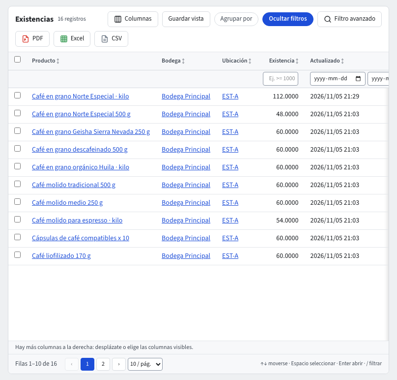

# Inventario y costos

El módulo **Inventario** lleva cuánto tienes de cada producto en cada bodega. El módulo **Costos** lleva cuánto vale. Cada entrada, salida, ajuste, traslado o conteo es un documento con número propio. Las existencias cambian solo a través de esos documentos, nunca a mano.

Los dos módulos tienen en su barra superior las secciones **Maestros**, **Documentos**, **Reportes** y **Parámetros**. Abrir, filtrar y exportar los listados funciona igual que en el resto del sistema (guía **Listados**). El ciclo de los registros (Guardar, Anular, Versiones) se explica en la guía **Maestros y documentos** (`maestros-y-documentos.md`).

Solo llevan existencias los productos de tipo **Bien**. Un movimiento que solo nombra servicios no mueve nada, y el sistema lo dice al guardarlo.

## Bodegas y ubicaciones

Están en **Inventario › Maestros**.

1. **Bodegas** › **Nuevo**: escribe el **Código** (por ejemplo `PRIN`) y el **Nombre**. **Dirección** es opcional.
2. **Permite existencias negativas**: si está apagado, se rechaza una salida que deje la bodega por debajo de cero.
3. **Ubicaciones** divide una bodega en estantes o zonas. Elige la bodega al crear la ubicación. Después ya no se puede cambiar.

La empresa tiene además una bodega de tránsito (código `TRANSITO`). El sistema la usa sola para los traslados despachados que aún no se reciben, y no aparece en las listas de los formularios.

## Lotes, seriales y seguimiento por producto

Un producto puede seguirse **por lote** (por ejemplo café con fecha de tostión y de vencimiento) o **por serial** (una unidad con su número, como un molino). Por defecto un producto no tiene seguimiento y todo funciona como siempre.

1. **Inventario › Parámetros › Seguimiento por producto** dice cómo se sigue cada producto: **Sin seguimiento**, **Por lote** o **Por serial**. Para un producto por lote hay tres opciones más:
   - **FEFO**: al vender sale primero el lote que vence antes.
   - **Vencimiento obligatorio**: un lote sin fecha de vencimiento se rechaza.
   - **Bloquea lotes vencidos**: un lote vencido no se vende.
2. Cambiar el seguimiento de un producto pide tu **código de verificación**. Solo se puede cuando el producto **no tiene existencias** en ninguna bodega. Si las tiene, sácalas primero con un ajuste y vuelve a entrarlas con su lote después del cambio. Cambiar solo FEFO, el vencimiento o el bloqueo no pide sacar nada.
3. **Inventario › Maestros › Lotes** lista los lotes. Cada lote es de **un solo producto**. Su **Código** es el que traes del proveedor o escaneas, y no se repite dentro del mismo producto (dos productos sí pueden tener el mismo código). Lleva **Vence**, **Producido** y una **Nota**. Un lote **Bloqueado** queda retenido y no se vende.
4. **Inventario › Maestros › Seriales** lista los seriales. Cada uno es una unidad de un producto por serial, con su número único dentro del producto y, si quieres, el lote al que pertenece. Su **Estado del serial** lo llevan los movimientos: **Disponible** cuando entra, **Despachado** cuando sale, **Dado de baja** en un ajuste. No se cambia a mano.

En las líneas de movimiento y en **Existencias** se ven las columnas **Lote** y **Serial**. Están vacías en los productos sin seguimiento.

### Lotes y seriales en entradas, salidas, traslados, ajustes y conteos

Las existencias de un producto con seguimiento se llevan **por lote** o **por serial** dentro de cada bodega y ubicación. Al elegir un producto con seguimiento en una línea aparece la columna **Lote / seriales**.

- **Entrada.** Un producto por lote pide el **Código del lote**. Si el código es nuevo, el lote se crea solo al guardar, con el **Vencimiento** que escribas; si el producto exige vencimiento, sin fecha no se guarda. Si el lote ya existe, la entrada se suma a él (el código no distingue mayúsculas). Un producto por serial pide **un serial por unidad**, separados por comas: 3 unidades, 3 seriales. Cada serial nuevo se registra solo y queda **Disponible**. Un serial que ya está disponible no vuelve a entrar.
- **Salida.** Indica el lote o los seriales que salen. Si el lote no tiene esa cantidad en la bodega y ubicación, la salida se rechaza, aunque la bodega permita existencias negativas. Un serial que no está en esa bodega y ubicación tampoco sale. El serial que sale queda **Despachado**; si vuelve con una entrada, queda **Disponible** otra vez.
- **Traslado.** Cada línea dice el lote o los seriales que viajan. Al despachar y al recibir se mueve el mismo lote o serial, también mientras está en tránsito.
- **Ajuste.** Sigue pidiendo tu código de verificación. Cada línea dice su lote o sus seriales. Un ajuste negativo de un serial lo deja **Dado de baja**. Un ajuste positivo con un serial nuevo lo registra y lo deja disponible.
- **Conteo.** Al crear el conteo, un producto con seguimiento sale en la hoja **una línea por lote o serial** con existencias en esa ubicación. Cuenta cada lote; en un serial pon 1 si lo encontraste y 0 si falta. Lo que encuentres y no esté en la hoja (un lote nuevo, un serial escaneado) se agrega al registrar el conteo, por ahora con el asistente. Al aplicar, cada diferencia es una línea del ajuste: un lote con 2 de menos, un lote nuevo con lo encontrado, un serial que falta con −1 (queda dado de baja).

Si la línea no dice el lote o los seriales, o los seriales no coinciden con la cantidad, el formulario lo dice al pie antes de guardar.

## Movimientos: entradas, salidas y ajustes

Ve a **Inventario › Documentos › Movimientos** › **Nuevo**.

1. Elige el **Tipo**:
   - **Entrada**: suma existencias. Cada línea lleva su **Costo unitario**.
   - **Salida**: resta existencias.
   - **Ajuste**: escribe la cantidad con signo (+ suma, − resta).
2. Elige la **Bodega**. Por cada línea, el **Producto** (escribe parte del código o del nombre), la **Ubicación** si la bodega tiene ubicaciones, y la **Cantidad**.
3. En un ajuste, escribe el **Motivo** (merma, sobrante, daño).
4. Pulsa **Guardar**. Al pie, el formulario dice qué falta.

Un **ajuste** te pide tu **código de verificación** (la app de autenticación) antes de guardarse. Contabilidad lo registra con el costo de cada producto. En el registro del ajuste, la pestaña **Contabilidad** muestra su comprobante.

Las entradas se numeran `EN-…`, las salidas `SA-…` y los ajustes `AJ-…`. Un movimiento guardado no se edita. Si hubo un error, usa **Anular** en la barra del registro.

## Transferencias entre bodegas

**Inventario › Documentos › Transferencias** › **Nuevo**.

1. Elige la **Bodega de origen**, la **Bodega de destino** (debe ser distinta) y las líneas con su cantidad.
2. Pulsa **Guardar**. El traslado queda **Solicitado** y todavía no mueve nada.
3. Cuando la mercancía sale, abre el traslado y pulsa **Despachar**. Las cantidades pasan a la bodega de tránsito y el traslado queda **En tránsito**.
4. Cuando llega, pulsa **Recibir**. Las cantidades entran a la bodega de destino y el traslado queda **Recibido**.

## Conteos físicos

**Inventario › Documentos › Conteos** › **Nuevo**: elige la bodega y los productos que vas a contar, y pulsa **Guardar**. El conteo guarda lo que el sistema tiene en ese momento.

1. En la **Hoja de conteo**, escribe lo **Contado** por línea y pulsa **Registrar conteo**. Puedes hacerlo por partes. La columna **Diferencia** muestra contado menos sistema.
2. Cuando todas las líneas estén contadas, pulsa **Aplicar conteo**. El sistema pide tu **código de verificación** y registra todas las diferencias como **un solo ajuste**.
3. El conteo queda **Aplicado** y enlaza a su ajuste. Abre el ajuste para ver su comprobante en la pestaña **Contabilidad**.

## Existencias

**Inventario › Reportes › Existencias** muestra cuánto hay de cada producto por bodega y ubicación, con la fecha del último cambio. Filtra por producto o bodega, o exporta a Excel. Los datos que tu rol no puede ver salen ocultos.

## Costos

El detalle del costeo (cómo se calcula el promedio ponderado, qué hace un costo en destino y cómo se resuelven los costos pendientes) está en la guía **Costos** (`costos.md`).

- **Costos › Reportes › Capas de costo**: el costo de cada entrada. Con el promedio ponderado, cada entrada recalcula el costo promedio del producto.
- **Costos › Reportes › Costos pendientes**: salidas de productos que aún no tienen costo, por ejemplo cuando sale mercancía antes de registrar su entrada. Se resuelven solas cuando llega la entrada. Mientras tanto, revisa esta lista antes de cerrar el mes.
- **Costos › Documentos › Costos en destino**: suma al costo de una entrada lo que se pagó después por traerla (flete, aranceles, seguro).
  1. Pulsa **Nuevo**.
  2. Elige la **Entrada de mercancía** y escribe el **Valor**.
  3. En **Repartir por**, elige **Valor** o **Cantidad**.
  4. Elige la **Contrapartida**. Si es una cuenta por pagar o un anticipo, elige también el **Proveedor**.
  5. Pulsa **Guardar**. Pulsar dos veces no lo registra dos veces.

  Anular un costo en destino pide tu código de verificación.
- **Costos › Parámetros › Costeo**: el **Método** de costeo de la empresa. Hoy es **Promedio ponderado**; PEPS (FIFO) llega en la fase 3, y el sistema lo rechaza si lo eliges. **Guardar** pide tu código de verificación.

## Preguntas frecuentes

- **«No encuentro la bodega de tránsito»**: no se elige en los formularios. La usan solo los traslados despachados.
- **«Aplicar conteo está gris»**: falta registrar lo contado en alguna línea.
- **«El ajuste no aparece en contabilidad»**: el comprobante se crea al guardar el ajuste. Si contabilidad aún no tiene cuentas para el inventario, el sistema lo rechaza y dice qué falta. Consulta la guía **Reglas contables**.
