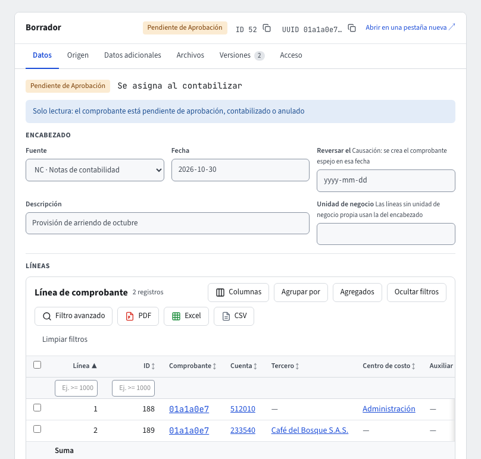
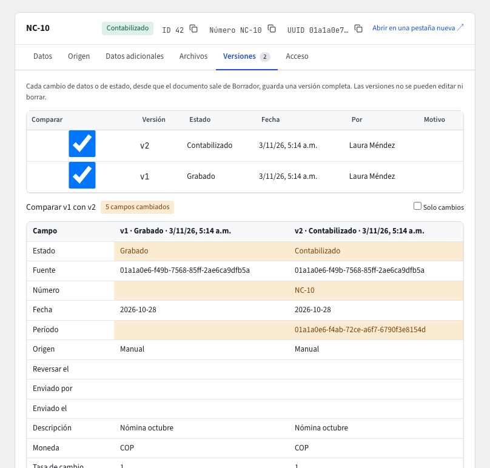

# Maestros y documentos: estados, guardar, aprobar y anular

Todo lo que registras en Goliatt es un **maestro** o un **documento**, y los dos funcionan igual en todos los módulos:

- Un **maestro** es un dato base que usan los documentos: un tercero, un producto, una categoría, una cuenta, un centro de costo.
- Un **documento** es un hecho del negocio con fecha: un comprobante contable (y, más adelante, facturas, pedidos y recibos).

Cada registro tiene la misma barra de acciones en la fila de sus pestañas (a la derecha; encima de ellas si no caben), el mismo pie con quién lo creó y lo modificó, y las mismas pestañas **Versiones** (documentos) y **Acceso** (solo administradores).

## El ID de cada registro

Cada maestro y cada documento recibe al crearse un **ID**: un número consecutivo por empresa y por tipo (1, 2, 3…) que nunca se repite ni se reutiliza. Aparece en el encabezado del registro junto al **UUID** (con un botón para copiarlo), en la columna **ID** de los listados y en la paleta **⌘K**: escribe el ID para encontrar el registro.

El ID no es el número legal del documento. Un comprobante recibe además su **Número** (por ejemplo NC-2026-0042) cuando se contabiliza; mientras no lo tiene, el ID lo identifica (por ejemplo en el asunto de un correo de **Notificar**).

## Los estados

| Estado | Qué significa |
|---|---|
| **Borrador** | Recién creado, sin revisar. Un documento en Borrador se puede eliminar. |
| **Grabado** | Revisado y completo. |
| **Pendiente de Aprobación** | Enviado a aprobación; no se edita. |
| **No Aprobado** | Devuelto con un motivo; se corrige y se vuelve a enviar. |
| **Aprobado** | Aprobado por alguien con el permiso. |
| **Contabilizado** | Solo documentos que contabilizan: ya está en la contabilidad. Un comprobante reversado se ve **Contabilizado · Revertido**. |
| **Anulado** | Solo documentos: anulado con un motivo; no cambia más. |

Si un tipo de registro requiere aprobación lo decide el administrador en **Parámetros › Configuración de tipos** (guía [Parámetros](parametros.md)). El valor se copia en cada registro al crearlo.

## Guardar y enviar a aprobación

- Si el tipo **no requiere aprobación**, solo ves **Guardar**. Guardar revisa el registro y lo deja **Grabado**. Un documento que contabiliza se contabiliza en ese mismo paso.
- Si el tipo **requiere aprobación**, ves **Guardar** y **Guardar y enviar a aprobación**. El segundo guarda y envía en un solo paso: el registro queda **Pendiente de Aprobación**. Si solo pulsaste **Guardar**, el registro queda **Grabado** y aparece **Enviar a aprobación** para enviarlo después.
- Si guardar funciona pero el envío no (por ejemplo, falta un dato que pide la aprobación), el aviso dice «Se guardó, pero no se envió a aprobación» con el motivo, y el registro sigue Grabado.

Si un documento no se puede contabilizar (período cerrado, descuadrado, un tercero que no se puede usar), **no se guarda nada**: el documento sigue en el estado que tenía y tus cambios siguen en el formulario. Corrige lo que dice el aviso y vuelve a intentarlo.

## Aprobar y No aprobar

En un registro **Pendiente de Aprobación**, quien tiene el permiso ve **Aprobar** y **No aprobar**:

1. **Aprobar** lo deja **Aprobado**. Un documento que contabiliza se contabiliza en el mismo paso; si no se puede, la aprobación no se hace y el documento sigue Pendiente.
2. **No aprobar** pide el **Motivo** (obligatorio). El registro queda **No Aprobado**, tal como estaba, y el motivo queda en su historial y en **Versiones**. Su autor lo corrige, guarda y lo envía otra vez.

Puede aprobar cualquier persona con el permiso, también quien creó o modificó el registro. Los comprobantes manuales pueden exigir que apruebe otra persona (guía [Comprobantes](contabilidad/comprobantes.md)).

Un **maestro Aprobado** se puede seguir editando. Si cambias un dato que requiere aprobación (en un tercero: el documento, el nombre, los datos tributarios), al guardar vuelve a **Pendiente de Aprobación**; el aviso lo dice antes de guardar. Mientras no esté aprobado otra vez, no se puede usar en documentos nuevos.

## Qué se puede cambiar en cada estado

- **Documento**: se edita en **Borrador**, **Grabado** y **No Aprobado**. En Pendiente, Aprobado, Contabilizado o Anulado es de solo lectura.
- **Maestro**: se edita en todos sus estados. Para dejar de usarlo, cambia **Activo** a «No»: conserva su historial y deja de ofrecerse en documentos nuevos.

Un maestro se puede usar en un documento cuando está **Activo** y **Aprobado** (o **Grabado**, si su tipo no requiere aprobación).

## Anular, Revertir y Eliminar

- **Anular** (documentos **Grabado**, **Pendiente de Aprobación**, **No Aprobado** o **Aprobado**): escribe el **Motivo de la anulación**. El documento queda **Anulado** y conserva su número, si tenía.
- **Revertir** (un comprobante **Contabilizado**): crea un comprobante nuevo con las líneas invertidas, con fecha y **Motivo de la reversión** (guía [Comprobantes](contabilidad/comprobantes.md)).
- **Eliminar**: un documento solo en **Borrador** (nunca tuvo número). Un maestro se elimina solo si nada lo usa; si algún documento lo usa, el sistema lo rechaza y te sugiere marcarlo **Activo = No**. Pide confirmación: «¿Eliminar este registro? Queda la entrada de auditoría.»

Antes de cambiar el estado, guarda tus cambios: con cambios sin guardar, los botones de estado dicen «Guarda los cambios antes de cambiar el estado».

## Más acciones de la barra

- **Nuevo** abre un registro vacío del mismo tipo.
- **Duplicar** (o **Ctrl+D**) abre uno nuevo con los datos de este (guía [Moverse por el sistema](navegacion.md)).
- **Imprimir** genera el PDF del registro con la plantilla de la empresa (guía [Plantillas PDF e Imprimir](plantillas-pdf.md)).
- **Notificar** envía ese PDF por correo; solo en documentos, desde que salen de Borrador (guía [Notificaciones por correo](notificaciones.md)).
- En pantallas angostas, las acciones que no caben pasan a **Más ▾**.

## El pie y la pestaña Versiones

El pie del registro dice **Creado en … por …**, **Modificado en … por …** y el **Estado**.

En un documento, la pestaña **Versiones** guarda una versión completa (encabezado, líneas y datos adicionales) cada vez que cambian sus datos o su estado, desde que sale de Borrador. Las versiones no se editan ni se borran.

1. Abre **Versiones**: ves la lista con la versión, el estado, la fecha, quién y el motivo (si lo hubo).
2. Marca dos versiones en **Comparar** para verlas lado a lado; **Solo cambios** deja solo los campos que cambiaron.

Un campo enmascarado u oculto para ti se muestra •••••••• en las dos versiones y **nunca** se marca como cambiado.

## Si algo no funciona

- «Otra persona cambió este registro mientras lo tenías abierto»: pulsa **Recargar** y vuelve a hacer tu cambio.
- No ves **Aprobar**, **Anular** o **Eliminar**: tu rol no tiene ese permiso, o una regla de **Acceso** del registro no te lo da (guía [Acceso por registro](acceso-por-registro.md)).
- El asistente también puede guardar, aprobar, no aprobar o anular por ti: siempre te muestra antes una tarjeta para confirmar, y no te ofrece cambiar un registro que no puedes modificar (guía [El asistente](asistente.md)).

## La pestaña Contabilidad de un documento

Un documento que contabiliza (una factura, una nota, un recibo, una entrada o salida de inventario, una entrega) muestra en su pestaña **Contabilidad** el comprobante que generó tal como se ve en la pestaña **Datos** del comprobante, en solo lectura: el **encabezado** (fuente, fecha, descripción, unidad de negocio) y la grilla de **líneas** (cuenta, tercero, centro de costo, débito y crédito, con la suma). Encima de cada comprobante van su número (enlace que lo abre en su propia pestaña) y su estado. Si el documento generó varios comprobantes (por ejemplo, el original y su reversión) se muestran uno debajo del otro; si generó más de cuatro, la pestaña los lista en una grilla.
