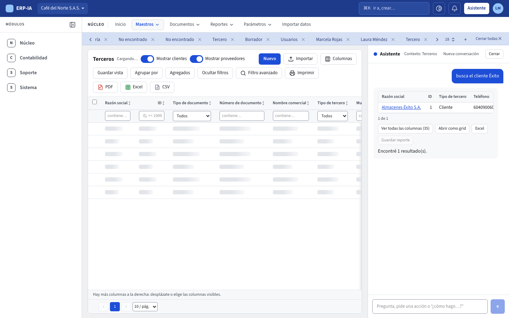

# Moverse por el sistema

Todas las pantallas de ERP-IA comparten el mismo marco: una barra azul oscura arriba, debajo la barra con las secciones del módulo, a la izquierda el **menú de módulos**, luego la fila de pestañas y, a la derecha, el panel del asistente.

## El menú de módulos (a la izquierda)

El menú lateral muestra solo los **nombres de los módulos** que tu empresa tiene y que tu rol puede usar (por ejemplo **Núcleo**, **Contabilidad**, **Soporte**). Al elegir un módulo, la barra de secciones muestra las suyas y se abre su primera pantalla, salvo que ya tengas una de ese módulo abierta en una pestaña. El módulo activo queda marcado.

- El botón de arriba del menú, **Contraer menú**, lo reduce a una franja de 60 px con el ícono de cada módulo (el nombre completo aparece al pasar el mouse); **Expandir menú** lo vuelve a abrir.
- Tu elección se recuerda en este navegador. Si nunca lo cambiaste, el menú empieza contraído en pantallas de menos de 1440 px de ancho y abierto en las más anchas.
- Por debajo de 1024 px el menú lateral desaparece y los módulos están en el botón **Menú** (ver «Menú en pantallas pequeñas»).

## La barra de arriba

De izquierda a derecha:

- **ERP-IA**: el nombre del sistema.
- **La empresa activa** (con una flecha ▾): abre la lista de tus empresas. La que está marcada con ✓ es en la que trabajas; cada una muestra su NIT. Elige otra para cambiar. Todo lo que ves (listados, registros, permisos) pertenece a la empresa activa, y cada empresa recuerda sus propias pestañas y su propio tema. **Agregar empresa** aparece desactivada: por ahora no se agregan empresas desde la pantalla.
- **La caja ⌘K**: abre la paleta de comandos (ver abajo).
- **El botón de tema**: alterna el aspecto.
- **La campana**: las notificaciones. El número sobre la campana aparece solo cuando hay algo sin leer; por ahora siempre dice «Sin novedades».
- **Asistente**: abre o cierra el panel del asistente (también con **Ctrl+/**, o **⌘/** en Mac).
- **Tu usuario** (el círculo con tus iniciales): muestra tu nombre, correo y roles, permite cambiar el tema y tiene la opción **Salir**.

Una opción o un módulo solo aparece si tu empresa lo tiene habilitado y tu rol puede usarlo.

## Las secciones de cada módulo

Debajo de la barra azul está la **barra de secciones** del módulo activo: en todos los módulos son las cuatro secciones **Maestros ▾ · Documentos ▾ · Reportes ▾ · Parámetros ▾**, más alguna opción propia del módulo; por ejemplo en Núcleo **Inicio · Maestros ▾ · Documentos ▾ · Reportes ▾ · Parámetros ▾ · Importar datos**. La sección de la pantalla en que estás aparece subrayada. **Inicio** está siempre en el primer módulo. Cada módulo ordena sus pantallas en las mismas cuatro secciones, para que encuentres todo en el mismo lugar:

- **Maestros**: los datos base que usan los documentos. En Núcleo, **Productos** y **Categorías**; en Contabilidad, **Terceros**, el **Plan de cuentas**, los **Centros de costo**, las **Fuentes**, las **Plantillas de comprobante** y los demás maestros. (Si tu empresa no tiene Contabilidad, **Terceros** queda en Núcleo.)
- **Documentos**: los documentos del negocio. En Contabilidad, los **Comprobantes**.
- **Reportes**: las consultas e informes. En Contabilidad, **Movimientos** e **Informes**.
- **Parámetros**: la configuración del módulo. En Contabilidad, **Períodos** y **Reglas contables**.

Haz clic en una sección para ver sus opciones y elige una. Si una sección todavía no tiene pantallas, al abrirla dice «Aún no hay elementos en esta sección». Cuando una opción tiene algo pendiente (por ejemplo **Reglas contables** con eventos por contabilizar), el número aparece junto a la opción y también junto al nombre de su sección.

## Opciones restringidas

El administrador de la empresa puede ocultar una sección o una opción del menú a un rol o a un usuario. Si la ocultó para ti:

- No la ves en la barra, en el menú de pantallas pequeñas ni en la paleta **⌘K**, y el asistente tampoco puede usarla por ti.
- Si llegas a su dirección por otro camino (un enlace, una pestaña guardada o escribiéndola), ves la pantalla **Sin acceso**: «No tienes acceso a esta pantalla», con el botón **Volver al inicio**. Si la necesitas, pídesela al administrador.
- Ocultar una sección oculta todas sus opciones. Estas reglas solo quitan opciones: nunca te dan acceso a algo que tu rol no puede usar, y a los administradores de la empresa nunca se les aplican.
- Lo que hace esa pantalla tampoco se puede hacer desde otro lugar. Por ejemplo, si **Períodos** está oculta para ti, no puedes cerrar ni reabrir el año. Si **Terceros** está oculta, no puedes importar terceros desde ningún listado.
- **Importar datos** es distinta: si la ocultan, solo desaparece esa pantalla. Puedes seguir importando desde el botón **Importar** de cada listado que sí ves.

## Las pestañas

Cada pantalla que abres queda en una pestaña de la fila que está debajo de la barra azul.

- **Inicio** es fija: no se cierra.
- Al abrir una opción del menú se abre su pestaña. Si ya estaba abierta, el sistema te lleva a ella en lugar de abrir otra.
- Al hacer clic en una fila de un listado, el registro se abre en una pestaña propia con el nombre del registro. **Nuevo** abre una pestaña «Crear …» con el formulario vacío.
- Si el registro no existe o tu rol no tiene acceso a él (por ejemplo, un proveedor cuando tu rol solo ve clientes), la pestaña dice «No encontrado» y la página explica «No encontramos este registro o no tienes acceso a él», con el botón **Volver al inicio**.
- La **✕** de cada pestaña la cierra. Al cerrar la pestaña activa pasas a la vecina.
- El botón **+** abre la paleta de comandos para elegir la pantalla de una pestaña nueva.
- **Cerrar todas ✕** (a la derecha, solo aparece si hay pestañas que cerrar) cierra todas menos Inicio. Antes pide confirmación y te dice cuáles se cerrarán: «Los formularios sin guardar se perderían».
- Si las pestañas no caben en el ancho, la fila se desplaza de lado y la pestaña activa siempre queda a la vista; **+** y **Cerrar todas ✕** se quedan fijos a la derecha.
- Se mantienen hasta 30 pestañas; si abres más, se cierran las más antiguas.

Tus pestañas se guardan en tu usuario, por empresa: al volver a ingresar, o desde otro computador, encuentras las mismas.

## Duplicar un registro

Para crear un registro parecido a uno que ya existe (un tercero de la misma cadena, un producto en otra presentación, una categoría con los mismos impuestos), ábrelo y pulsa **Duplicar** en la barra de acciones del registro, junto a **Nuevo** e **Imprimir** (en pantallas de menos de 768 px, dentro de **Más ▾**), o usa **Ctrl+D** (en Mac, **⌘D**) mientras el registro está abierto.

- Se abre la pestaña «Crear …» con el formulario lleno con los datos **guardados** del registro de origen (lo que estabas cambiando sin guardar no pasa a la copia), y un aviso **«Copia de <nombre>»** con un enlace al original.
- Quedan vacíos los datos que identifican al registro, para que escribas los del nuevo: en un tercero, el **número de documento** y su **DV**; en un producto, el **código interno (SKU)**; en una categoría, el **nombre**; un ticket de soporte se copia al formulario **Nuevo ticket** y queda **Abierto**. El **ID** consecutivo, el estado DIAN y «Listo para facturar» se calculan de nuevo al crear.
- No se copian los **contactos**, las **fotos** ni los **archivos**: quedan en el registro de origen.
- Solo se copia lo que tu rol puede ver, y de los datos adicionales solo los que tu rol puede ingresar: un campo enmascarado u oculto para ti (por ejemplo, el cupo de crédito) queda vacío en la copia.
- Revisa y pulsa **Crear**. La copia pasa por las mismas validaciones, permisos y código de verificación que un registro nuevo: si dejas vacío el número de documento, o escribes el de un tercero que ya existe, el sistema lo rechaza igual.
- **Duplicar** aparece solo si tu rol puede crear registros de ese tipo. Mientras escribes en un cuadro de texto, o con una ventana abierta encima, **Ctrl+D** no duplica. Si sales del formulario de la copia sin guardarla, la copia se descarta: al volver, el formulario está vacío. La auditoría muestra el nuevo registro con «clonado desde <nombre del original>».

## La paleta de comandos (⌘K)

Pulsa **⌘K** (en Windows y Linux, **Ctrl+K**) o haz clic en la caja de la barra. Se abre una ventana para escribir:

1. Escribe parte del nombre de lo que buscas. Por ejemplo «terc», «productos» o «ticket». También encuentra por palabras relacionadas («clientes», «proveedores», «nit», «iva», «ayuda») y no distingue tildes ni mayúsculas.
2. Verás dos tipos de resultados: **Ir a …** (abre esa pantalla) y **Crear …** (abre la pantalla con el formulario de un registro nuevo; solo aparece para lo que tu rol puede crear: tercero, producto, categoría de producto, ticket de soporte).
3. Muévete con **↑ ↓**, ejecuta con **Enter** y cierra con **Esc**.

**Buscar por ID.** Cada maestro y documento tiene un **ID** consecutivo (guía [Maestros y documentos](maestros-y-documentos.md)). Escribe el número, «ID 123» o «#123» y la paleta lista los registros con ese ID que puedes ver (un tercero, un comprobante…); elige uno para abrirlo.

Si lo que escribes no coincide con nada, o es una frase de tres palabras o más, el primer resultado es **Preguntar al asistente: «…»**. Al elegirlo se abre el panel del asistente y tu frase se le envía como pregunta (ver [El asistente](asistente.md)).

## La barra de acciones de un registro

Todo maestro y todo documento tiene arriba la misma barra: **Nuevo**, **Duplicar**, **Imprimir**, **Notificar** (solo documentos) y los botones de su estado: **Guardar**, **Guardar y enviar a aprobación**, **Aprobar**, **No aprobar**, **Anular**, **Revertir**, **Eliminar**. Solo aparecen los que corresponden al estado del registro y a tu rol. Al final de la barra, junto a **Guardar** y **Eliminar**, está **Cerrar**: cierra la página y su pestaña y te lleva al listado. Si hay cambios sin guardar, pide confirmar antes de descartarlos. Qué hace cada uno está en [Maestros y documentos](maestros-y-documentos.md).

## El tema: claro, oscuro o automático

El botón de tema de la barra (y la opción **Tema** del menú de tu usuario) va cambiando en este orden: **Automático** (sigue al sistema operativo), **Claro** y **Oscuro**. El cambio se aplica al instante y se guarda para tu usuario en cada empresa.

## El panel del asistente

El botón **Asistente** abre o cierra un panel a la derecha. Muestra el contexto de la pantalla en que estás y la conversación con el asistente; cerrarlo no la pierde. Cómo usarlo está en [El asistente](asistente.md).

En pantallas angostas (menos de 1280 píxeles de ancho, como un portátil de 1366 con la ventana reducida) el panel se abre cerrado, para no quitarle espacio a los formularios; en pantallas anchas se abre abierto. Cuando lo abres o lo cierras tú, el sistema lo recuerda para tu usuario y tu empresa, y esa elección manda sobre el ancho de la pantalla.

**Ctrl+/** (en Mac, **⌘/**) hace lo mismo desde cualquier pantalla: si el panel está cerrado lo abre con el cursor listo en la caja para escribir; si está abierto lo cierra y el cursor vuelve a la pantalla.

## Usar el teclado

- **Saltar al contenido**: la primera vez que pulsas **Tab** en una pantalla aparece arriba a la izquierda el enlace «Saltar al contenido». Pulsa **Enter** y el cursor pasa directo a la pantalla, sin recorrer la barra ni las pestañas.
- El elemento que tiene el cursor siempre se ve con un borde azul.
- **⌘K** o **Ctrl+K** abre la paleta de comandos; **Ctrl+/** o **⌘/** abre o cierra el asistente.
- **La fila de pestañas** es una sola parada de **Tab** (la pestaña activa). Con **← →** pasas de una pestaña a otra, **Enter** la abre y **Supr** (Delete) cierra la que tiene el cursor (Inicio no se cierra); el cursor queda en la pestaña vecina. La ✕ de cada pestaña sigue funcionando con el mouse.
- **Ctrl+D** (en Mac, **⌘D**) en un registro abierto lo duplica (ver «Duplicar un registro»), en lugar de agregar la página a los favoritos del navegador.
- **Las pestañas de un registro** (Datos, Contactos, Fotos, Datos adicionales, Archivos, Versiones, Acceso) se recorren con **← →**, e **Inicio** y **Fin** van a la primera y la última. El título del registro y sus pestañas quedan siempre visibles arriba mientras bajas por un formulario largo.

## Llenar un formulario con el teclado

Los formularios de Terceros, Productos y Categorías se recorren sin soltar el teclado:

- **Enter** pasa al campo siguiente y **Mayús+Enter** vuelve al anterior. Ni en el último campo guarda: el cursor se queda donde está. Los campos calculados (DV, nombre para documentos, margen) se saltan. En una caja de texto de varias líneas, **Enter** escribe un salto de línea.
- **Ctrl+Enter** (en Mac, **⌘Enter**) o **Ctrl+S** guardan desde cualquier campo. Si una caja de búsqueda tiene la lista abierta con una opción marcada, primero elige esa opción y guarda con ella; un texto a medio escribir que no coincide con nada se descarta.
- **Ver códigos DIAN**, arriba a la derecha del formulario, muestra u oculta los nombres técnicos de la DIAN junto a las etiquetas («DANE», «schemeName»…) y los códigos delante de los nombres de las listas («05001 · Medellín»). Empieza apagado para que el formulario sea compacto; tu elección se recuerda para tu usuario y tu empresa en todos los formularios. Los textos de ayuda que no son códigos (por ejemplo «máx. 450») se ven siempre.
- **Proveedor principal** de un producto también se recorre con **Enter**; su lista se abre al llegar, pero **Enter** o **Tab** solo eligen una fila después de que escribes o pulsas **↑ ↓**, así que pasar de largo no elige a nadie.
- **Departamento**, **Municipio**, **Unidad de medida** y **Categoría** son cajas de búsqueda: escribe parte del nombre (o del código) sin preocuparte por las tildes («medellin» encuentra «Medellín»), muévete por la lista con **↑ ↓**, elige con **Enter** o **Tab**, y **Esc** cierra la lista y deja lo que estaba elegido. Si borras el texto y sales de la caja, el valor queda vacío.
- Los valores que el sistema calcula (el **DV**, el **Nombre para documentos**, el **Margen**, el **Código estándar** cuando es tu código interno) se pueden leer, seleccionar y copiar: el botón de copiar al lado los lleva al portapapeles y avisa «Copiado».

## Menú en pantallas pequeñas y opciones de más

- **En pantallas de menos de 1024 px** (tabletas y teléfonos) el menú lateral se oculta y los módulos y las opciones del módulo se abren desde el botón **Menú**: una hoja con los **Módulos** y las opciones del módulo activo, con las secciones (**Maestros**, **Documentos**, **Reportes**, **Parámetros**) ya desplegadas; una sección sin pantallas dice «Aún no hay elementos en esta sección». Tocar una opción te lleva allí y cierra la hoja.
- **En pantallas anchas**, las opciones que no caben en la barra de secciones pasan, en el mismo orden, al menú **Más ▾** al final de la barra. El ⌘K, el tema, las notificaciones, el **Asistente**, tu usuario y el selector de empresa nunca se desplazan; un nombre de empresa largo se recorta y su nombre completo aparece al pasar el mouse.
- Las opciones que están directamente en la barra (Inicio, Importar datos, Soporte) son **enlaces**: con **⌘/Ctrl+clic** o el botón del medio se abren en otra pestaña del navegador.
- **Pestañas.** Una pestaña de registro lleva el nombre de su tipo (por ejemplo **Comprobante**) y, si abres un registro, el módulo de la barra sigue siendo el suyo. Si una página te redirige a otra, la pestaña se reemplaza en vez de quedar dos.
- **⌘K.** Solo ofrece **Crear …** para los registros que se crean desde su listado (Crear comprobante, Crear tercero…). Las demás creaciones («desde plantilla», reversar, apertura) están en su propia pantalla.
- **Cambios sin guardar.** Un formulario con cambios muestra **Cambios sin guardar** junto al título del registro (y un punto en su pestaña). Al cambiar de pantalla, cerrar su pestaña, cambiar de empresa o salir, el sistema pregunta **Guardar · Descartar · Cancelar**; **Cancelar** te deja donde estabas con lo escrito. Al recargar la página o cerrar el navegador pregunta el propio navegador. Lo que escribes no se guarda en el navegador: solo vive en la pantalla abierta.
- **Pantallas táctiles.** Con puntero táctil o por debajo de 768 px, los botones de la barra y el cierre de las pestañas miden al menos 44 px.
