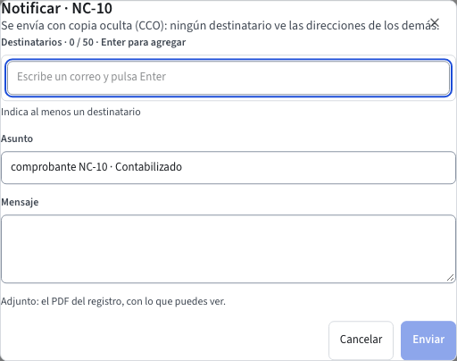

# Notificaciones por correo y Notificar

Goliatt envía por correo el PDF de un documento de dos maneras: **automáticamente**, cuando el documento entra en un estado que tiene destinatarios, y **a mano**, con el botón **Notificar** del documento.

## Notificar un documento

1. Abre el documento. **Notificar** está en la barra de acciones desde que el documento sale de Borrador («Guarda el documento para poder enviarlo»). Los maestros no tienen Notificar.
2. Pulsa **Notificar**. Se abre **Notificar · <documento>**:
   - **Destinatarios**: ya trae los correos configurados para el estado actual del documento. Escribe un correo y pulsa **Enter** para agregarlo (máximo 50); la **✕** lo quita. Un correo mal escrito se marca y no deja enviar hasta que lo corrijas o lo quites.
   - **Asunto**: por defecto «<tipo> <número> · <estado>»; si el documento aún no tiene número, lleva su **ID**. Puedes cambiarlo (máximo 300 caracteres).
   - **Mensaje**: el texto del correo; puedes cambiarlo.
3. Pulsa **Enviar**. El aviso dice «Enviado a N destinatarios en copia oculta».

El correo lleva adjunto el PDF del documento con la plantilla predeterminada (guía [Plantillas PDF e Imprimir](plantillas-pdf.md)), con lo que **tú** puedes ver: un campo oculto para tu rol sale vacío.

Se envía siempre **con copia oculta (CCO)**: ningún destinatario ve las direcciones de los demás.

## Avisos automáticos por estado

El administrador define en **Parámetros › Destinatarios por estado** a quién se le envía el PDF cuando un documento entra en cada estado (por ejemplo, a tesorería cuando un comprobante queda **Aprobado**). Desde entonces, cada vez que un documento entra en ese estado el sistema envía su PDF a esa lista, en copia oculta, con los permisos de quien hizo el cambio. Sin lista, no se envía nada. Los pasos están en la guía [Parámetros](parametros.md).

## Cada envío queda registrado

Cada correo, a mano o automático, queda en el registro de envíos con los destinatarios, la plantilla y su versión, el asunto y el resultado (en cola, enviado o fallido). Si un envío falla, el aviso «No se pudo enviar» dice el motivo; vuelve a intentarlo con **Notificar**.

## Desde el asistente

Puedes pedir «envía por correo el comprobante NC-2026-0042 a tesoreria@empresa.co». Enviar un correo sale del sistema, así que el asistente **siempre** te muestra primero una tarjeta con los destinatarios para que la confirmes; no envía nada hasta que pulses **Confirmar** (guía [El asistente](asistente.md)).

## Si algo no funciona

- **Notificar** está desactivado: el documento está en Borrador. Guárdalo primero.
- No ves **Notificar**: tu rol no tiene el permiso «Notificar por correo», o el registro es un maestro.
- «Indica al menos un destinatario»: agrega un correo y pulsa **Enter** antes de enviar.
