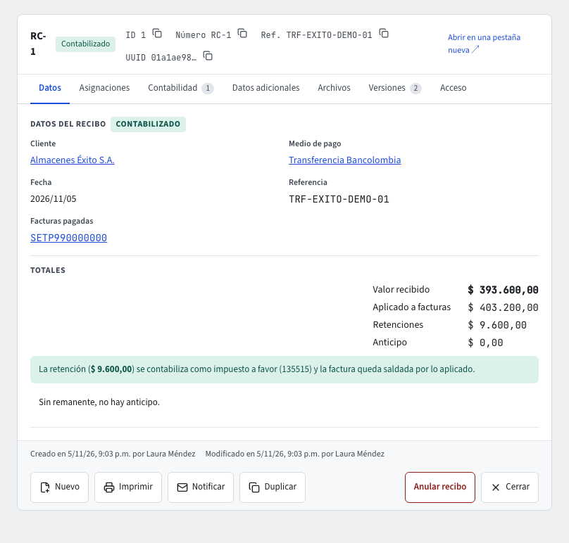

# Pagos de clientes: el recibo de caja

Cuando un cliente te paga, registras un **recibo de caja**. Vive en **Pagos › Documentos › Recibos de caja**. En una sola operación, el sistema revisa el pago, lo aplica a las facturas que indicas, le da su número (**RC-1**, **RC-2**…) y lo **contabiliza**: la caja o el banco del medio de pago, las retenciones que el cliente te practicó, la cuenta por cobrar de cada factura y, si sobra dinero, un anticipo del cliente. Si algo de eso no se puede hacer, el recibo no se registra y nada cambia: ni el número, ni las facturas, ni la contabilidad.

En el listado **Recibos de caja** ves cada recibo con su número, el cliente, la fecha, el valor y el estado (**Contabilizado** o **Anulado**); los filtros rápidos muestran solo los de un estado, y puedes exportar el listado o imprimirlo (guías **Listados** y **Exportar**). **Nuevo** abre el formulario **Registrar pago**. También puedes pedir al **asistente** (guía **El asistente**) que registre o anule un recibo: te muestra una tarjeta con el cliente, el valor, las facturas y las retenciones, y solo lo registra cuando la confirmas.

## Antes de empezar: medios de pago y cajas

En **Pagos › Maestros › Medios de pago** está cada forma en que te pagan: efectivo, transferencia, tarjeta, cheque u otro. Cada medio tiene:

- un **código** y un **nombre** que tú escoges (por ejemplo `BANCOLOMBIA`, «Transferencia Bancolombia»);
- un **tipo** (efectivo, transferencia, tarjeta, cheque u otro), que decide la cuenta donde entra el dinero. El plan de cuentas de Colombia ya trae: efectivo y cheque a **110505 Caja general**, transferencia y tarjeta a **111005 Bancos, moneda nacional**. Si quieres otra cuenta para un tipo, cámbiala en **Contabilidad › Mapeo de cuentas** (rol **Caja**, con la dimensión `payment_method:<tipo>`, por ejemplo `payment_method:transfer`; guía **Reglas contables**). Confirma estas cuentas con tu contador. Un medio de tipo **Otro** (bonos, por ejemplo) no tiene cuenta asignada: el sistema no le recibe pagos, para que nada llegue a la caja sin que nadie lo haya decidido;
- su **código DIAN de medio de pago**: el sistema solo acepta un código de la tabla de la DIAN y que corresponda al tipo (efectivo 10; transferencia 42 o 47; tarjeta 48 crédito o 49 débito; cheque 20; otro 1, 71 o ZZZ);
- **Activo**: un medio inactivo no se puede usar en recibos nuevos.

El código de un medio no se repite en la empresa (sin importar mayúsculas). Cada medio se crea con **Nuevo** en su listado y se guarda con **Guardar**. En **Pagos › Maestros › Cajas** registras las cajas donde recibes efectivo; un recibo puede indicar en qué caja entró el dinero, solo si su medio de pago es de efectivo.

## Qué pide un recibo de caja

1. **El cliente**: debe estar **Listo para facturar** (guía **Terceros**). Si no lo está, el sistema te dice qué le falta (datos DIAN, archivos, aprobación o que esté inactivo).
2. **El medio de pago**, y si quieres la **caja**, la **referencia** (número de consignación, voucher o cheque) y la **fecha** (si no la das, es la de hoy; no puede ser posterior a hoy).
3. **El valor recibido**: el dinero que entró.
4. **Las facturas que paga**, cada una con el **valor que se le aplica** y, si el cliente te practicó retenciones sobre ella, cada **retención** con su tipo (retención en la fuente, de IVA o de ICA), el concepto del certificado, la tarifa, la base y el valor.

## Registrar pago, paso a paso

1. En **Recibos de caja**, pulsa **Nuevo**.
2. Busca el **cliente**. Un cliente que no está listo para facturar aparece deshabilitado con lo que le falta (por ejemplo «Faltan datos DIAN: Dirección»).
3. Escoge el **medio de pago**. Si es de efectivo, aparece **Caja** para indicar dónde entró el dinero. Escribe la **fecha** (hoy o antes), la **referencia** y el **valor recibido**.
4. En **Facturas del cliente** ves sus facturas abiertas con la fecha, el vencimiento, el total y el **saldo**. Las que todavía no se pueden pagar aparecen con la marca **No se puede pagar** y el motivo (por ejemplo «La DIAN aún no ha aceptado la factura»).
5. En cada factura que paga, escribe lo que le **aplicas** (o pulsa **Saldo completo**). Si el cliente te practicó una retención sobre ella, pulsa **Retención** y completa el tipo, el código del certificado, la **tarifa %** y la **base**: el **valor** se calcula solo y puedes corregirlo con el del certificado.
6. Abajo ves los **totales** mientras escribes: lo aplicado a las facturas, las **retenciones**, el **efectivo aplicado** y el **anticipo** (lo recibido que no se aplica). Si el valor recibido no alcanza para el efectivo aplicado, el formulario te lo dice.
7. Pulsa **Registrar pago**. El recibo queda numerado y **Contabilizado** en ese momento. Si algo no se puede (el cliente dejó de estar listo, una factura cambió de saldo, el periodo está cerrado), el formulario te muestra el motivo y nada se registra.

## El recibo registrado

El recibo muestra en **Datos** el cliente, el medio de pago, la caja, la fecha y la referencia (el cliente, el medio, la caja y cada factura abren su propio registro), los totales y una nota de lo que hizo la contabilidad: la retención como impuesto a favor (135515) y, si sobró dinero, el anticipo (280505). La pestaña **Asignaciones** lista lo aplicado a cada factura (valor, retenciones y efectivo) y las retenciones del cliente con su código, tarifa y base. La pestaña **Contabilidad** muestra su comprobante. **Imprimir** genera el recibo con la plantilla de la empresa (guía **Plantillas PDF**).

Cada factura pagada muestra, en sus datos, los **Recibos de caja** que la pagaron, con un enlace a cada uno.

Si tu rol no puede ver los valores de las facturas (número, total o lo ya pagado, acreditado o debitado), **Registrar pago** no lista las facturas abiertas del cliente y avisa que no tienes permiso: el sistema no muestra por esa vía lo que tu rol tiene oculto. Pide al administrador que te dé acceso a esos campos de la factura (guía **Administración**).

## Qué factura se puede pagar

El sistema acepta una factura solo si:

- es del **mismo cliente** del recibo;
- está **emitida** (no en borrador) y **aceptada por la DIAN**. Una factura sin enviar, en proceso o rechazada todavía no recibe pagos: regístralo cuando la DIAN la acepte (guía **Facturación electrónica**);
- **no está anulada** ni tiene una **nota crédito de anulación en curso** (la anulaste y la DIAN aún no responde);
- está en **pesos** (los pagos de facturas en moneda extranjera llegan en una fase posterior);
- tiene fecha **igual o anterior** a la del recibo;
- y el valor aplicado **no supera su saldo**: el total de la factura, más sus notas débito, menos sus notas crédito y menos lo que otros recibos ya le aplicaron. El mensaje te dice el saldo exacto, por ejemplo «tiene un saldo de $ 119.000,00».

Puedes pagar una factura en varios recibos (abonos) y un recibo puede pagar varias facturas del cliente; cada factura va una sola vez en el recibo. Si dos personas registran a la vez pagos de la misma factura, el sistema las atiende una tras otra: nunca se aplica más que el saldo.

## La factura pagada

Cuando los recibos de una factura cubren todo lo que debe (su total, más sus notas débito, menos sus notas crédito), la factura pasa a la etapa **Pagada** y muestra el **valor pagado**. Con abonos, la factura sigue **Emitida** con lo pagado hasta ahora y su saldo baja; el último abono la deja **Pagada**. Las retenciones que el cliente practicó cuentan como pagadas: la factura queda saldada por el valor completo. Si la factura vino de una oportunidad del CRM (por su cotización y su pedido), la oportunidad registra una actividad «Factura … pagada» (guía **CRM**).

Una factura pagada sale del cupo de crédito del cliente (guía **Pedidos**) y de la cartera por edades (guía **Cartera por edades**). Si anulas un recibo, sus facturas recuperan el saldo y vuelven a **Emitida**.

## Retenciones: el cliente paga menos, la factura queda saldada

Si el cliente te retiene, te paga menos dinero pero la factura queda saldada por el **valor completo**. Ejemplo: una factura de $ 119.000,00 a la que el cliente le practicó retención en la fuente del 2,5 % sobre la base de $ 100.000,00 ($ 2.500,00). Registras el recibo con **valor recibido** $ 116.500,00 y, en la factura, **valor aplicado** $ 119.000,00 con la retención de $ 2.500,00. El asiento queda:

- Débito **Bancos** (o la caja del medio) $ 116.500,00;
- Débito **Anticipo de impuestos: retención en la fuente** (135515) $ 2.500,00, con el concepto, la tarifa y la base;
- Crédito **Clientes nacionales** (130505) $ 119.000,00.

El valor de cada retención debe ser la base por la tarifa (se admite hasta $ 0,50 de diferencia, el redondeo al peso), y las retenciones de una factura no pueden superar lo que se le aplica. Si el valor recibido no alcanza para el efectivo aplicado a las facturas, el recibo se rechaza.

## Anticipos: lo que sobra

Si el valor recibido es mayor que lo que se aplica en efectivo a las facturas, la diferencia queda como **anticipo del cliente** (crédito a **280505 Anticipos y avances recibidos de clientes**). Un recibo sin facturas es todo anticipo. El cruce de un anticipo con facturas futuras llega en una próxima entrega.

## La contabilidad y el periodo

El recibo se contabiliza en el mismo momento (diario **RC**, recibos de caja), con el cliente como tercero. Si el periodo de la fecha está **cerrado**, o la contabilidad no puede tomar el asiento, el recibo **no se registra** y te dice por qué. Si la empresa aún no inició su contabilidad (fecha de inicio), el recibo se rechaza. Si la empresa no usa el módulo de contabilidad, el recibo se registra y su asiento queda pendiente hasta que la active.

**Pendiente de contabilizar.** Si la empresa eligió el modo de contabilización **Asíncrona con reintentos** (guía **Reglas contables**), el recibo de caja se guarda antes de que su comprobante exista y su ficha muestra la insignia **Pendiente de contabilizar** hasta que el sistema lo registre; si el registro falla, la insignia dice **Contabilización fallida · ver pendientes** y lleva a **Pendientes de contabilizar**. Con la contabilidad apagada la insignia dice **Contabilidad desactivada**, y sin el módulo contratado, **Módulo contable no contratado**. En el modo por defecto, **Inmediata y estricta**, esta insignia no aparece: sin comprobante no hay documento.

Si un administrador modificó la regla contable **Recibo de caja** de su empresa, esa regla se conserva tal como la dejó. La regla del sistema incluye la línea de **anticipos**; una regla modificada antes de esta versión no la tiene, y un recibo con anticipo se rechaza como **descuadrado** hasta que el administrador la agregue (guía **Reglas contables**).

Si repites la misma solicitud (por ejemplo, el formulario se envió dos veces), el sistema reconoce que es el mismo pago y responde con el recibo ya registrado: nunca lo registra dos veces.

## Anular un recibo

Un recibo registrado no se edita. Si hubo un error (la consignación se devolvió, el valor estaba mal), **anúlalo** y registra uno nuevo si hace falta. En el recibo, pulsa **Anular recibo**: la ventana te explica qué se revierte y qué facturas vuelven a deberse; escribe el **motivo de la anulación** y pulsa **Anular recibo**. Anular pide tu **código de verificación** (guía **Ingresar y verificación en dos pasos**). Al anular:

- el recibo queda **Anulado** (nunca se borra) con su motivo;
- las facturas **recuperan el saldo** que el recibo les había aplicado (una factura **Pagada** vuelve a **Emitida**);
- su asiento se **revierte** en la misma operación, con la fecha de la anulación (hoy, si no indicas otra; no puede ser anterior al recibo). Si el periodo de esa fecha está cerrado, la anulación se rechaza y el recibo sigue como estaba.

Un recibo anulado no se puede volver a anular.

**Duplicar** un recibo copia solo el cliente, el medio de pago y la caja: el valor, la referencia y las facturas se indican de nuevo y el sistema revisa todo al registrarlo. Duplicar un medio de pago o una caja copia sus datos menos el código, que escribes de nuevo.

La pestaña **Documentos relacionados** del recibo muestra la factura que pagó y los documentos de donde viene; un recibo anulado sigue en la lista, tachado y con la etiqueta **Anulado** (guía **Documentos relacionados**).
