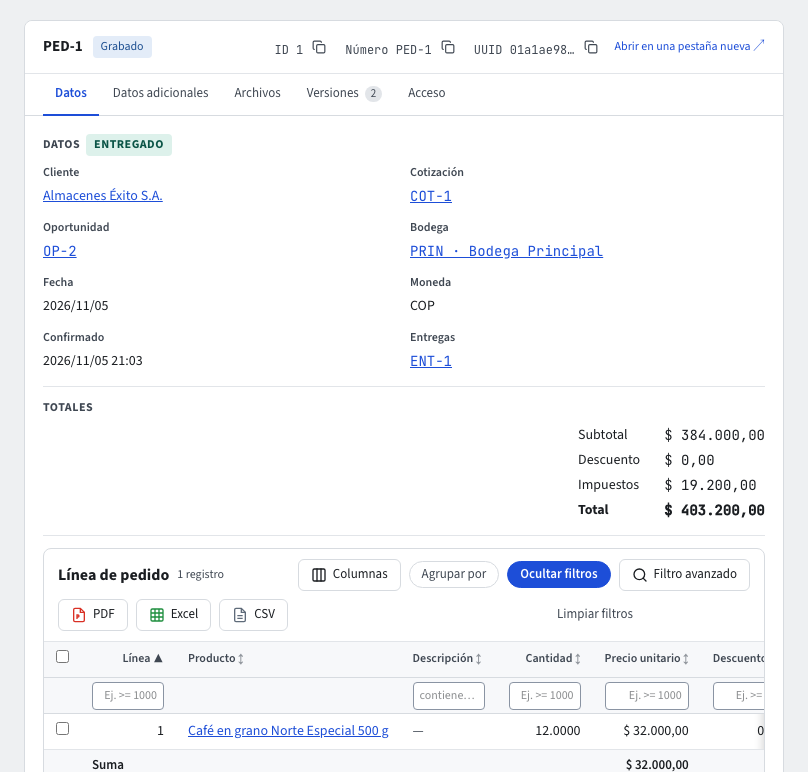

# Pedidos de venta

Un **pedido** es lo que un cliente te compró en firme: el producto, la cantidad, el precio, el descuento y los impuestos de cada línea. Vive en **Ventas › Documentos › Pedidos**, se numera `PED-…` al grabarlo y no genera asientos contables (los genera la factura). Al **confirmarlo** se reservan sus existencias en la bodega.

El listado de **Ventas › Documentos › Pedidos** muestra el número, el cliente, las fechas, la etapa (**Abierto**, **Confirmado**, **Entregado en parte**, **Entregado**, **Cancelado**), el total y el estado. **Nuevo** abre **Crear pedido**; un clic en el número abre el pedido. Todo esto también lo puedes pedir al **asistente** (guía **El asistente**).

## Crear un pedido

En **Crear pedido** indica el **Cliente**, la **Bodega** de donde saldrá la mercancía, la **Entrega prometida** (la fecha en que la prometiste al cliente) si la conoces, y las líneas (producto y cantidad). El precio de cada línea sale igual que en una cotización (guía **Ventas: precios y condiciones comerciales**): la lista de precios del cliente, la predeterminada o el precio de lista; un precio escrito a mano gana. Si no escribes descuento, se aplica el descuento habitual del cliente. Los impuestos (IVA, INC) y los totales los calcula el sistema con las reglas de Colombia. Pulsa **Guardar** en la barra de acciones.

El pedido grabado muestra sus **Datos** (el cliente, la cotización, la oportunidad y la bodega son enlaces a su ficha; si el cliente tiene cupo y tu rol ve sus datos comerciales, puede consultar facturas y puede reasignar pedidos (así el cálculo incluye los pedidos de todos los vendedores), también **Límite de crédito · Disponible**: el cupo menos lo que sus pedidos confirmados aún no tienen facturado y lo que sus facturas emitidas aún deben), la etapa, los **Totales**, sus líneas y sus **Entregas**. **Editar** vuelve al formulario mientras el pedido está abierto; **Imprimir** (en la barra) genera su PDF con el membrete de la empresa. **Duplicar** crea un pedido nuevo con el mismo cliente, bodega y líneas, con fecha de hoy y sin entrega prometida.

El campo **Cotización** de un pedido que vino de una cotización muestra el **número de la cotización** (`COT-…`), en el pedido y en la columna del listado, y un clic lo abre. Si tu rol no puede consultar cotizaciones, o la cotización no es tuya y no ves las de otros vendedores, no ves su número ni el enlace; si la empresa no usa CRM, el pedido no tiene cotización que mostrar.

El cliente y cada producto deben estar **listos para facturar** (datos DIAN completos, archivos requeridos, activos y aprobados). Si alguno no lo está, el pedido no se graba y el mensaje dice qué falta, línea por línea.

Puedes pedir al asistente, por ejemplo: «crea un pedido para Distribuidora Andina de 2 cafés de 500 g en la bodega principal, para entregar el 10 de noviembre».

## Desde una cotización aceptada

Cuando el cliente acepta una cotización (guía **Cotizaciones**), elige en ella la **Bodega del pedido** y pulsa **Crear pedido**: el pedido copia sus líneas **con los precios, las listas y los descuentos que el cliente aceptó**, aunque la lista de precios o el precio de lista hayan cambiado después. También toma su moneda, su tasa de cambio y la oportunidad de donde vino. Una cotización da un solo pedido; si ese pedido se cancela, puedes convertirla de nuevo. Una cotización abierta, enviada, vencida o anulada no se convierte.

## Cupo de crédito y descuento máximo: aprobación

Un pedido queda **Pendiente de Aprobación** en dos casos:

- **Cupo de crédito.** En las condiciones comerciales del cliente puedes fijar un **cupo de crédito** (en pesos, la moneda de la empresa). Si lo que el cliente ya debe más este pedido lo superan, el pedido espera aprobación. Lo que debe es: sus pedidos **confirmados** (también los entregados en parte o entregados) en lo que aún no se ha facturado, más sus **facturas emitidas** en lo que aún no ha pagado. Si el cliente no tiene cupo, no se revisa.
- **Descuento.** En **Parámetros de ventas** puedes fijar el **descuento máximo de un pedido sin aprobación**. Un pedido con una línea de descuento mayor espera aprobación.

Mientras espera, el pedido no se puede confirmar. Quien tenga el permiso de aprobar pedidos pulsa **Aprobar** en la barra de acciones (o **No aprobar**, con un motivo); aprobado, ya se confirma aunque supere el cupo: la aprobación es la autorización de excederlo.

Así, un pedido cuenta una sola vez: mientras no se factura, por su valor; una vez facturado, por lo que falte pagar de la factura. Una factura en borrador todavía no cuenta (el pedido sigue contando completo) y una factura pagada deja de contar.

## Confirmar

Pulsa **Confirmar pedido** en un pedido **Grabado** (o **Aprobado**, si lo necesitaba). Al confirmar:

1. El sistema vuelve a revisar que el cliente y los productos sigan listos para facturar.
2. Si el pedido nunca fue aprobado, vuelve a revisar el cupo de crédito (otros pedidos pudieron confirmarse mientras tanto). Si ahora lo supera, el pedido pasa a **Pendiente de Aprobación** en lugar de confirmarse.
3. El pedido queda **Confirmado**: sus líneas, su cliente, su bodega y sus valores ya no cambian.
4. **Inventario** reserva las existencias de cada línea en la bodega del pedido. Si no hay suficiente, reserva lo disponible y el resto queda pendiente (el pedido se confirma de todas formas). Los servicios y los productos que no manejan existencias no reservan nada. Un pedido sin bodega no reserva.
5. Si el pedido vino de una cotización con oportunidad, **CRM** marca la oportunidad como ganada.

Si confirmas dos veces por error (por ejemplo, un doble clic), la segunda vez recibes la misma respuesta de la primera y no se reserva nada de más. Dos pedidos del mismo cliente que se confirman al mismo tiempo se revisan uno después del otro, así que no pueden pasar juntos el cupo.

Lo reservado se ve en **Inventario › Reportes › Existencias** como *Reservado*, y deja de contar en *Disponible*. En un pedido confirmado, **Crear entrega** hace la entrega de todo lo que falta por entregar y la abre (guía **Entregas y devoluciones de venta**).

## Cancelar

Escribe el **Motivo de la cancelación** y pulsa **Cancelar pedido** (es su anulación; **Anular**, en la barra de acciones, hace lo mismo). Si estaba confirmado, Inventario **libera** sus reservas, aunque la reserva todavía no se hubiera hecho: un pedido cancelado nunca queda con existencias reservadas. Un pedido cancelado no vuelve a abrirse; crea uno nuevo si el cliente cambia de idea. Un pedido que ya tiene entregas no se cancela: anula primero sus entregas (guía **Entregas y devoluciones de venta**); uno entregado ya no se cancela. Un pedido **facturado** (con una factura emitida, también cuando la empresa factura al confirmar el pedido) no se cancela: anula primero la factura con su nota crédito (guía **Facturas de venta**). Si alguien está emitiendo su factura en ese momento, la cancelación espera y luego se rechaza.

## Permisos

Cada acción es un permiso del rol: crear, cambiar, confirmar, aprobar y cancelar pedidos. Un vendedor que no deba aprobar sus propios excesos de cupo no debe tener el permiso de aprobar.
