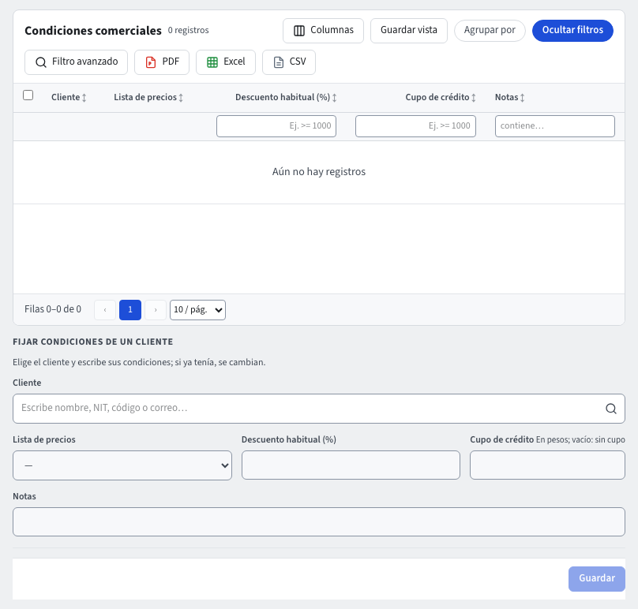

# Ventas: precios y condiciones comerciales

El módulo **Ventas** decide el precio de cada línea de lo que vendes (cotizaciones y, más adelante, pedidos y facturas). Las **listas de precios** son las de **Núcleo** (un precio por producto y lista); Ventas dice qué lista usa cada cliente y cuál usan los demás.

Las dos pantallas están en **Ventas › Parámetros**: **Condiciones comerciales** y **Parámetros de ventas**. Cada una guarda con su botón **Guardar** y muestra **Guardado** al terminar; si algo no se acepta, el mensaje dice por qué. También puedes pedirlo al **asistente** (guía **El asistente**), que ejecuta las mismas acciones con tus permisos y te pide confirmar cada cambio.

En **Ventas › Documentos** también encuentras un acceso a **Cotizaciones**. Las cotizaciones siguen siendo de **CRM** (guía **Cotizaciones**): el acceso abre la misma pantalla y solo aparece si tu empresa tiene CRM y puedes verla.

## De dónde sale el precio

Para un producto y un cliente, el sistema busca en este orden y usa el primero que tenga precio:

1. La **lista de precios del cliente** (sus condiciones comerciales).
2. La **lista de precios predeterminada** de la empresa.
3. El **precio de lista** del producto (su ficha en **Productos**).

Una lista inactiva, sin aprobar (si requiere aprobación) o en otra moneda que el documento no se usa. Si ninguna da precio, el sistema lo dice y escribes el precio a mano; el descuento habitual del cliente se aplica igual. Un precio escrito a mano en la línea siempre gana. Puedes preguntar al asistente «¿a qué precio le vendo el café de 500 g a Distribuidora Andina?» y te responde con el precio, la lista de donde sale y el descuento.

## Crear una lista de precios y fijar sus precios

Las listas de precios se crean y se llenan con el **asistente** (guía **El asistente**); todavía no tienen pantalla propia. Pídele, por ejemplo: «crea una lista de precios Mayoristas en pesos» y, después, «fija el precio del café de 500 g en la lista Mayoristas en 28.800». El asistente te muestra una tarjeta con lo que va a hacer y solo ejecuta cuando la confirmas, con tus permisos.

- **Crear una lista**: lleva un **nombre** (no puede repetirse en la empresa) y una **moneda** (código de tres letras, p. ej. COP). Nace **Grabada**; si tu empresa exige aprobación para las listas de precios, nace **Pendiente de Aprobación** y no se usa en los documentos hasta aprobarse.
- **Fijar un precio**: elige la lista y el producto, e indica el precio (no negativo, hasta dos decimales). Si el producto ya tenía precio en esa lista, se cambia; si no, se agrega. El producto debe estar activo y grabado (o aprobado, si se exige). No hace falta que esté listo para facturar: eso se exige en las líneas de los documentos, no en la lista. La lista debe estar activa y no esperar aprobación.
- **Quitar un precio**: el producto deja de tener precio en esa lista y, al vender, se usa el de la lista predeterminada o su precio de lista.
- **Cambiar el nombre o la moneda** de una lista existente se hace con **Grabar** (por el asistente o desde el registro de la lista).

Para que una lista se use, asígnala a un cliente en **Condiciones comerciales** o como **Lista de precios predeterminada** en **Parámetros de ventas** (más abajo). En la empresa de demostración, la lista **Mayoristas** (en pesos, con los productos físicos a un 10 % menos que su precio de lista, en pesos enteros) viene creada y es la lista de Almacenes Éxito.

## Condiciones comerciales de un cliente

**Ventas › Parámetros › Condiciones comerciales**: el listado muestra los clientes que ya tienen condiciones propias (lista, descuento, cupo y notas). Debajo, en **Fijar condiciones de un cliente**, elige el **Cliente** (debe ser un tercero de tipo cliente), su **Lista de precios** y su **Descuento habitual (%)**, y pulsa **Guardar**. El descuento habitual se propone en cada línea que no traiga uno propio; puedes cambiarlo en la línea. Quitar la lista deja al cliente con la lista predeterminada. El **Cupo de crédito** (en pesos) es lo máximo que el cliente puede tener en pedidos confirmados sin aprobación; vacío, no tiene tope (guía **Pedidos de venta**). Al cambiar un solo dato, los demás se conservan.

## Parámetros de ventas

**Ventas › Parámetros › Parámetros de ventas**: la **Lista de precios predeterminada**, la que da el precio a los clientes sin lista propia o cuando su lista no trae el producto. Debe estar activa (y aprobada, si las listas requieren aprobación). Sin lista predeterminada, se usa el precio de lista del producto. El **Descuento máximo de un pedido sin aprobación (%)**: un pedido con una línea de descuento mayor espera aprobación; vacío, ningún pedido la espera por su descuento. Cuándo gana el vendedor su comisión, en la casilla **Base de comisión**: **Al facturar** o **Al recaudo** (en proporción a lo que se recauda; es la opción inicial). La base y la tasa de cada línea quedan fijas al emitir la factura, así cambies el plan o esta opción después.

Las cotizaciones que usan estos precios se explican en la guía **Cotizaciones**; los pedidos, en la guía **Pedidos de venta**.

## Planes de comisión

**Ventas › Maestros › Planes de comisión**: quién gana comisión por lo que vende. Un plan tiene un **Nombre**, el **Beneficiario** (el tercero al que se le paga: un **Empleado** o un **Agente comercial**, de tipo empleado o proveedor y listo para facturar), los **usuarios** cuyos pedidos comisionan bajo el plan, la **Tasa general (%)**, una tasa por **categoría de producto** si alguna gana distinto, los **Días para pagar** y las fechas **Vigente desde** y **Vigente hasta** (vacía, sin fin). Un usuario está en un solo plan activo a la vez: un plan que se cruza en fechas con otro del mismo usuario no se acepta. Pulsa **Nuevo** para crear uno con sus usuarios y sus tasas por categoría, o abre uno del listado para cambiarlo; también puedes pedírselo al **asistente** («crea un plan de comisión del 5 % para Andrea, 7 % en Café molido»), que te muestra el plan y te pide confirmar. El paso a paso, las comisiones y el informe **Comisiones por vendedor** están en la guía **Comisiones**.

Al emitir una factura hecha desde un pedido, cada línea guarda su **base de comisión**: el subtotal de la línea antes de impuestos y después de descuentos, en pesos (y en la moneda de la factura si es en otra moneda), con la tasa de la categoría de su producto o la general del plan del vendedor del pedido. Las muestras gratuitas y las líneas que no vienen de un pedido no comisionan; un vendedor sin plan, tampoco.

### Cuándo se causa la comisión y cómo se contabiliza

La comisión se **causa** (nace como un documento **Comisión**, prefijo **COM-**, uno por beneficiario y por factura o recaudo) según la opción **Cuándo gana el vendedor su comisión** de los parámetros de ventas, la que regía al emitir la factura:

- **Al emitir la factura**: al emitirse la factura se causa toda la comisión de sus líneas, con la fecha de la factura.
- **Al recaudar la factura** (la opción inicial): cada recibo de caja o anticipo aplicado a la factura causa la parte de la comisión que corresponde a lo que pagó, con la fecha del recibo o de la aplicación. Por ejemplo, un recibo del 40 % de la factura causa el 40 % de la comisión; el que salda la factura causa lo que falte, para que la suma cuadre al centavo. La retención que el cliente practicó cuenta como pagada. En una factura en otra moneda la parte se mide en esa moneda: la diferencia en cambio del recaudo no cambia la comisión.

La comisión se contabiliza sola, en la fuente **NC Notas de contabilidad**: débito al gasto de comisiones en el centro de costo de cada línea de la factura y crédito a la cuenta por pagar del beneficiario, con su fecha de vencimiento (la fecha de la comisión más los **Días para pagar** del plan). La cuenta depende del tipo de beneficiario: un **Empleado** va a 520518 Comisiones contra 250505 Salarios por pagar; un **Agente comercial**, a 523595 Otros servicios (comisiones) contra 233520 Comisiones por pagar (guía **Reglas contables**). Se causa por el valor bruto: la retención en la fuente de la comisión se practica al pagarla. La cuenta por pagar queda en **Cartera por edades** (cuentas por pagar) a nombre del beneficiario, con su vencimiento.

Si la comisión no se puede contabilizar (por ejemplo, el beneficiario dejó de estar listo para facturar), la comisión se guarda igual y el comprobante queda en **Contabilidad › Pendientes de contabilizar**, donde se corrige y se reintenta; la factura y el recibo no se afectan. Con la contabilidad apagada, el comprobante espera y se registra al volver a activarla.

### Cuándo se revierte una comisión

La comisión sigue a la factura y al recaudo que la causaron; nadie tiene que revertirla a mano:

- **Anular la factura** (la nota crédito de anulación): todas las comisiones de esa factura quedan **Revertidas** y su comprobante se reversa (débito a la cuenta por pagar del beneficiario, crédito al gasto). Las bases de la factura se cierran: ya no causan nada. La cuenta por pagar desaparece de **Cartera por edades**.
- **Nota crédito parcial** (una devolución o un descuento sobre algunas líneas): la base de comisión de cada línea que corrige la nota baja en el valor de la nota (antes de impuestos) y la comisión se recalcula con la misma tasa que tenía al facturar. Si la comisión se causó al emitir la factura, se crea una comisión **COM-** de la nota por la diferencia, en negativo (por ejemplo, una nota del 30 % de una línea de $ 1.000.000 al 5 % devuelve $ 15.000). Si se causa al recaudar, solo baja lo que falta por causar: los recibos siguientes causan sobre la base nueva y, al saldar la factura, la suma es la tasa por la base menos la nota, al centavo. Una nota débito no cambia la comisión.
- **Anular un recibo de caja** o **deshacer la aplicación de un anticipo**: la comisión que causó ese recibo o esa aplicación se revierte entera; las de los otros recibos siguen igual. Lo que había causado vuelve a quedar por causar: el siguiente recibo que pague la factura lo causa otra vez.

Una comisión **Pagada** nunca se revierte sola: queda como está y quien puede revertir comisiones recibe una recomendación en **Inicio** para revisarla. (En esta versión las comisiones todavía no se pagan desde el sistema.) Cada comisión se ve en **Ventas › Documentos › Comisiones** y el resumen por vendedor en **Ventas › Reportes › Comisiones por vendedor** (guía **Comisiones**).

Cada vendedor ve solo los planes y las bases de los planes que lo incluyen. Quien tiene el permiso **Ver las comisiones de todos los vendedores** (en **Administración › Roles**; un rol nuevo no lo trae) ve todos. Las tasas y los valores son confidenciales: un rol que no ve datos confidenciales los ve ocultos.

## El PDF de una entrega

En pantalla el documento se llama **Entrega** (prefijo **ENT-**). Al **Imprimir** una entrega, el PDF lleva como título **Remisión de entrega**, el nombre que usan los clientes y transportadores para este documento. El PDF no trae precios: es lo que salió de la bodega. Si tu empresa definió su propia plantilla de impresión para las entregas, se usa esa y su título.

De una cotización a su recibo, cada documento de la venta muestra los demás en su pestaña **Documentos relacionados** (guía **Documentos relacionados**).
